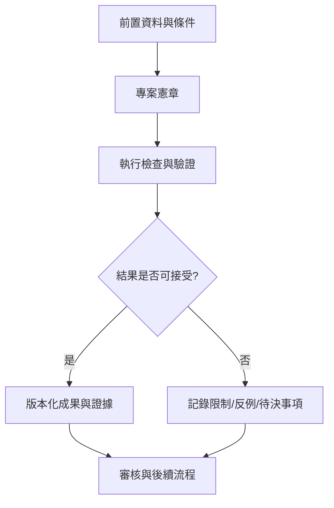

# 00｜專案憲章

> AXIOM v2.1 整合基線｜文件 ID AX-00｜狀態：設計基線（未實作）｜2026-10-19

## 1. 文件定位與決策摘要

產品不是「輸入數據必然找出唯一真公式」；核心承諾是以可重現的流程提出候選、證據與不確定性。研究物件必須有可追溯的資料與方法版本。

**設計原則**：每個規範都要能轉換成可測試的行為、可追溯的證據或明確的工程決策；凡屬目標數字均非已實測結果。

## 2. 章節專屬規格

### 名稱與定位

**AXIOM — Adaptive eXploration, Inference, and Objective Mathematics**；中文：**公理探索：自適應數據與數學發現平台**。縮寫 AXIOM。名稱為專案建議名稱，正式商標與網域可用性尚未檢索。定位為跨領域、數據驅動的公式、統計規律、動態模型及可檢驗理論候選發現平台。

### 核心承諾

從可解讀的數據自動產生多個候選模型，附上證據、適用域、限制與反例；以長期記憶改善搜尋效率；在有條件時進行符號推導與形式化證明。**不承諾任意有限數據可唯一反推出真實公式**。

### 範圍與階段

P0 可信基礎與基準測試；P1 單序列公式發現；P2 經驗記憶與公式片段；P3 ChatGPT/Ollama 研究協調；P4 公式推演、證明與策略學習；P5 雙序列相依／相斥；P6 多序列高階關係；P7 跨領域研究工作台。

### 非目標

首版不提供「一鍵證明現實理論」；不宣稱統計相關即因果；不執行無限制任意程式碼；不讓 LLM 直接改寫已驗證證據；不以單一擬合分數作為可信度。

### 治理角色

產品負責人：需求與優先級；數學／統計負責人：可識別性、驗證與基準；AI 負責人：模型路由與學習；後端負責人：執行、安全、儲存；前端負責人：研究工作台與可視化；QA/SRE：效能、復原、發版閘門。

## 3. 能力分解與詳細規格

### 3.1 定位與邊界

AXIOM（Adaptive eXploration, Inference, and Objective Mathematics）定位為跨領域數據驅動的數學與統計發現平台。輸入是帶有語意與來源的觀測資料；輸出是可執行的模型、證據、反例、適用域及後續研究建議。

**強制規則／例外處理**：不承諾任意有限數據均有唯一真實公式；模型擬合、數學證明與現實因果解釋必須分離。

### 3.2 目標能力

單序列公式發現為首期交付；其後擴展雙序列相依／互斥、多變量動態關係、公式推演與形式化證明。

**強制規則／例外處理**：必須能在無法識別時輸出多個候選及所需新證據，不得虛構確定性。

### 3.3 角色與責任

研究使用者定義資料與約束；系統管理員配置資源與權限；研究審核者核准證據與知識提升；平台工程師維護執行環境。

**強制規則／例外處理**：每個研究任務、資料集、模型與審核決定都有責任人與可追溯紀錄。

### 3.4 交付分層

核心數學可信層、研究協調層、經驗記憶層、AI 提案層、互動呈現層、運維治理層。

**強制規則／例外處理**：前端不能直接判定證明成立；LLM 不能繞過數學驗證器。

## 4. 執行規範與設計檢查點

1. **前置檢查**：啟動「專案憲章」相關功能前，驗證資料版本、權限、依賴服務、研究模式及資源配額。

2. **核心處理**：依本文件第 2、3 節執行，記錄所有關鍵決策、失敗原因、所採用的假設及每一個中間產物的來源。

3. **完成條件**：輸出不僅有成功結果，也有失敗、部分成功、歧義及不可執行狀態；不得默默回退成看似正常的結果。

4. **品質檢查**：用正常、邊界、異常、對抗、重試、並行與取消情境驗證行為；保留對照測試與審核記錄。

## 5. 作業流程圖

## 6. 失敗情境與降級策略

| 失敗或風險 | 系統反應 | 留存證據 |
|---|---|---|
| 輸入不符合「專案憲章」要求 | 拒絕執行並提供可修正的欄位錯誤 | 輸入版本、驗證規則、錯誤代碼 |
| 依賴服務中斷或超時 | 有限次重試；超出預算即終止並保存 checkpoint | 服務版本、耗時、重試紀錄 |
| 結果彼此衝突或證據不足 | 保留候選及歧義，不提升證據等級 | 候選集合、反例、驗證集 |
| 資源配額超出 | 中止重運算，保留已完成的可信部分結果 | CPU/GPU 秒、記憶體峰值、任務狀態 |

## 7. 可執行驗收案例

**AC-00-01 正常路徑**：給定完整合法的輸入、固定資料版本與計算預算，執行「專案憲章」流程，必須產出可追溯的結果與完成狀態。

**AC-00-02 異常路徑**：故意提供缺欄、錯誤型別、超時或不合法狀態，必須得到明確診斷且不得產生已驗證的假結果。

**AC-00-03 重現性**：在固定輸入、版本、隨機種子與執行環境下重跑，輸出應符合預先定義的決定性或容差標準。

**AC-00-04 權限與審核**：未授權角色不得讀取或發布研究資料；審核者能查詢完整證據鏈。

## 8. 實作任務分解與交付物

| 順序 | 工作項 | 完成定義 |
|---|---|---|
| 1 | 規格與輸入輸出契約 | 完成 schema、狀態與錯誤定義，審查通過 |
| 2 | 核心流程與依賴整合 | 完成可重現的端到端最小流程 |
| 3 | 邊界與反例測試 | 正常、異常、資源限制及證據不足皆有測試 |
| 4 | 視覺化與運維可見性 | 使用者可理解結果、限制、進度與失敗原因 |
| 5 | 發布審核 | 有版本、驗收紀錄、回滾方案及已知限制 |

## 9. 跨文件依賴與審核問題

依賴 [AX-06](<../03-架構/06-總體技術架構.md>) 總體架構、[AX-10](<../04-數學核心/10-公式DSL與等價正規化.md>) 公式 DSL、[AX-20](<../07-資料與API/20-資料模型與儲存規劃.md>) 資料模型、[AX-28](<../10-測試/28-數學基準測試規格.md>) 基準測試與 [AX-29](<../10-測試/29-驗收測試與品質閘門.md>) 品質閘門；涉及 UI 時同時參照 [AX-22](<../08-前端UX/22-設計系統與視覺規範.md>)～24；涉及 AI 記憶時參照 [AX-16](<../05-記憶/16-經驗記憶與檢索架構.md>)～19。

**審核必問**：本文件「專案憲章」所描述的結果，是數值近似、統計支持、符號等價，還是形式化證明？是否已清楚標記適用條件、失敗邊界與未決事項？
