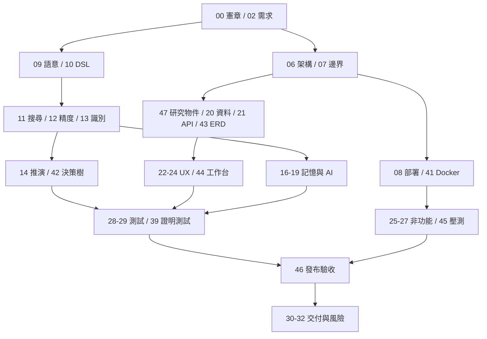

# 01｜閱讀導航與文件地圖

> AXIOM v2.1 整合基線｜文件 ID AX-01｜狀態：設計基線（未實作）｜2026-10-19

## 文件目的與範圍

本文件說明各章的閱讀順序、相互依賴與變更維護規則。全套共 48 篇編號章節（AX-00～AX-47）；README 與整合紀錄另計。所有目標數字仍需實測或審核，不因文件整合而成為已交付成果。

## 依角色閱讀

| 角色 | 路徑 | 需要產出的審查結果 |
|---|---|---|
| 產品／PM | [AX-00 專案憲章](<00-專案憲章.md>) → [AX-02 需求規格與使用情境](<../01-需求/02-需求規格與使用情境.md>) → [AX-03 成功指標與研究品質](<../01-需求/03-成功指標與研究品質.md>) → [AX-04 端到端研究流程](<../02-流程/04-端到端研究流程.md>) → [AX-30 里程碑與分階段開發計畫](<../11-交付/30-里程碑與分階段開發計畫.md>) → [AX-31 工作拆解WBS與依賴](<../11-交付/31-工作拆解WBS與依賴.md>) → [AX-32 風險登錄與決策紀錄](<../11-交付/32-風險登錄與決策紀錄.md>) | 首期範圍、成功指標、里程碑與風險責任 |
| 數學 | [AX-09 數據語意與前處理](<../04-數學核心/09-數據語意與前處理.md>) → [AX-10 公式DSL與等價正規化](<../04-數學核心/10-公式DSL與等價正規化.md>) → [AX-11 搜尋策略與公式組合](<../04-數學核心/11-搜尋策略與公式組合.md>) → [AX-12 參數最佳化與數值精度](<../04-數學核心/12-參數最佳化與數值精度.md>) → [AX-13 可識別性不確定性與主動採樣](<../04-數學核心/13-可識別性不確定性與主動採樣.md>) → [AX-14 推演一般化與形式化證明](<../04-數學核心/14-推演一般化與形式化證明.md>) → [AX-42 公式搜尋與推演決策樹](<../13-專題深化/42-公式搜尋與推演決策樹.md>) → [AX-28 數學基準測試規格](<../10-測試/28-數學基準測試規格.md>) → [AX-39 推導證明與理論演化測試](<../10-測試/39-推導證明與理論演化測試.md>) | 運算子邊界、候選評分、歧義與證明驗收 |
| 後端／資料 | [AX-06 總體技術架構](<../03-架構/06-總體技術架構.md>) → [AX-07 模組邊界與事件契約](<../03-架構/07-模組邊界與事件契約.md>) → [AX-08 部署與運算資源規劃](<../03-架構/08-部署與運算資源規劃.md>) → [AX-47 完整研究物件契約](<../13-專題深化/47-完整研究物件契約.md>) → [AX-20 資料模型與儲存規劃](<../07-資料與API/20-資料模型與儲存規劃.md>) → [AX-21 API與任務契約](<../07-資料與API/21-API與任務契約.md>) → [AX-43 資料庫ERD與關係約束](<../13-專題深化/43-資料庫ERD與關係約束.md>) | 版本關係、交易、冪等與 API 狀態 |
| AI／記憶 | [AX-16 經驗記憶與檢索架構](<../05-記憶/16-經驗記憶與檢索架構.md>) → [AX-17 知識圖譜與理論演化](<../05-記憶/17-知識圖譜與理論演化.md>) → [AX-18 ChatGPT與Ollama協作](<../06-AI/18-ChatGPT與Ollama協作.md>) → [AX-19 策略學習微調與蒸餾](<../06-AI/19-策略學習微調與蒸餾.md>) → [AX-05 基準測試與持續學習流程](<../02-流程/05-基準測試與持續學習流程.md>) → [AX-40 資料治理倫理與領域適用性](<../09-非功能/40-資料治理倫理與領域適用性.md>) | 記憶審核、模型路由、盲測隔離與資料使用邊界 |
| 前端 | [AX-22 設計系統與視覺規範](<../08-前端UX/22-設計系統與視覺規範.md>) → [AX-23 頁面清單與資訊架構](<../08-前端UX/23-頁面清單與資訊架構.md>) → [AX-24 畫面線框與互動流程](<../08-前端UX/24-畫面線框與互動流程.md>) → [AX-44 研究工作台畫面詳細規格](<../13-專題深化/44-研究工作台畫面詳細規格.md>) → [AX-35 畫面驗收清單](<../12-附錄/35-畫面驗收清單.md>) | 頁面狀態、候選比較、圖表與鍵盤驗收 |
| 維運／QA | [AX-08 部署與運算資源規劃](<../03-架構/08-部署與運算資源規劃.md>) → [AX-41 Docker本地架設指南](<../03-架構/41-Docker本地架設指南.md>) → [AX-25 效能與成本治理](<../09-非功能/25-效能與成本治理.md>) → [AX-26 安全隱私與可信執行](<../09-非功能/26-安全隱私與可信執行.md>) → [AX-27 可觀測性備份與故障復原](<../09-非功能/27-可觀測性備份與故障復原.md>) → [AX-29 驗收測試與品質閘門](<../10-測試/29-驗收測試與品質閘門.md>) → [AX-45 非功能SLO與壓測方案](<../13-專題深化/45-非功能SLO與壓測方案.md>) → [AX-46 發布驗收矩陣與交付證據](<../13-專題深化/46-發布驗收矩陣與交付證據.md>) | 環境矩陣、故障恢復、量測報告及發布證據 |

## 文件之間的依賴

## 共用契約的權威位置

- [AX-04 端到端研究流程](<../02-流程/04-端到端研究流程.md>)：研究狀態、執行 phase 與停止診斷的區分。
- [AX-10 公式DSL與等價正規化](<../04-數學核心/10-公式DSL與等價正規化.md>)：公式 DSL、型別、定義域及等價正規化。
- [AX-34 術語表與證據等級](<../12-附錄/34-術語表與證據等級.md>)：E/P 雙軸與文字證據代碼的相容規則。
- [AX-47 完整研究物件契約](<../13-專題深化/47-完整研究物件契約.md>)：研究版本、執行、驗證與證據引用的必要欄位。
- [AX-43 資料庫ERD與關係約束](<../13-專題深化/43-資料庫ERD與關係約束.md>)：關係約束、交易與大物件一致性。
- [AX-41 Docker本地架設指南](<../03-架構/41-Docker本地架設指南.md>)：macOS／WSL2 本地部署及隔離邊界。
- [AX-45 非功能SLO與壓測方案](<../13-專題深化/45-非功能SLO與壓測方案.md>)：SLO 口徑、負載模型與量測協定。
- [AX-46 發布驗收矩陣與交付證據](<../13-專題深化/46-發布驗收矩陣與交付證據.md>)：需求到驗收證據的追溯與發布簽核。

## 文件規範與變更控制

文件使用繁體中文 Markdown；圖採可編輯 Mermaid。AX-* 是文件編號，REQ-* 是需求、ADR-* 是架構決策、TEST-*／AC-* 是測試或驗收、RISK-* 是風險。既有編號保持穩定；新增章節使用未占用編號。

每次重大變更須記錄責任角色、背景、選項、取捨、驗證方法與回退條件；未指派的人與日期以待決標示，不虛構簽核。變更 DSL 同步檢查搜尋、持久化、遷移與 round-trip；變更研究物件同步檢查 API、ERD、事件、畫面與驗收；變更證據語義同步檢查 proof checker、記憶審核與發布閘門。

需求與方案未決時登錄 AX-37；風險與已選架構決策登錄 AX-32。後續寫入本目錄，來源快照不作平行維護。完成編輯後更新 README、交叉連結與 MANIFEST，避免內容和校驗清單分歧。

返回[完整索引](<../README.md>)；查看[整合紀錄](<../INTEGRATION.md>)。
