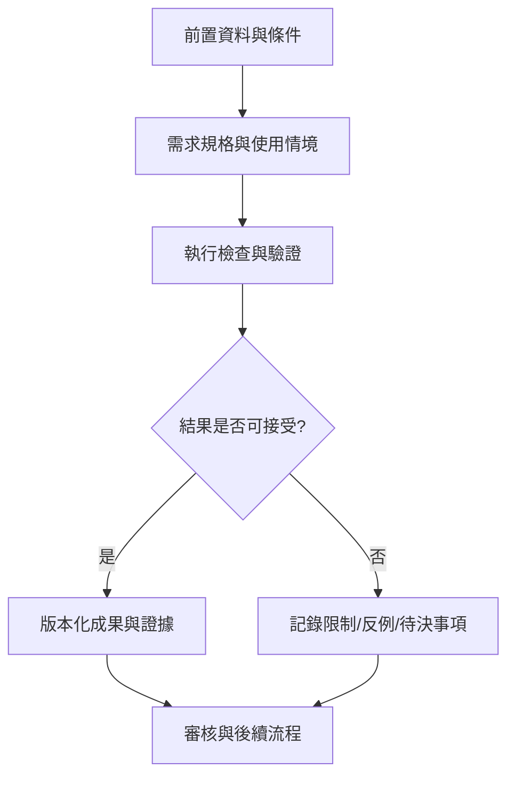

# 02｜需求規格與使用情境

> AXIOM v2.1 整合基線｜文件 ID AX-02｜狀態：設計基線（未實作）｜2026-10-19

## 1. 文件定位與決策摘要

研究員提交任務時必須填寫研究目的（描述／預測／機制）、自變數、目標變數、可用資料、時間順序、硬性約束與計算預算。若資料缺少必要欄位，阻止執行並提供修復指引。

**設計原則**：每個規範都要能轉換成可測試的行為、可追溯的證據或明確的工程決策；凡屬目標數字均非已實測結果。

## 2. 章節專屬規格

### 核心需求清單

| ID | 能力 | 優先級 | 可驗收行為 |
|---|---|---|---|
| REQ-001 | 資料匯入與品質報告 | P0 | 錯誤資料可追溯並可拒收 |
| REQ-002 | 自動公式候選生成 | P0 | 至少三種不同搜尋策略可比較 |
| REQ-003 | 獨立驗證與拒答 | P0 | 不可識別時明確輸出歧義 |
| REQ-004 | 公式片段與經驗記憶 | P1 | 可檢索來源與失敗反例 |
| REQ-005 | AI 假說與策略協調 | P1 | 模型不可繞過驗證器 |
| REQ-006 | 公式推演與證明 | P2 | 區分數值、符號、形式化證明 |
| REQ-007 | 雙序列關係 | P3 | 區分相關、互斥、因果假說 |
| REQ-008 | 多序列研究 | P4 | 條件關係與高階交互 |
| REQ-009 | 研究工作台 | P0 | 公式／圖表／證據可聯動 |
| REQ-010 | 可重現與版本化 | P0 | 任務可回放與比對 |

### 使用者旅程

研究員建立專案 → 上傳資料並設定語意／單位 → 查看品質與可識別性 → 啟動研究 → 觀察候選公式與殘差 → 挑選推演／驗證 → 比較模型 → 儲存研究結論與不確定性 → 新數據到來時增量重驗。

### 權限角色

訪客只讀已公開結果；研究員可建立研究與候選；審核員可核准經驗晉級；管理員可管理模型、配額與資料政策；服務帳號只取得最小權限。

## 3. 能力分解與詳細規格

### 3.1 使用者故事與權限

研究員匯入 CSV/Parquet/JSON 後建立研究，選定自變數、觀測變數、單位、採樣方式及假設；審核者可查看證據、反例與推導鏈；管理員控制算力、配額及資料權限。

**強制規則／例外處理**：每個故事標註角色、前置條件、主流程、替代流程、失敗回復、驗收證據。

### 3.2 研究模式

探索模式允許不確定性與候選並列；驗證模式固定公式與假設後只執行預註冊測試；基準模式隔離真實生成公式；預測模式必須建立時間順序切分。

**強制規則／例外處理**：模式切換不能悄悄覆寫資料切分或已發布結果。

### 3.3 非功能需求

資料保密、可重現性、可取消任務、斷點恢復、資源隔離、操作可追蹤、畫面可讀與鍵盤可用均列為交付條件。

**強制規則／例外處理**：不得以單一成功案例宣稱跨領域通用。

### 3.4 優先級管理

MUST：單數據、公式 DSL、驗證、記憶、視覺化；SHOULD：複合模型、主動採樣、模型路由；LATER：形式化證明自動化、多變量因果研究。

**強制規則／例外處理**：需求變更要同步更新驗收矩陣與里程碑。

## 4. 執行規範與設計檢查點

1. **前置檢查**：啟動「需求規格與使用情境」相關功能前，驗證資料版本、權限、依賴服務、研究模式及資源配額。

2. **核心處理**：依本文件第 2、3 節執行，記錄所有關鍵決策、失敗原因、所採用的假設及每一個中間產物的來源。

3. **完成條件**：輸出不僅有成功結果，也有失敗、部分成功、歧義及不可執行狀態；不得默默回退成看似正常的結果。

4. **品質檢查**：用正常、邊界、異常、對抗、重試、並行與取消情境驗證行為；保留對照測試與審核記錄。

## 5. 作業流程圖

## 6. 失敗情境與降級策略

| 失敗或風險 | 系統反應 | 留存證據 |
|---|---|---|
| 輸入不符合「需求規格與使用情境」要求 | 拒絕執行並提供可修正的欄位錯誤 | 輸入版本、驗證規則、錯誤代碼 |
| 依賴服務中斷或超時 | 有限次重試；超出預算即終止並保存 checkpoint | 服務版本、耗時、重試紀錄 |
| 結果彼此衝突或證據不足 | 保留候選及歧義，不提升證據等級 | 候選集合、反例、驗證集 |
| 資源配額超出 | 中止重運算，保留已完成的可信部分結果 | CPU/GPU 秒、記憶體峰值、任務狀態 |

## 7. 可執行驗收案例

**AC-02-01 正常路徑**：給定完整合法的輸入、固定資料版本與計算預算，執行「需求規格與使用情境」流程，必須產出可追溯的結果與完成狀態。

**AC-02-02 異常路徑**：故意提供缺欄、錯誤型別、超時或不合法狀態，必須得到明確診斷且不得產生已驗證的假結果。

**AC-02-03 重現性**：在固定輸入、版本、隨機種子與執行環境下重跑，輸出應符合預先定義的決定性或容差標準。

**AC-02-04 權限與審核**：未授權角色不得讀取或發布研究資料；審核者能查詢完整證據鏈。

## 8. 實作任務分解與交付物

| 順序 | 工作項 | 完成定義 |
|---|---|---|
| 1 | 規格與輸入輸出契約 | 完成 schema、狀態與錯誤定義，審查通過 |
| 2 | 核心流程與依賴整合 | 完成可重現的端到端最小流程 |
| 3 | 邊界與反例測試 | 正常、異常、資源限制及證據不足皆有測試 |
| 4 | 視覺化與運維可見性 | 使用者可理解結果、限制、進度與失敗原因 |
| 5 | 發布審核 | 有版本、驗收紀錄、回滾方案及已知限制 |

## 9. 跨文件依賴與審核問題

依賴 [AX-06](<../03-架構/06-總體技術架構.md>) 總體架構、[AX-10](<../04-數學核心/10-公式DSL與等價正規化.md>) 公式 DSL、[AX-20](<../07-資料與API/20-資料模型與儲存規劃.md>) 資料模型、[AX-28](<../10-測試/28-數學基準測試規格.md>) 基準測試與 [AX-29](<../10-測試/29-驗收測試與品質閘門.md>) 品質閘門；涉及 UI 時同時參照 [AX-22](<../08-前端UX/22-設計系統與視覺規範.md>)～24；涉及 AI 記憶時參照 [AX-16](<../05-記憶/16-經驗記憶與檢索架構.md>)～19。

**審核必問**：本文件「需求規格與使用情境」所描述的結果，是數值近似、統計支持、符號等價，還是形式化證明？是否已清楚標記適用條件、失敗邊界與未決事項？

## 延伸閱讀

[AX-03 成功指標與研究品質](<03-成功指標與研究品質.md>)；[AX-46 發布驗收矩陣與交付證據](<../13-專題深化/46-發布驗收矩陣與交付證據.md>)。
