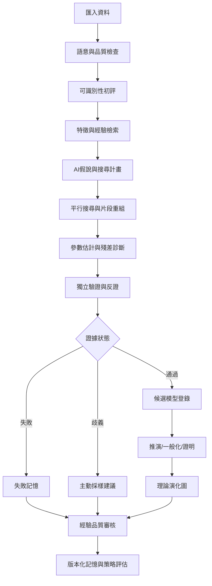
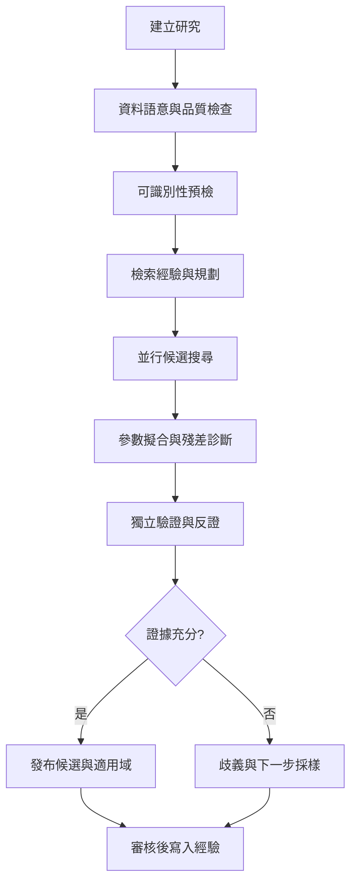

# 04｜端到端研究流程

> AXIOM v2.1 整合基線｜文件 ID AX-04｜狀態：設計基線（未實作）｜2026-10-19

## 1. 文件定位與決策摘要

正式狀態轉移：DRAFT→VALIDATING→READY→QUEUED→RUNNING→REVIEW→PUBLISHED；RUNNING 可 PAUSED/FAILED/CANCELLED；REVIEW 可 REJECTED 回到新版本研究。每次轉移寫入 AuditEvent。

**設計原則**：每個規範都要能轉換成可測試的行為、可追溯的證據或明確的工程決策；凡屬目標數字均非已實測結果。

## 2. 章節專屬規格

### 主流程

### 研究狀態機

研究狀態採第 1 節的 DRAFT → VALIDATING → READY → QUEUED → RUNNING → REVIEW → PUBLISHED。原先的 PROFILING、FEASIBILITY、RETRIEVING、PLANNING、SEARCHING 與執行期 VALIDATING 改為 `run.phase`，不與研究狀態共用同一列舉。NEEDS_DATA、INCONCLUSIVE、EXPIRED 記錄於診斷／停止原因；REJECTED 是審核結果，新研究版本從 DRAFT 開始。每次轉移寫入不可覆寫事件紀錄。

### 決策閘門

資料品質不足可停機或標示探索模式；搜尋預算耗盡輸出最佳已知候選與限制；驗證失敗不得晉級知識庫；新數據可能撤銷先前結論。

## 3. 能力分解與詳細規格

### 3.1 研究生命週期

建立研究→上傳資料→語意檢查→品質報告→可識別性預檢→經驗檢索→規劃假說→候選搜尋→參數最佳化→反證→證據評級→保存／發布。

**強制規則／例外處理**：每一步產生不可變版本的輸入與輸出摘要；任務重試需具冪等性。

### 3.2 研究狀態機

DRAFT、VALIDATING、READY、QUEUED、RUNNING、PAUSED、REVIEW、PUBLISHED、FAILED、CANCELLED；非法轉移回報明確原因。

**強制規則／例外處理**：發布前不得跳過獨立驗證；取消要停止子任務並釋放資源。

### 3.3 回饋學習迴圈

成功與失敗都進入經驗候選區；品質審核後才進入可檢索知識；訓練資料另行挑選；新模型須通過隔離基準及影子測試。

**強制規則／例外處理**：避免測試答案進入提示詞或檢索結果。

### 3.4 異常分支

資料品質不良、奇異點、搜尋超時、AI API 失敗、OOM、模型不收斂、證明失敗都需保存失敗上下文並回報下一步建議。

**強制規則／例外處理**：不允許以空白畫面或通用 500 錯誤代替研究診斷。

## 4. 執行規範與設計檢查點

1. **前置檢查**：啟動「端到端研究流程」相關功能前，驗證資料版本、權限、依賴服務、研究模式及資源配額。

2. **核心處理**：依本文件第 2、3 節執行，記錄所有關鍵決策、失敗原因、所採用的假設及每一個中間產物的來源。

3. **完成條件**：輸出不僅有成功結果，也有失敗、部分成功、歧義及不可執行狀態；不得默默回退成看似正常的結果。

4. **品質檢查**：用正常、邊界、異常、對抗、重試、並行與取消情境驗證行為；保留對照測試與審核記錄。

## 5. 架構／流程圖

## 6. 失敗情境與降級策略

| 失敗或風險 | 系統反應 | 留存證據 |
|---|---|---|
| 輸入不符合「端到端研究流程」要求 | 拒絕執行並提供可修正的欄位錯誤 | 輸入版本、驗證規則、錯誤代碼 |
| 依賴服務中斷或超時 | 有限次重試；超出預算即終止並保存 checkpoint | 服務版本、耗時、重試紀錄 |
| 結果彼此衝突或證據不足 | 保留候選及歧義，不提升證據等級 | 候選集合、反例、驗證集 |
| 資源配額超出 | 中止重運算，保留已完成的可信部分結果 | CPU/GPU 秒、記憶體峰值、任務狀態 |

## 7. 可執行驗收案例

**AC-04-01 正常路徑**：給定完整合法的輸入、固定資料版本與計算預算，執行「端到端研究流程」流程，必須產出可追溯的結果與完成狀態。

**AC-04-02 異常路徑**：故意提供缺欄、錯誤型別、超時或不合法狀態，必須得到明確診斷且不得產生已驗證的假結果。

**AC-04-03 重現性**：在固定輸入、版本、隨機種子與執行環境下重跑，輸出應符合預先定義的決定性或容差標準。

**AC-04-04 權限與審核**：未授權角色不得讀取或發布研究資料；審核者能查詢完整證據鏈。

## 8. 實作任務分解與交付物

| 順序 | 工作項 | 完成定義 |
|---|---|---|
| 1 | 規格與輸入輸出契約 | 完成 schema、狀態與錯誤定義，審查通過 |
| 2 | 核心流程與依賴整合 | 完成可重現的端到端最小流程 |
| 3 | 邊界與反例測試 | 正常、異常、資源限制及證據不足皆有測試 |
| 4 | 視覺化與運維可見性 | 使用者可理解結果、限制、進度與失敗原因 |
| 5 | 發布審核 | 有版本、驗收紀錄、回滾方案及已知限制 |

## 9. 跨文件依賴與審核問題

依賴 [AX-06](<../03-架構/06-總體技術架構.md>) 總體架構、[AX-10](<../04-數學核心/10-公式DSL與等價正規化.md>) 公式 DSL、[AX-20](<../07-資料與API/20-資料模型與儲存規劃.md>) 資料模型、[AX-28](<../10-測試/28-數學基準測試規格.md>) 基準測試與 [AX-29](<../10-測試/29-驗收測試與品質閘門.md>) 品質閘門；涉及 UI 時同時參照 [AX-22](<../08-前端UX/22-設計系統與視覺規範.md>)～24；涉及 AI 記憶時參照 [AX-16](<../05-記憶/16-經驗記憶與檢索架構.md>)～19。

**審核必問**：本文件「端到端研究流程」所描述的結果，是數值近似、統計支持、符號等價，還是形式化證明？是否已清楚標記適用條件、失敗邊界與未決事項？

## 延伸閱讀

[AX-47 完整研究物件契約](<../13-專題深化/47-完整研究物件契約.md>)；[AX-34 術語表與證據等級](<../12-附錄/34-術語表與證據等級.md>)。
