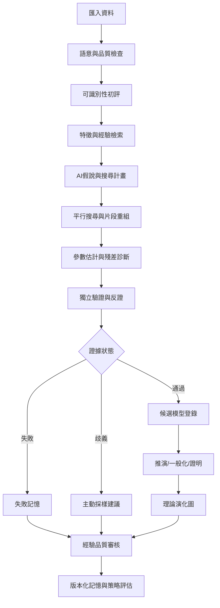

# 端到端研究流程

> AXIOM | 規劃基線 v1.0 | 2026-10-19 | 文件：`02-流程/04-端到端研究流程.md`

## 文件目的
規範從數據到可檢驗知識的狀態機。

## 主流程

## 研究狀態機

CREATED → PROFILING → FEASIBILITY → RETRIEVING → PLANNING → SEARCHING → VALIDATING → REVIEW → PUBLISHED；支線：NEEDS_DATA、INCONCLUSIVE、FAILED、CANCELLED、EXPIRED。每次轉移寫入不可覆寫事件紀錄。

## 決策閘門

資料品質不足可停機或標示探索模式；搜尋預算耗盡輸出最佳已知候選與限制；驗證失敗不得晉級知識庫；新數據可能撤銷先前結論。

## 驗收與交付準則
- 文件內所有決策均有負責角色、驗證方法及可追溯的需求編號。
- 未完成事項不得標示為已實作；未經獨立驗證的數學主張不得標示為已證明。
- 重大設計變更應同步更新索引、架構決策與相關測試計畫。
