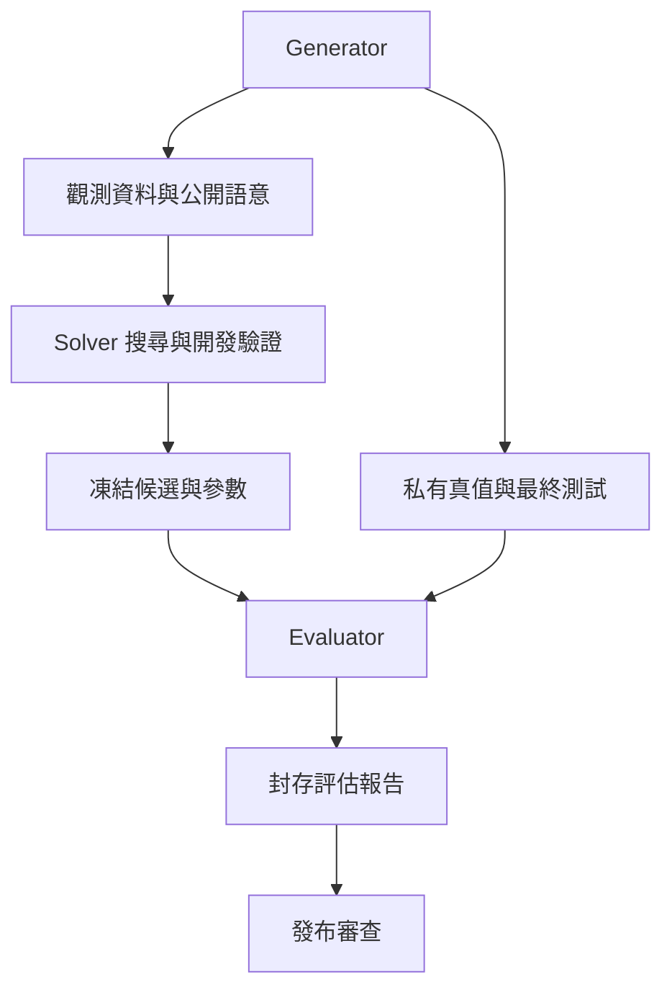

# 05｜基準測試與持續學習流程

> AXIOM v2.3 設計規格｜文件 ID AX-05｜狀態：待實作、待驗收｜2026-10-19

## 三種身分與資料流

Generator 可產生觀測與真值；Solver 只可讀公開觀測與訓練／開發 split；Evaluator 可讀封存真值與最終盲測。三者使用不同服務帳號、bucket/prefix 與憑證；Solver 不持有 evaluator 憑證，不能透過日誌、報告或檢索取得真值。

## 搜尋內驗證與最終盲測

fit 用來擬合參數，development 用於模型結構、超參數、早停及片段選擇；final_test 只供凍結後一次最終評估。任何被搜尋反覆查詢的 split 都不得稱獨立最終盲測。

切分在前處理前完成；補值、標準化、特徵選擇、變點定位等有學習參數的轉換只能 fit 在訓練 fold。時間序列用前推／blocked folds，資料洩漏檢查包含滯後與重疊窗口。AX-28 固定切分及評分協定。

FrozenCandidate 明確固定唯一FitRun、全部參數binding、候選DSL hash、development rank與資料／觀測切分；FrozenSubmission再固定候選排序、sealed_test_id與metric_version，snapshot計算依AX-47；Evaluator 以 FrozenSubmission.snapshot_hash 與 SealedTest ledger 保證一個封存測試版本只接受一個候選提交包。內含所有 Top-k 候選，不能看結果後換排名。因 evaluator 崩潰而重送必須同 key／同內容，回傳同一評估；任何更改視為測試已消耗，需新未曝光測試版本。

## 評估資料不得直接回訓

final_test 的公式、參數、觀測、種子、逐題分數與失敗反例不進檢索／訓練；只有隔離覆核者可見詳細報告。開發者若已查看最終題目，該測試版本退役，後續不再報作未知測試。可發布聚合報告，但反覆比較同一封存集合也會形成適應性選擇；新版本正式判定必須使用未消耗集合。

開發集經驗可審核進入記憶，仍保留 source_split 與 generator family。封存題轉成訓練資料前須正式退役且另建 blind set；無授權資料永不因退役自動取得訓練權。訓練模型的來源資料快照可追溯，撤銷見 AX-26。

## 驗收

| ID | 輸入／操作 | 預期 |
|---|---|---|
| AC-05-01 | Solver 請求真值 bucket、報告 API 或向量索引 | 一律拒絕，審計保留且不洩漏物件是否存在 |
| AC-05-02 | 開發驗證後改候選再讀 final_test | 凍結前不可讀；評估後更改需新測試版本 |
| AC-05-03 | 匯出訓練資料含 final_test lineage | DATASET_CONTAMINATION 阻擋整批匯出 |
| AC-05-04 | Evaluator crash，重送相同 snapshot | 只生成一份同 evaluation_id 報告，不重複計分 |

封存測試身分 sealed_test_id 由 Evaluator 依來源內容sha、不可變case/family身分、固定final row IDs與protocol hash登記，獨立於ResearchVersion及可重建的Dataset容器ID，客戶端不可藉換 ResearchVersion 重新取得同一集合的未消耗狀態。多個研究版本引用同一 sealed_test_id 共用消耗 ledger；正常操作重試只允許同 snapshot_hash。對已由使用者提供的已知資料，隔離只保證 Solver 不讀 final，不宣稱使用者本身未知真值。

BenchmarkPartition是跨題家族／來源隔離，ObservationSplit是單題觀測分區；不能用前者取代後者。私有真值、seed manifest與完整partition管理資訊僅評估管理身分可讀，Solver只拿該題允許的觀測投影。新Dataset容器若引用相同內容／case與封存列，仍命中既有SealedTest，不重新取得未消耗資格。
