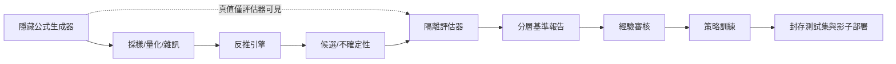

# 基準測試與持續學習流程

> AXIOM | 規劃基線 v1.0 | 2026-10-19 | 文件：`02-流程/05-基準測試與持續學習流程.md`

## 文件目的
定義真值生成、盲測、學習及部署隔離。

## 盲測流程

## 資料隔離

訓練／驗證／最終盲測按公式 AST 家族與生成器來源隔離；同一結構只換係數不可算獨立未知結構；測試集的公式與種子不得出現在 LLM 上下文或向量檢索。

## 訓練與發布

經驗記錄先去重、反例校驗、可信標籤審核，再進入訓練資料版本；離線指標勝出後進行影子測試，未勝出不升版。

## 驗收與交付準則
- 文件內所有決策均有負責角色、驗證方法及可追溯的需求編號。
- 未完成事項不得標示為已實作；未經獨立驗證的數學主張不得標示為已證明。
- 重大設計變更應同步更新索引、架構決策與相關測試計畫。
