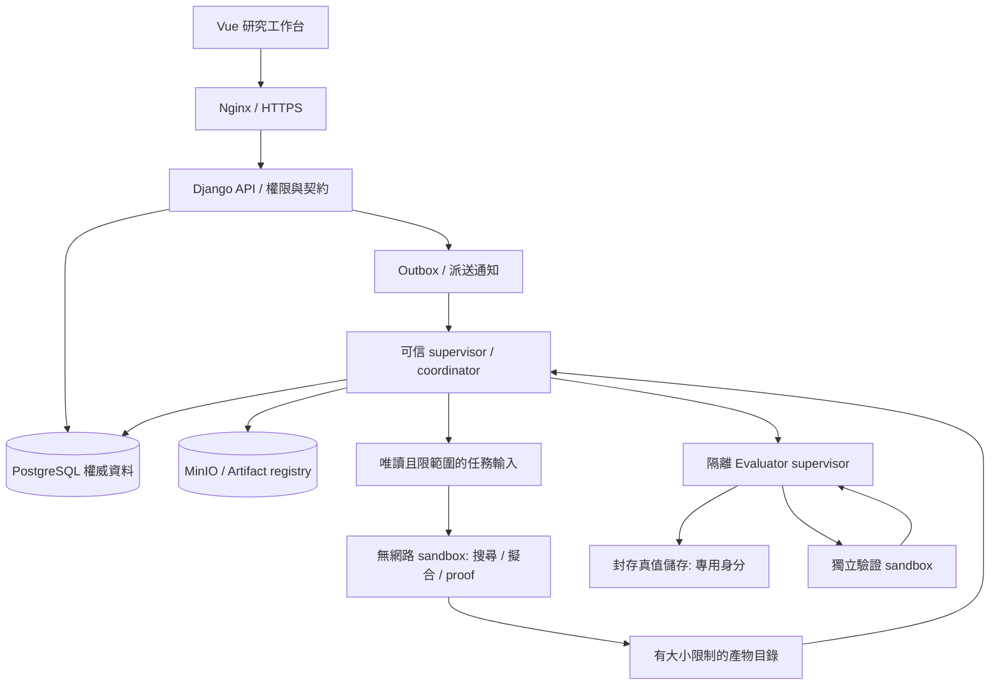

# 06｜總體技術架構

> AXIOM v2.9 設計規格｜文件 ID AX-06｜狀態：待實作、待驗收｜2026-10-20

## 文件定位與決策摘要

部署採前端 Nginx、Django ASGI、PostgreSQL、Redis、MinIO、Celery worker、研究協調器、LLM gateway、隔離數學執行器；Lean 4 可選獨立容器。服務間只開必要連線。

## 章節專屬規格

### 部署拓樸

### 設計原則

模組化單體 Django 管理身份、專案、資料、研究與 API；計算工作池獨立擴展。將公式 DSL、證據、實驗事件與模型版本視為長期穩定契約。CPU/GPU 工作分離，禁止 HTTP request 同步執行長時間公式搜尋。

### 一致性與容錯

資料庫保存狀態與索引，物件儲存保存大資料；工作事件採冪等鍵與重試退避；輸出物件先上傳再以交易登錄；研究結果可從 checkpoint 恢復。

### 技術取捨

Django/DRF 便於資料治理與管理介面；Celery + Redis 適合首版，複雜長時工作流可評估 Temporal；pgvector 首版足夠，超大規模再評估專用向量服務；MinIO 為自架選項，雲端可使用相容 S3 儲存。

## 控制面與執行面的隔離

搜尋／擬合／證明 sandbox 全部無網路、無資料庫或物件服務憑證；只有可信 supervisor 寫權威資料。Evaluator 與 Solver 輸入及身分隔離。內部狀態與公開 DTO 見 AX-38／47。

## 章節驗收案例

以下為預定測試，狀態皆 NOT_RUN；實際證據依 AX-46 登錄。

| ID | 固定情境／操作 | 預期判定 |
|---|---|---|
| AC-06-01 | HTTP worker 收到長搜尋 | 只提交 run，回 202，不同步算式搜尋 |
| AC-06-02 | Redis 清空 | 權威 Run/outbox 仍可重建，無資料遺失 |
| AC-06-03 | LLM 輸出資料庫寫入命令 | 不執行，Gateway 只允許結構化提案 |
| AC-06-04 | proof 要求外網與資料庫憑證 | 拒絕，改由受控輸入輸出 |

## 共用規則

版本、錯誤、證據與審查規則見 [AX-48 共用契約與文件治理](<../00-總覽/48-共用契約與文件治理.md>)；本章的專屬限制及驗收條件仍須同時滿足。

## 自主研究四個責任面

ARSE產生結構與表徵候選；ARTE記錄可驗證決策與因果依賴；MAVE依預註冊計畫組合數學／實證／正逆向證據；ATME保存AI紀錄、封存與受控學習。它們是現有PROFILE、Coordinator、Evaluator、Artifact registry、Gateway及Memory的責任擴充，不各自擁有繞過Run控制的私有調度器。數學判定仍由可信引擎與checker、資料讀取仍由ACL／split／seal管控，所有分支與整理均計預算。完整流程及版本邊界見AX-49～52。
