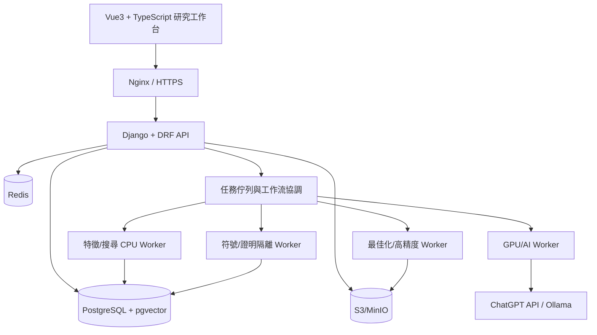

# 總體技術架構

> AXIOM | 規劃基線 v1.0 | 2026-10-19 | 文件：`03-架構/06-總體技術架構.md`

## 文件目的
定義 Django、Vue、數學工作池與記憶系統的邊界。

## 部署拓樸

## 設計原則

模組化單體 Django 管理身份、專案、資料、研究與 API；計算工作池獨立擴展。將公式 DSL、證據、實驗事件與模型版本視為長期穩定契約。CPU/GPU 工作分離，禁止 HTTP request 同步執行長時間公式搜尋。

## 一致性與容錯

資料庫保存狀態與索引，物件儲存保存大資料；工作事件採冪等鍵與重試退避；輸出物件先上傳再以交易登錄；研究結果可從 checkpoint 恢復。

## 技術取捨

Django/DRF 便於資料治理與管理介面；Celery + Redis 適合首版，複雜長時工作流可評估 Temporal；pgvector 首版足夠，超大規模再評估專用向量服務；MinIO 為自架選項，雲端可使用相容 S3 儲存。

## 驗收與交付準則
- 文件內所有決策均有負責角色、驗證方法及可追溯的需求編號。
- 未完成事項不得標示為已實作；未經獨立驗證的數學主張不得標示為已證明。
- 重大設計變更應同步更新索引、架構決策與相關測試計畫。
