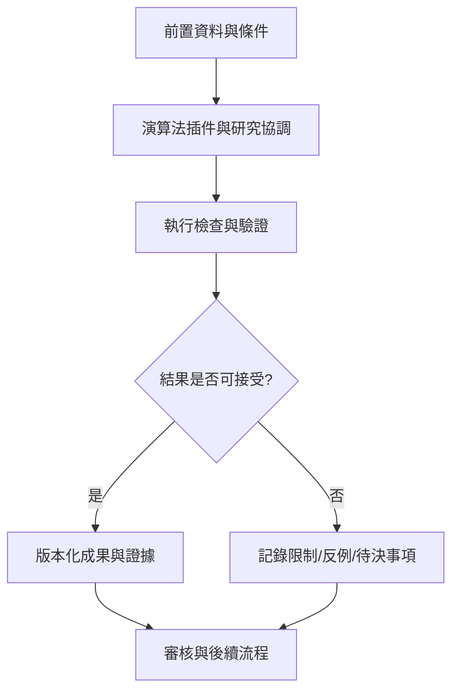

# 38｜演算法插件與研究協調

> AXIOM v2.1 整合基線｜文件 ID AX-38｜狀態：設計基線（未實作）｜2026-10-19

## 1. 文件定位與決策摘要

插件 manifest 定義 plugin_id、version、supported_data_types、operators、resource_class、determinism、input/output schema、timeout；插件輸出候選公式與 provenance，不得直接寫入已驗證知識庫。

**設計原則**：每個規範都要能轉換成可測試的行為、可追溯的證據或明確的工程決策；凡屬目標數字均非已實測結果。

## 2. 章節專屬規格

### 插件協定

每個插件宣告 family、supported_data_types、operators、cost_model、precision_support、dependencies、input_schema、output_schema、resource_class、deterministic_seed_support。

### 策略調度

協調器先跑快速基線，根據資料指紋及經驗挑選候選家族；同時保留探索池；根據驗證收益調整 CPU/GPU 時間；超時/失敗自動降級。

### 任務生命週期

排隊 → 領取租約 → 執行 → checkpoint → 驗證 → 提交；worker 崩潰時由租約過期回收；重試必須冪等，避免重複記憶寫入。

## 3. 能力分解與詳細規格

### 3.1 分層與部署原則

Vue SPA 與 Django API 分離；研究編排器負責任務與策略；Python 計算工作池執行搜尋；隔離證明服務與 LLM gateway；PostgreSQL 保存權威資料，MinIO 保存大物件。

**強制規則／例外處理**：LLM 不可直接操作資料庫或宿主作業系統；長時間計算不得阻塞 HTTP worker。

### 3.2 計算工作池

分 CPU 短任務、CPU 重任務、GPU 任務、符號證明任務；依計算預算、資料敏感等級及演算法需求派送。

**強制規則／例外處理**：排程器必須提供優先級、超時、取消、重試、租約、檢查點與重複任務去重。

### 3.3 版本與依賴

服務 API、公式 DSL、資料 schema、事件 schema、演算法插件與模型權重各自版本化；跨服務契約採向後相容與遷移窗口。

**強制規則／例外處理**：升級時使用契約測試、影子流量與回滾程序。

### 3.4 擴充與隔離

研究租戶、資料空間、權限與配額隔離；外部 AI 模型透過統一 Gateway；數學運算只能在安全執行器內。

**強制規則／例外處理**：高風險輸入、模型生成內容和上傳檔案均視為不可信。

## 4. 執行規範與設計檢查點

1. **前置檢查**：啟動「演算法插件與研究協調」相關功能前，驗證資料版本、權限、依賴服務、研究模式及資源配額。

2. **核心處理**：依本文件第 2、3 節執行，記錄所有關鍵決策、失敗原因、所採用的假設及每一個中間產物的來源。

3. **完成條件**：輸出不僅有成功結果，也有失敗、部分成功、歧義及不可執行狀態；不得默默回退成看似正常的結果。

4. **品質檢查**：用正常、邊界、異常、對抗、重試、並行與取消情境驗證行為；保留對照測試與審核記錄。

## 5. 作業流程圖

## 6. 失敗情境與降級策略

| 失敗或風險 | 系統反應 | 留存證據 |
|---|---|---|
| 輸入不符合「演算法插件與研究協調」要求 | 拒絕執行並提供可修正的欄位錯誤 | 輸入版本、驗證規則、錯誤代碼 |
| 依賴服務中斷或超時 | 有限次重試；超出預算即終止並保存 checkpoint | 服務版本、耗時、重試紀錄 |
| 結果彼此衝突或證據不足 | 保留候選及歧義，不提升證據等級 | 候選集合、反例、驗證集 |
| 資源配額超出 | 中止重運算，保留已完成的可信部分結果 | CPU/GPU 秒、記憶體峰值、任務狀態 |

## 7. 可執行驗收案例

**AC-38-01 正常路徑**：給定完整合法的輸入、固定資料版本與計算預算，執行「演算法插件與研究協調」流程，必須產出可追溯的結果與完成狀態。

**AC-38-02 異常路徑**：故意提供缺欄、錯誤型別、超時或不合法狀態，必須得到明確診斷且不得產生已驗證的假結果。

**AC-38-03 重現性**：在固定輸入、版本、隨機種子與執行環境下重跑，輸出應符合預先定義的決定性或容差標準。

**AC-38-04 權限與審核**：未授權角色不得讀取或發布研究資料；審核者能查詢完整證據鏈。

## 8. 實作任務分解與交付物

| 順序 | 工作項 | 完成定義 |
|---|---|---|
| 1 | 規格與輸入輸出契約 | 完成 schema、狀態與錯誤定義，審查通過 |
| 2 | 核心流程與依賴整合 | 完成可重現的端到端最小流程 |
| 3 | 邊界與反例測試 | 正常、異常、資源限制及證據不足皆有測試 |
| 4 | 視覺化與運維可見性 | 使用者可理解結果、限制、進度與失敗原因 |
| 5 | 發布審核 | 有版本、驗收紀錄、回滾方案及已知限制 |

## 9. 跨文件依賴與審核問題

依賴 [AX-06](<06-總體技術架構.md>) 總體架構、[AX-10](<../04-數學核心/10-公式DSL與等價正規化.md>) 公式 DSL、[AX-20](<../07-資料與API/20-資料模型與儲存規劃.md>) 資料模型、[AX-28](<../10-測試/28-數學基準測試規格.md>) 基準測試與 [AX-29](<../10-測試/29-驗收測試與品質閘門.md>) 品質閘門；涉及 UI 時同時參照 [AX-22](<../08-前端UX/22-設計系統與視覺規範.md>)～24；涉及 AI 記憶時參照 [AX-16](<../05-記憶/16-經驗記憶與檢索架構.md>)～19。

**審核必問**：本文件「演算法插件與研究協調」所描述的結果，是數值近似、統計支持、符號等價，還是形式化證明？是否已清楚標記適用條件、失敗邊界與未決事項？
