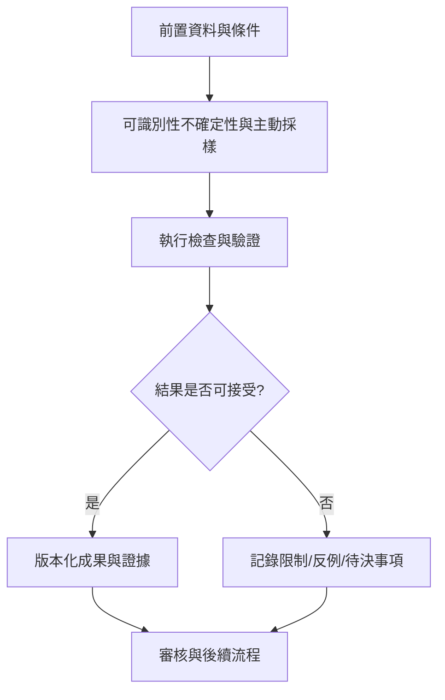

# 13｜可識別性不確定性與主動採樣

> AXIOM v2.1 整合基線｜文件 ID AX-13｜狀態：設計基線（未實作）｜2026-10-19

## 1. 文件定位與決策摘要

結構可識別性與實務可識別性分開：前者問理論上能否唯一辨識，後者問當前噪聲與採樣下能否區分。主動採樣只在可控制輸入時推薦新 x；不可控制時提出觀測需求。

**設計原則**：每個規範都要能轉換成可測試的行為、可追溯的證據或明確的工程決策；凡屬目標數字均非已實測結果。

## 2. 章節專屬規格

### 可識別性

區分結構可識別性、實務可識別性、採樣混疊、局部等價、模型不可區分；同區間增加筆數不一定能辨識不同公式。

### 不確定性

分別回報觀測、參數、結構、數值、模型缺漏與分布漂移的不確定性；統計信賴區間與模型可信敘述不得混用。

### 主動採樣

在可控制採樣時依候選預測差異、噪聲、成本與安全邊界建議 x*；不可控制時提出未來觀測窗口；主動採樣計畫須與驗證資料隔離。

### 拒答規則

若存在多個樣本外表現近似且無法區分的候選，輸出候選集合與下一步資料需求，不輸出「唯一真實公式」。

## 3. 能力分解與詳細規格

### 3.1 資料語意模型

區分連續量、計數、比例、機率、類別、時間、空間、序列索引；記錄單位、精度、觀測機制、時間戳與時區、量測儀器、資料來源。

**強制規則／例外處理**：單位不相容的公式禁止進入候選池；缺少語意時以未知標記而非自行假定。

### 3.2 公式表示與合法性

公式使用受限制 DSL、具型別 AST、明確定義域、參數與約束；分開儲存機器結構、SymPy 表示、LaTeX 顯示、數值求值圖。

**強制規則／例外處理**：不使用任意 eval；驗證奇異點、複數域、單位一致性及數值溢位。

### 3.3 多策略搜尋

快速基線→形狀/頻譜/差分特徵→公式家族→符號迴歸→片段重組→殘差再探索；每一階段有成本上限與早停條件。

**強制規則／例外處理**：至少保留部分預算做獨立探索，避免經驗造成搜尋偏差。

### 3.4 高精度與不確定性

數值精度與測量準確度分開；在 float64 失穩時可提升至任意精度；以參數、結構、觀測與分布不確定性分層輸出。

**強制規則／例外處理**：增加顯示小數位不能視為增加證據。

### 3.5 推演與證明

公式延伸、一般化、微分積分、ODE、遞迴、對稱性、不變量、極限；推導步驟保存假設、使用規則、證明狀態與反例。

**強制規則／例外處理**：符號化簡不等於形式化證明；形式化證明只在受信任的 proof checker 通過後標記。

### 3.6 多資料關聯

雙序列先檢查對齊、延遲、混雜與多重檢定；互斥需事件定義及聯合發生機率，不得用負相關替代；多變量再處理條件依賴與高階交互。

**強制規則／例外處理**：觀測相關性不得自動標示為因果。

## 4. 關鍵技術決策與邊界條件

1. 每組候選要評估在觀測域與外插域的分歧程度，並回報最有辨識力的可觀測區域。

2. 參數不可識別時輸出參數區間或等價類，不要輸出看似精確的單一係數。

3. 主動採樣需要考慮安全、成本與可行性；如果無法控制數據來源，只輸出觀測建議。

4. 對高不確定性研究允許 abstain，並用校準指標評估拒答是否恰當。

## 5. 作業流程圖

## 6. 失敗情境與降級策略

| 失敗或風險 | 系統反應 | 留存證據 |
|---|---|---|
| 輸入不符合「可識別性不確定性與主動採樣」要求 | 拒絕執行並提供可修正的欄位錯誤 | 輸入版本、驗證規則、錯誤代碼 |
| 依賴服務中斷或超時 | 有限次重試；超出預算即終止並保存 checkpoint | 服務版本、耗時、重試紀錄 |
| 結果彼此衝突或證據不足 | 保留候選及歧義，不提升證據等級 | 候選集合、反例、驗證集 |
| 資源配額超出 | 中止重運算，保留已完成的可信部分結果 | CPU/GPU 秒、記憶體峰值、任務狀態 |

## 7. 可執行驗收案例

**AC-13-01 正常路徑**：給定完整合法的輸入、固定資料版本與計算預算，執行「可識別性不確定性與主動採樣」流程，必須產出可追溯的結果與完成狀態。

**AC-13-02 異常路徑**：故意提供缺欄、錯誤型別、超時或不合法狀態，必須得到明確診斷且不得產生已驗證的假結果。

**AC-13-03 重現性**：在固定輸入、版本、隨機種子與執行環境下重跑，輸出應符合預先定義的決定性或容差標準。

**AC-13-04 權限與審核**：未授權角色不得讀取或發布研究資料；審核者能查詢完整證據鏈。

## 8. 實作任務分解與交付物

| 順序 | 工作項 | 完成定義 |
|---|---|---|
| 1 | 規格與輸入輸出契約 | 完成 schema、狀態與錯誤定義，審查通過 |
| 2 | 核心流程與依賴整合 | 完成可重現的端到端最小流程 |
| 3 | 邊界與反例測試 | 正常、異常、資源限制及證據不足皆有測試 |
| 4 | 視覺化與運維可見性 | 使用者可理解結果、限制、進度與失敗原因 |
| 5 | 發布審核 | 有版本、驗收紀錄、回滾方案及已知限制 |

## 9. 跨文件依賴與審核問題

依賴 [AX-06](<../03-架構/06-總體技術架構.md>) 總體架構、[AX-10](<10-公式DSL與等價正規化.md>) 公式 DSL、[AX-20](<../07-資料與API/20-資料模型與儲存規劃.md>) 資料模型、[AX-28](<../10-測試/28-數學基準測試規格.md>) 基準測試與 [AX-29](<../10-測試/29-驗收測試與品質閘門.md>) 品質閘門；涉及 UI 時同時參照 [AX-22](<../08-前端UX/22-設計系統與視覺規範.md>)～24；涉及 AI 記憶時參照 [AX-16](<../05-記憶/16-經驗記憶與檢索架構.md>)～19。

**審核必問**：本文件「可識別性不確定性與主動採樣」所描述的結果，是數值近似、統計支持、符號等價，還是形式化證明？是否已清楚標記適用條件、失敗邊界與未決事項？
