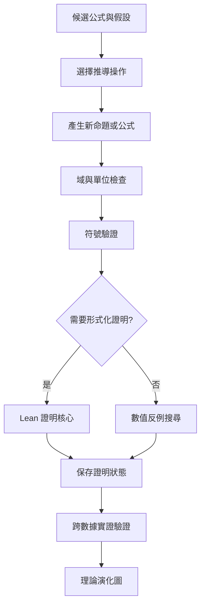

# 14｜推演一般化與形式化證明

> AXIOM v2.3 設計規格｜文件 ID AX-14｜狀態：待實作、待驗收｜2026-10-19

## 文件定位與決策摘要

推導圖的邊型別包括 differentiate/integrate/substitute/generalize/restrict/equivalent/approximate/contradicts；每條邊記錄前提、步驟、檢查器、版本及反例。Lean proof status 與經驗證據分離。

## 章節專屬規格

### 推演操作

微分、積分、代換、極限、級數、漸近、對稱性、不變量、反函數、變數擴充、參數化通式、ODE/遞迴推導；每一步保存原公式、規則、假設與結果。

### 證明等級

數值測試、符號推導、形式化核心接受與現實實證是不同判定，不構成必須依序經過的升級鏈。E0～E3 與 P0～P2 分開保存；未證明命題維持 open。

### 演化圖

節點：公式、命題、假說、模型家族；邊：derived_from、generalizes、specializes、contradicts、equivalent_under、supported_by；每條邊含假設、證據、版本。

### 限制

LLM 只能提出證明草案；SymPy 無法化簡不代表命題錯誤；Lean 核心驗證只保證形式化定理在所列公理／假設下成立。

## 關鍵技術決策與邊界條件

1. 推導步驟必須引用前一步公式版本、假設、使用的規則、目標命題與工具版本。

2. 符號計算的 timeout、假設不足、條件化結果都必須是合法結果狀態，不可自動改成成功。

3. Lean 4 等證明器的受信任核心檢查成功才標記 formal proof；AI 撰寫的 proof text 未經檢查只算草稿。

4. 公式一般化須比較多個案例的共同結構，並在留出案例上檢查新通式是否有預測力。

## 架構／流程圖

## 章節驗收案例

以下為預定測試，狀態皆 NOT_RUN；實際證據依 AX-46 登錄。

| ID | 固定情境／操作 | 預期判定 |
|---|---|---|
| AC-14-01 | 把 x/x 化為 1 且原域含 0 | 保存排除域，不能宣告原域整體等價 |
| AC-14-02 | checker 超時 | UNKNOWN／證據不足，不當成 FALSIFIED |
| AC-14-03 | 未檢查 LLM proof 草稿 | P0，不標 PROVEN_FORMAL |
| AC-14-04 | 命題只在 x>0 成立 | 推導、圖邊與報告均保留此前提 |

## 延伸閱讀

[AX-39 推導證明與理論演化測試](<../10-測試/39-推導證明與理論演化測試.md>)；[AX-34 術語表與證據等級](<../12-附錄/34-術語表與證據等級.md>)。

## 共用規則

版本、錯誤、證據與審查規則見 [AX-48 共用契約與文件治理](<../00-總覽/48-共用契約與文件治理.md>)；本章的專屬限制及驗收條件仍須同時滿足。
