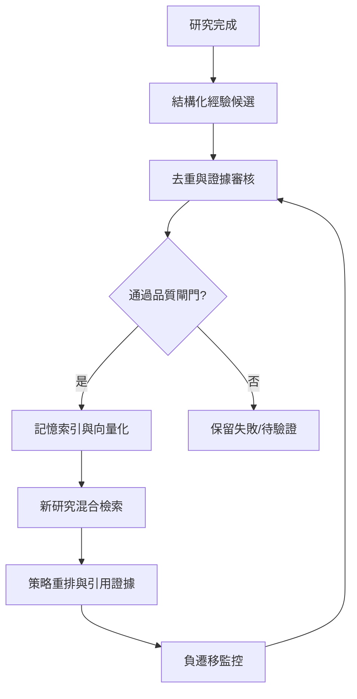

# 16｜經驗記憶與檢索架構

> AXIOM v2.4 設計規格｜文件 ID AX-16｜狀態：待實作、待驗收｜2026-10-20

## 文件定位與決策摘要

記憶查詢先用資料類型、單位、域、採樣密度、噪聲級硬過濾，再混合 embedding/特徵/AST 重排；回傳經驗時必須附 evidence_id、適用域、成功與失敗統計。

## 章節專屬規格

### 記憶分類

案例、公式、片段、策略、失敗、證據、推導、證明、一般化、演化、訓練樣本；統一保存 context-action-outcome-evidence 與來源。

### 檢索方式

混合：統計特徵近鄰、頻譜與形狀相似、公式 AST 子圖、文字語意向量、領域／定義域篩選；分數校準與 rerank；避免只用 embedding 判斷數學相似。

### 寫入與治理

原始事件不可覆寫；摘要可重建；候選經驗須經獨立驗證才可晉級；新反例可降權、撤銷、標記失效；去重依資料指紋＋AST 等價類＋實驗上下文。

### 負遷移

持續比較 memory-on / memory-off，記錄各情境下的搜尋收益；若歷史案例導致效果下降，降低推薦權重但保留反例。

## 關鍵技術決策與邊界條件

1. 檢索品質以 Recall@k、nDCG、引用證據完整率與負遷移率衡量，且按資料家族分層。

2. 經驗保留 Context、Action、Outcome、Evidence、ApplicableDomain、FailureModes、Version、Source。

3. 成功案例與失敗案例都可以檢索；失敗案例不能當作推薦答案，只能作反例與策略排除線索。

4. 更新權重前需有足夠對照實驗，避免一次失敗就永久封殺有效方法。

## 架構／流程圖

## 章節驗收案例

以下為預定測試，狀態皆 NOT_RUN；實際證據依 AX-46 登錄。

| ID | 固定情境／操作 | 預期判定 |
|---|---|---|
| AC-16-01 | 租戶 A 檢索相似 B 案例 | 候選召回前權限過濾，結果不含 B |
| AC-16-02 | 記憶包含已撤銷 evidence | 權威有效性檢查排除，即使向量快取未清 |
| AC-16-03 | 同預算 memory-on 比 off 更差 | 報負遷移，不宣稱學習成功 |
| AC-16-04 | 失敗案例被當推薦公式 | 拒絕提升，只作反例線索 |

## 共用規則

版本、錯誤、證據與審查規則見 [AX-48 共用契約與文件治理](<../00-總覽/48-共用契約與文件治理.md>)；本章的專屬限制及驗收條件仍須同時滿足。
