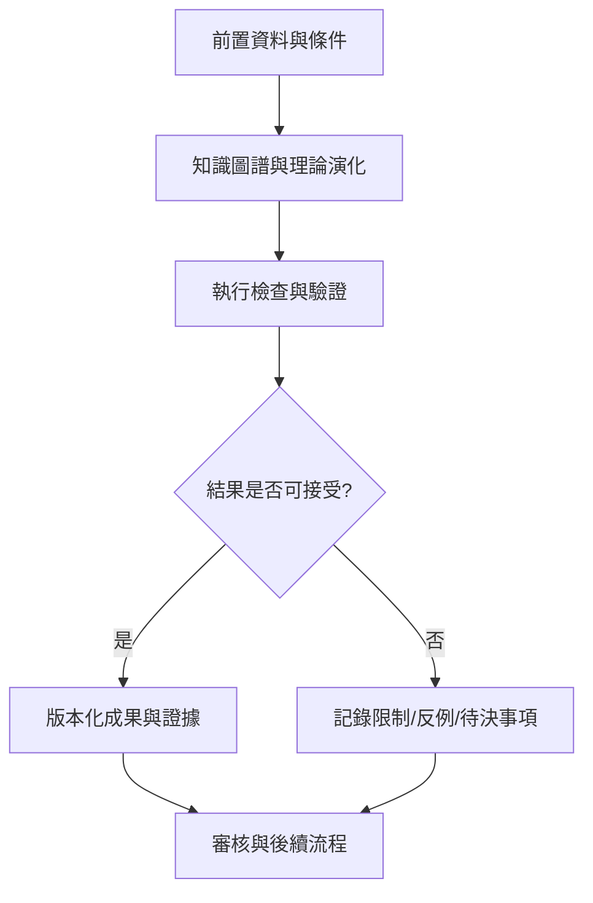

# 17｜知識圖譜與理論演化

> AXIOM v2.1 整合基線｜文件 ID AX-17｜狀態：設計基線（未實作）｜2026-10-19

## 1. 文件定位與決策摘要

理論圖節點包括 equation_family、equation_instance、hypothesis、experiment、proof、counterexample；邊含 derived_from、generalizes、supported_by、falsified_by。圖譜變更需保留前一版本。

**設計原則**：每個規範都要能轉換成可測試的行為、可追溯的證據或明確的工程決策；凡屬目標數字均非已實測結果。

## 2. 章節專屬規格

### 知識節點

Dataset、FeaturePattern、Hypothesis、EquationAST、Fragment、ParameterSet、Derivation、Proof、Counterexample、Validation、Experiment、DomainConstraint。

### 關係類型

FITS、DERIVED_FROM、GENERALIZES、SPECIALIZES、REFUTED_BY、EQUIVALENT_UNDER、SHARES_FRAGMENT、VALID_ON、TESTED_BY；每條關係記錄來源、建立者、時間、證據與撤銷狀態。

### 查詢場景

尋找「同樣殘差型態但不同公式」的案例；查找某公式的所有反例；找出某片段跨領域有效的條件；回溯模型從 v1 到 v5 的每次修訂理由。

### 儲存取捨

首版 PostgreSQL 關聯表＋遞迴查詢即可；圖譜規模及查詢複雜度達到實測瓶頸後，再評估專用圖資料庫。

## 3. 能力分解與詳細規格

### 3.1 記憶分層

原始實驗紀錄、公式與片段、搜尋策略、反例、推導證明、歸納知識及訓練樣本分庫管理；以穩定 ID 關聯，不以 LLM 文字摘要代替原始證據。

**強制規則／例外處理**：每筆記憶必須追溯資料集、演算法版本、模型版本、驗證與適用域。

### 3.2 相似檢索

融合統計特徵、頻譜、形狀、公式 AST 與語意向量；先做硬條件過濾，再做候選召回與重排。

**強制規則／例外處理**：同一來源衍生的近重複案例不得讓檢索品質測試灌水。

### 3.3 記憶生命週期

候選→已驗證→可檢索→降權→封存／撤銷；當新證據衝突時保留歷史版本並建立衝突連結。

**強制規則／例外處理**：錯誤記憶必須能追蹤曾影響哪些研究結果。

### 3.4 理論演化圖

公式節點、假說節點、資料節點、證據節點與推導邊；邊記錄變換、假設、時間與驗證狀態。

**強制規則／例外處理**：圖譜是關係索引而非真理來源；節點可信度由證據決定。

## 4. 執行規範與設計檢查點

1. **前置檢查**：啟動「知識圖譜與理論演化」相關功能前，驗證資料版本、權限、依賴服務、研究模式及資源配額。

2. **核心處理**：依本文件第 2、3 節執行，記錄所有關鍵決策、失敗原因、所採用的假設及每一個中間產物的來源。

3. **完成條件**：輸出不僅有成功結果，也有失敗、部分成功、歧義及不可執行狀態；不得默默回退成看似正常的結果。

4. **品質檢查**：用正常、邊界、異常、對抗、重試、並行與取消情境驗證行為；保留對照測試與審核記錄。

## 5. 作業流程圖

## 6. 失敗情境與降級策略

| 失敗或風險 | 系統反應 | 留存證據 |
|---|---|---|
| 輸入不符合「知識圖譜與理論演化」要求 | 拒絕執行並提供可修正的欄位錯誤 | 輸入版本、驗證規則、錯誤代碼 |
| 依賴服務中斷或超時 | 有限次重試；超出預算即終止並保存 checkpoint | 服務版本、耗時、重試紀錄 |
| 結果彼此衝突或證據不足 | 保留候選及歧義，不提升證據等級 | 候選集合、反例、驗證集 |
| 資源配額超出 | 中止重運算，保留已完成的可信部分結果 | CPU/GPU 秒、記憶體峰值、任務狀態 |

## 7. 可執行驗收案例

**AC-17-01 正常路徑**：給定完整合法的輸入、固定資料版本與計算預算，執行「知識圖譜與理論演化」流程，必須產出可追溯的結果與完成狀態。

**AC-17-02 異常路徑**：故意提供缺欄、錯誤型別、超時或不合法狀態，必須得到明確診斷且不得產生已驗證的假結果。

**AC-17-03 重現性**：在固定輸入、版本、隨機種子與執行環境下重跑，輸出應符合預先定義的決定性或容差標準。

**AC-17-04 權限與審核**：未授權角色不得讀取或發布研究資料；審核者能查詢完整證據鏈。

## 8. 實作任務分解與交付物

| 順序 | 工作項 | 完成定義 |
|---|---|---|
| 1 | 規格與輸入輸出契約 | 完成 schema、狀態與錯誤定義，審查通過 |
| 2 | 核心流程與依賴整合 | 完成可重現的端到端最小流程 |
| 3 | 邊界與反例測試 | 正常、異常、資源限制及證據不足皆有測試 |
| 4 | 視覺化與運維可見性 | 使用者可理解結果、限制、進度與失敗原因 |
| 5 | 發布審核 | 有版本、驗收紀錄、回滾方案及已知限制 |

## 9. 跨文件依賴與審核問題

依賴 [AX-06](<../03-架構/06-總體技術架構.md>) 總體架構、[AX-10](<../04-數學核心/10-公式DSL與等價正規化.md>) 公式 DSL、[AX-20](<../07-資料與API/20-資料模型與儲存規劃.md>) 資料模型、[AX-28](<../10-測試/28-數學基準測試規格.md>) 基準測試與 [AX-29](<../10-測試/29-驗收測試與品質閘門.md>) 品質閘門；涉及 UI 時同時參照 [AX-22](<../08-前端UX/22-設計系統與視覺規範.md>)～24；涉及 AI 記憶時參照 [AX-16](<16-經驗記憶與檢索架構.md>)～19。

**審核必問**：本文件「知識圖譜與理論演化」所描述的結果，是數值近似、統計支持、符號等價，還是形式化證明？是否已清楚標記適用條件、失敗邊界與未決事項？
