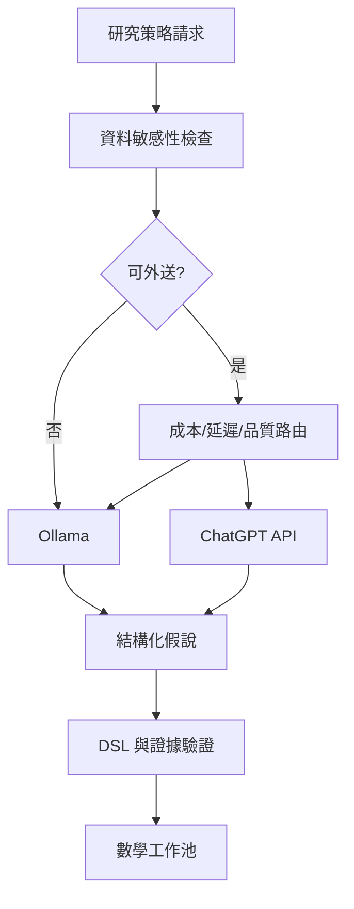

# 18｜ChatGPT與Ollama協作

> AXIOM v2.8 設計規格｜文件 ID AX-18｜狀態：待實作、待驗收｜2026-10-20

## 文件定位與決策摘要

LLM Gateway 輸入為研究摘要、匿名化特徵、候選與可用運算子；輸出為結構化 hypothesis、rationale、proposed_tests、expected_cost；禁止回傳可直接執行的任意 Python。

## 章節專屬規格

### 角色分工

Ollama：本地批次分類、假說初稿、經驗摘要；ChatGPT API：高難度策略規劃、公式解釋與反例構思；Python：唯一的數學執行、擬合、驗證與基準評估來源。

### 模型路由

依任務難度、隱私等級、上下文大小、延遲、成本與模型歷史表現路由；低信心或模型分歧可升級；不可因模型投票就宣告公式正確。

### 結構化輸出

AI 僅提交假說類型、候選 AST、推導計畫、實驗建議、風險說明與預算需求；經 schema 驗證、運算白名單及可信度閘門後才能執行。

### 供應商治理

API 版本、資料保留與隱私條款、計費、速率限制與模型可用性需於採購前確認；設計供應商可替換接口，避免把模型名稱寫死在核心資料契約。

## 關鍵技術決策與邊界條件

1. 所有 AI 提案需符合固定 JSON schema：假說類型、候選 AST、適用條件、預期檢驗、預估成本、風險；schema 驗證失敗可有限次重試。

2. 提示詞只提供經過最小化的特徵摘要；敏感資料若未經核准，不可傳至 ChatGPT API。

3. 雙模型分歧時保存各自提案與證據，交給數學引擎比較，不能用多數決替代檢驗。

4. 建立每任務 token 預算、速率限制、退避重試、成本上限、模型健康檢查與離線退化路徑。

## 架構／流程圖

## 章節驗收案例

以下為預定測試，狀態皆 NOT_RUN；實際證據依 AX-46 登錄。

| ID | 固定情境／操作 | 預期判定 |
|---|---|---|
| AC-18-01 | 合法結構化假說且算子支援 | 只進候選，不直接核准證據 |
| AC-18-02 | 提案含 Python、未知 AST op 或 prompt injection | 拒絕／隔離，不執行任意程式 |
| AC-18-03 | RESTRICTED 研究本地模型離線 | 無雲端回退，保留 policy_version |
| AC-18-04 | 模型 timeout 重試耗盡 token | 停止提案且計入總帳，規則搜尋可獨立繼續 |

## 共用規則

版本、錯誤、證據與審查規則見 [AX-48 共用契約與文件治理](<../00-總覽/48-共用契約與文件治理.md>)；本章的專屬限制及驗收條件仍須同時滿足。

## 輸出與回退契約

M4 提案 schema 必含 hypothesis_type、candidate_ast（遵循 DSL 版本）、assumptions、proposed_tests、expected_cost、risks、source_ids；候選 AST 為可空，null 必須附 cannot_propose_reason。無 source_ids 不能捏造引用。輸入只取有授權且未撤銷的開發上下文，禁止 final_test。供應商 adapter、模型版本與 token 對帳需通過 M4 契約審查；D-04 未關閉前外部 adapter 保持停用。

## 本地模型池與可追溯呼叫

AX-52定義候選模型角色、capability／memory硬篩選與受控探索，不再固定「只有某家模型才能做高難度推理」。小型整理、協調、數學提案、替代挑戰及embedding各自選型；多模型一致不升證據。模型tag存在只證候選可查，實際品質、digest、runtime與tokenizer／權限先驗收。每呼叫產生AIRuntimeRecord，缺usage或斷流不當0；不能取得的內部思考不承諾保存。
