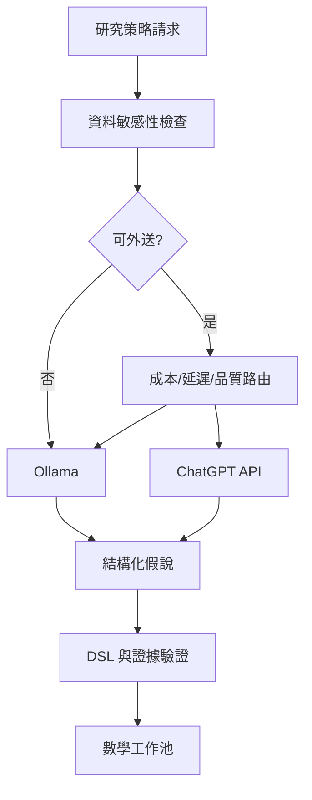

# 18｜ChatGPT與Ollama協作

> AXIOM v2.1 整合基線｜文件 ID AX-18｜狀態：設計基線（未實作）｜2026-10-19

## 1. 文件定位與決策摘要

LLM Gateway 輸入為研究摘要、匿名化特徵、候選與可用運算子；輸出為結構化 hypothesis、rationale、proposed_tests、expected_cost；禁止回傳可直接執行的任意 Python。

**設計原則**：每個規範都要能轉換成可測試的行為、可追溯的證據或明確的工程決策；凡屬目標數字均非已實測結果。

## 2. 章節專屬規格

### 角色分工

Ollama：本地批次分類、假說初稿、經驗摘要；ChatGPT API：高難度策略規劃、公式解釋與反例構思；Python：唯一的數學執行、擬合、驗證與基準評估來源。

### 模型路由

依任務難度、隱私等級、上下文大小、延遲、成本與模型歷史表現路由；低信心或模型分歧可升級；不可因模型投票就宣告公式正確。

### 結構化輸出

AI 僅提交假說類型、候選 AST、推導計畫、實驗建議、風險說明與預算需求；經 schema 驗證、運算白名單及可信度閘門後才能執行。

### 供應商治理

API 版本、資料保留與隱私條款、計費、速率限制與模型可用性需於採購前確認；設計供應商可替換接口，避免把模型名稱寫死在核心資料契約。

## 3. 能力分解與詳細規格

### 3.1 AI 角色邊界

ChatGPT 用於複雜研究規劃與假說比較；Ollama 用於本地批次候選、分類與摘要；所有公式計算由 Python 可信數學引擎完成。

**強制規則／例外處理**：AI 回覆只作提案；需通過 schema 與數學檢查才能進入執行流程。

### 3.2 模型路由

根據資料敏感度、任務難度、延遲、成本、歷史品質、模型健康度決定本地或外部；失敗時退化到規則搜尋或其他已核准模型。

**強制規則／例外處理**：禁止未經授權將敏感數據傳送到外部 API。

### 3.3 策略學習

先訓練輕量策略排序器，特徵為資料指紋與預算，標籤為策略的樣本外效果與耗時；有證據後才進行本地 LLM 微調。

**強制規則／例外處理**：評估採相同資料、相同預算與盲測；防止相似生成公式跨訓練與測試切分。

### 3.4 負遷移與安全

記憶輔助搜尋與無記憶搜尋並行比較；偵測負遷移並降權；模型生成的 DSL、說明與工具呼叫均採白名單。

**強制規則／例外處理**：禁止 LLM 自行宣布已證明或跳過驗證。

## 4. 關鍵技術決策與邊界條件

1. 所有 AI 提案需符合固定 JSON schema：假說類型、候選 AST、適用條件、預期檢驗、預估成本、風險；schema 驗證失敗可有限次重試。

2. 提示詞只提供經過最小化的特徵摘要；敏感資料若未經核准，不可傳至 ChatGPT API。

3. 雙模型分歧時保存各自提案與證據，交給數學引擎比較，不能用多數決替代檢驗。

4. 建立每任務 token 預算、速率限制、退避重試、成本上限、模型健康檢查與離線退化路徑。

## 5. 架構／流程圖

## 6. 失敗情境與降級策略

| 失敗或風險 | 系統反應 | 留存證據 |
|---|---|---|
| 輸入不符合「ChatGPT與Ollama協作」要求 | 拒絕執行並提供可修正的欄位錯誤 | 輸入版本、驗證規則、錯誤代碼 |
| 依賴服務中斷或超時 | 有限次重試；超出預算即終止並保存 checkpoint | 服務版本、耗時、重試紀錄 |
| 結果彼此衝突或證據不足 | 保留候選及歧義，不提升證據等級 | 候選集合、反例、驗證集 |
| 資源配額超出 | 中止重運算，保留已完成的可信部分結果 | CPU/GPU 秒、記憶體峰值、任務狀態 |

## 7. 可執行驗收案例

**AC-18-01 正常路徑**：給定完整合法的輸入、固定資料版本與計算預算，執行「ChatGPT與Ollama協作」流程，必須產出可追溯的結果與完成狀態。

**AC-18-02 異常路徑**：故意提供缺欄、錯誤型別、超時或不合法狀態，必須得到明確診斷且不得產生已驗證的假結果。

**AC-18-03 重現性**：在固定輸入、版本、隨機種子與執行環境下重跑，輸出應符合預先定義的決定性或容差標準。

**AC-18-04 權限與審核**：未授權角色不得讀取或發布研究資料；審核者能查詢完整證據鏈。

## 8. 實作任務分解與交付物

| 順序 | 工作項 | 完成定義 |
|---|---|---|
| 1 | 規格與輸入輸出契約 | 完成 schema、狀態與錯誤定義，審查通過 |
| 2 | 核心流程與依賴整合 | 完成可重現的端到端最小流程 |
| 3 | 邊界與反例測試 | 正常、異常、資源限制及證據不足皆有測試 |
| 4 | 視覺化與運維可見性 | 使用者可理解結果、限制、進度與失敗原因 |
| 5 | 發布審核 | 有版本、驗收紀錄、回滾方案及已知限制 |

## 9. 跨文件依賴與審核問題

依賴 [AX-06](<../03-架構/06-總體技術架構.md>) 總體架構、[AX-10](<../04-數學核心/10-公式DSL與等價正規化.md>) 公式 DSL、[AX-20](<../07-資料與API/20-資料模型與儲存規劃.md>) 資料模型、[AX-28](<../10-測試/28-數學基準測試規格.md>) 基準測試與 [AX-29](<../10-測試/29-驗收測試與品質閘門.md>) 品質閘門；涉及 UI 時同時參照 [AX-22](<../08-前端UX/22-設計系統與視覺規範.md>)～24；涉及 AI 記憶時參照 [AX-16](<../05-記憶/16-經驗記憶與檢索架構.md>)～19。

**審核必問**：本文件「ChatGPT與Ollama協作」所描述的結果，是數值近似、統計支持、符號等價，還是形式化證明？是否已清楚標記適用條件、失敗邊界與未決事項？
