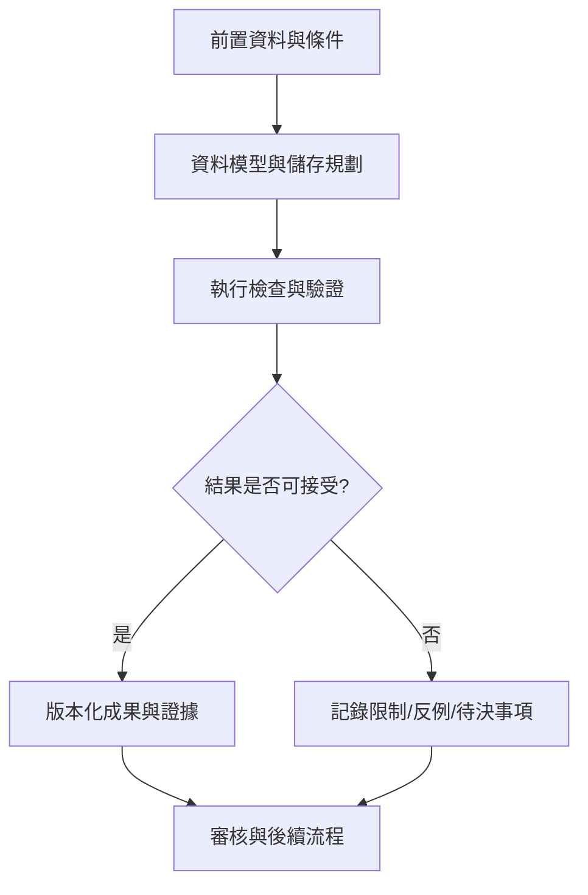

# 20｜資料模型與儲存規劃

> AXIOM v2.1 整合基線｜文件 ID AX-20｜狀態：設計基線（未實作）｜2026-10-19

## 1. 文件定位與決策摘要

每個研究版本關聯 DatasetVersion、FeatureSetVersion、EquationVersion、ValidationRun、ExperienceRecord；對象儲存用 content hash；原始檔與衍生資料分 bucket，避免以資料庫欄位存大型時序陣列。

**設計原則**：每個規範都要能轉換成可測試的行為、可追溯的證據或明確的工程決策；凡屬目標數字均非已實測結果。

## 2. 章節專屬規格

### 主要實體

projects、datasets、dataset_versions、features、research_runs、hypotheses、equations、equation_fragments、parameter_sets、search_attempts、validation_results、derivations、proofs、counterexamples、experience_records、experience_links、model_versions、training_datasets、audit_events。

### 資料關聯

project 1:N dataset；dataset 1:N version；research_run 1:N search_attempt；equation 1:N parameter_set；equation N:M evidence；derivation 連接 source/target equation；experience 引用可追溯事件。

### 儲存規則

PostgreSQL 儲存交易與可查詢結構；pgvector 儲存 embedding；MinIO 儲存原始檔、Parquet、圖像、模型權重與報告；Redis 不作為唯一永久資料來源。

### 保留政策

原始證據與已發布研究按政策保留；可重算暫存設 TTL；敏感資料採分級權限、加密與刪除請求；備份及還原需含物件與 DB 一致性。

## 3. 能力分解與詳細規格

### 3.1 資料庫正規化

Dataset、DatasetVersion、FeatureSet、Research、Hypothesis、Equation、EquationVersion、Fragment、Fit、Validation、Proof、Experience、TrainingRun、ModelVersion、AuditEvent 均有明確主鍵與版本關係。

**強制規則／例外處理**：數值實驗使用 immutable run ID；大檔存物件儲存並以 checksum 關聯。

### 3.2 資料生命週期

原始資料不可覆寫；轉換產物保留 lineage；暫存可過期；證據與審計依政策保留；刪除請求必須處理衍生記憶與訓練集。

**強制規則／例外處理**：刪除資料不能只刪資料表而留下可重建的敏感特徵。

### 3.3 API 契約

研究建立、資料上傳、特徵計算、任務提交、進度串流、候選查詢、驗證報告、經驗檢索、模型版本與審核動作各有獨立端點。

**強制規則／例外處理**：所有寫入 API 具 idempotency key；錯誤使用穩定 code、message、details、retryable。

### 3.4 任務事件

ResearchQueued、SearchStarted、CandidateFound、ValidationFinished、ProofChecked、MemoryApproved、TrainingCompleted 事件含 schema_version、event_id、run_id、timestamp、trace_id。

**強制規則／例外處理**：消費端去重；事件順序不可當作全域一致性保證。

## 4. 關鍵技術決策與邊界條件

1. 研究表主鍵為 UUID；數據版本不可覆寫；公式 AST 的 canonical hash 加入 schema version。

2. ValidationRun 必須引用資料版本、公式版本、切分策略、計算精度與環境版本。

3. ExperienceRecord 不可只存摘要；需有 evidence_id 與可撤銷的引用鏈。

4. 大型陣列與圖形寫入 MinIO，資料庫保存 checksum、URI、大小、媒體型別、生命週期狀態。

## 5. 作業流程圖

## 6. 失敗情境與降級策略

| 失敗或風險 | 系統反應 | 留存證據 |
|---|---|---|
| 輸入不符合「資料模型與儲存規劃」要求 | 拒絕執行並提供可修正的欄位錯誤 | 輸入版本、驗證規則、錯誤代碼 |
| 依賴服務中斷或超時 | 有限次重試；超出預算即終止並保存 checkpoint | 服務版本、耗時、重試紀錄 |
| 結果彼此衝突或證據不足 | 保留候選及歧義，不提升證據等級 | 候選集合、反例、驗證集 |
| 資源配額超出 | 中止重運算，保留已完成的可信部分結果 | CPU/GPU 秒、記憶體峰值、任務狀態 |

## 7. 可執行驗收案例

**AC-20-01 正常路徑**：給定完整合法的輸入、固定資料版本與計算預算，執行「資料模型與儲存規劃」流程，必須產出可追溯的結果與完成狀態。

**AC-20-02 異常路徑**：故意提供缺欄、錯誤型別、超時或不合法狀態，必須得到明確診斷且不得產生已驗證的假結果。

**AC-20-03 重現性**：在固定輸入、版本、隨機種子與執行環境下重跑，輸出應符合預先定義的決定性或容差標準。

**AC-20-04 權限與審核**：未授權角色不得讀取或發布研究資料；審核者能查詢完整證據鏈。

## 8. 實作任務分解與交付物

| 順序 | 工作項 | 完成定義 |
|---|---|---|
| 1 | 規格與輸入輸出契約 | 完成 schema、狀態與錯誤定義，審查通過 |
| 2 | 核心流程與依賴整合 | 完成可重現的端到端最小流程 |
| 3 | 邊界與反例測試 | 正常、異常、資源限制及證據不足皆有測試 |
| 4 | 視覺化與運維可見性 | 使用者可理解結果、限制、進度與失敗原因 |
| 5 | 發布審核 | 有版本、驗收紀錄、回滾方案及已知限制 |

## 9. 跨文件依賴與審核問題

依賴 [AX-06](<../03-架構/06-總體技術架構.md>) 總體架構、[AX-10](<../04-數學核心/10-公式DSL與等價正規化.md>) 公式 DSL、AX-20 資料模型、[AX-28](<../10-測試/28-數學基準測試規格.md>) 基準測試與 [AX-29](<../10-測試/29-驗收測試與品質閘門.md>) 品質閘門；涉及 UI 時同時參照 [AX-22](<../08-前端UX/22-設計系統與視覺規範.md>)～24；涉及 AI 記憶時參照 [AX-16](<../05-記憶/16-經驗記憶與檢索架構.md>)～19。

**審核必問**：本文件「資料模型與儲存規劃」所描述的結果，是數值近似、統計支持、符號等價，還是形式化證明？是否已清楚標記適用條件、失敗邊界與未決事項？

## 延伸閱讀

[AX-43 資料庫ERD與關係約束](<../13-專題深化/43-資料庫ERD與關係約束.md>)；[AX-47 完整研究物件契約](<../13-專題深化/47-完整研究物件契約.md>)。
