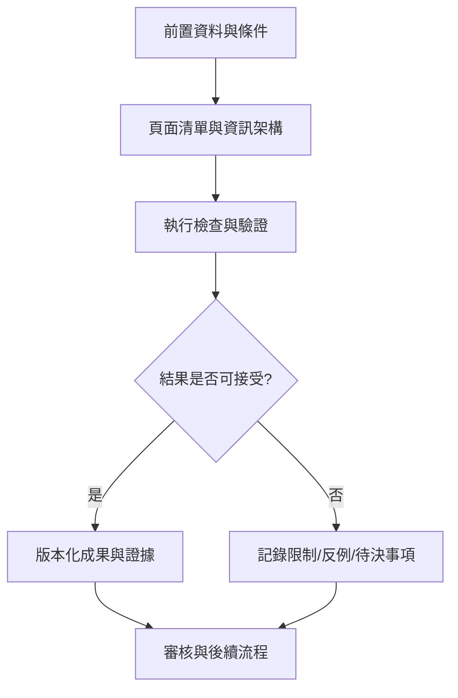

# 23｜頁面清單與資訊架構

> AXIOM v2.1 整合基線｜文件 ID AX-23｜狀態：設計基線（未實作）｜2026-10-19

## 1. 文件定位與決策摘要

頁面導覽：Dashboard→Datasets→Research Workspace→Candidates→Derivations→Evidence→Memory Graph→Benchmarks→Models→Admin。研究頁採固定研究 ID 與可分享的唯讀版本連結。

**設計原則**：每個規範都要能轉換成可測試的行為、可追溯的證據或明確的工程決策；凡屬目標數字均非已實測結果。

## 2. 章節專屬規格

### 主要導航

總覽 Dashboard；專案 Projects；數據庫 Datasets；研究工作台 Research Studio；公式庫 Equation Library；片段庫 Fragment Library；理論演化 Theory Graph；證據中心 Evidence; 基準測試 Benchmarks；經驗記憶 Memory；AI 模型與訓練 Models；任務與資源 Jobs；系統管理 Settings。

### 研究工作台佈局

左側：資料／假說樹；中央：多圖層數據與公式曲線；右側：候選排名、參數、證據、警示；下方：任務時間軸、殘差、推導步驟與反例。面板可拖拉調整並保存工作區。

### 比較與決策

最多可同屏比較多個候選：公式 LaTeX、複雜度、樣本外誤差、外插風險、適用域、證明狀態；證據不足要顯著但不誤導地呈現。

### 狀態與空畫面

首次使用引導、匯入中、搜尋中、等待資源、無可辨識公式、結果歧義、模型失敗、API 不可用等狀態均有可行下一步。

## 3. 能力分解與詳細規格

### 3.1 資訊架構

首頁儀表板、資料集、研究工作台、公式探索器、公式片段庫、推導證明工作台、理論演化圖、基準測試、AI 模型中心、系統管理。

**強制規則／例外處理**：每個主要頁面均有空狀態、載入狀態、失敗狀態與權限不足狀態。

### 3.2 研究工作台

左側資料與研究設定；中央散點／函數／殘差疊圖；右側候選公式、證據與假說；底部執行時間線與工作日誌。

**強制規則／例外處理**：可切換線性／對數軸，顯示採樣域與外插域邊界，不能用平滑線掩蓋離散觀測。

### 3.3 公式呈現

KaTeX 讀取 LaTeX；MathLive 編輯；Plotly 支援縮放、hover、圖層；大型資料採抽樣與視窗化；公式顯示和計算結構保持對應。

**強制規則／例外處理**：每條公式可展開參數、假設、推導鏈、誤差與適用域；複製 LaTeX 與匯出報告。

### 3.4 視覺可信度

觀測點、擬合線、預測區間、外插區間、驗證集及反例使用明確不同視覺語意；色彩不能作為唯一辨識依據。

**強制規則／例外處理**：高風險狀態要有文字標籤；支援鍵盤、縮放、螢幕閱讀器及手機閱讀。

## 4. 執行規範與設計檢查點

1. **前置檢查**：啟動「頁面清單與資訊架構」相關功能前，驗證資料版本、權限、依賴服務、研究模式及資源配額。

2. **核心處理**：依本文件第 2、3 節執行，記錄所有關鍵決策、失敗原因、所採用的假設及每一個中間產物的來源。

3. **完成條件**：輸出不僅有成功結果，也有失敗、部分成功、歧義及不可執行狀態；不得默默回退成看似正常的結果。

4. **品質檢查**：用正常、邊界、異常、對抗、重試、並行與取消情境驗證行為；保留對照測試與審核記錄。

## 5. 作業流程圖

## 6. 失敗情境與降級策略

| 失敗或風險 | 系統反應 | 留存證據 |
|---|---|---|
| 輸入不符合「頁面清單與資訊架構」要求 | 拒絕執行並提供可修正的欄位錯誤 | 輸入版本、驗證規則、錯誤代碼 |
| 依賴服務中斷或超時 | 有限次重試；超出預算即終止並保存 checkpoint | 服務版本、耗時、重試紀錄 |
| 結果彼此衝突或證據不足 | 保留候選及歧義，不提升證據等級 | 候選集合、反例、驗證集 |
| 資源配額超出 | 中止重運算，保留已完成的可信部分結果 | CPU/GPU 秒、記憶體峰值、任務狀態 |

## 7. 可執行驗收案例

**AC-23-01 正常路徑**：給定完整合法的輸入、固定資料版本與計算預算，執行「頁面清單與資訊架構」流程，必須產出可追溯的結果與完成狀態。

**AC-23-02 異常路徑**：故意提供缺欄、錯誤型別、超時或不合法狀態，必須得到明確診斷且不得產生已驗證的假結果。

**AC-23-03 重現性**：在固定輸入、版本、隨機種子與執行環境下重跑，輸出應符合預先定義的決定性或容差標準。

**AC-23-04 權限與審核**：未授權角色不得讀取或發布研究資料；審核者能查詢完整證據鏈。

## 8. 實作任務分解與交付物

| 順序 | 工作項 | 完成定義 |
|---|---|---|
| 1 | 規格與輸入輸出契約 | 完成 schema、狀態與錯誤定義，審查通過 |
| 2 | 核心流程與依賴整合 | 完成可重現的端到端最小流程 |
| 3 | 邊界與反例測試 | 正常、異常、資源限制及證據不足皆有測試 |
| 4 | 視覺化與運維可見性 | 使用者可理解結果、限制、進度與失敗原因 |
| 5 | 發布審核 | 有版本、驗收紀錄、回滾方案及已知限制 |

## 9. 跨文件依賴與審核問題

依賴 [AX-06](<../03-架構/06-總體技術架構.md>) 總體架構、[AX-10](<../04-數學核心/10-公式DSL與等價正規化.md>) 公式 DSL、[AX-20](<../07-資料與API/20-資料模型與儲存規劃.md>) 資料模型、[AX-28](<../10-測試/28-數學基準測試規格.md>) 基準測試與 [AX-29](<../10-測試/29-驗收測試與品質閘門.md>) 品質閘門；涉及 UI 時同時參照 [AX-22](<22-設計系統與視覺規範.md>)～24；涉及 AI 記憶時參照 [AX-16](<../05-記憶/16-經驗記憶與檢索架構.md>)～19。

**審核必問**：本文件「頁面清單與資訊架構」所描述的結果，是數值近似、統計支持、符號等價，還是形式化證明？是否已清楚標記適用條件、失敗邊界與未決事項？
