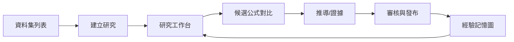

# 24｜畫面線框與互動流程

> AXIOM v2.8 設計規格｜文件 ID AX-24｜狀態：待實作、待驗收｜2026-10-20

## 文件定位與決策摘要

工作台三欄：左資料／條件，中圖表／公式疊加，右候選／證據；下方進度與日誌。選候選時同步更新圖線、殘差、參數表與推導樹；對比模式最多四條候選並排。

## 章節專屬規格

### 研究工作台線框

```text
┌──────────────── AXIOM Research Studio ────────────────┐
│ 專案 / 資料版本 / 研究狀態 / 預算 / 匯出             │
├──────────────┬────────────────────────┬──────────────┤
│ 資料與假說樹 │ 散點 + 候選曲線 + 區間  │ 候選公式排名 │
│ 特徵與篩選   │ 縮放/刷選/圖層切換      │ 參數與證據   │
├──────────────┴────────────────────────┴──────────────┤
│ 殘差 | 精度壓測 | 推導步驟 | 反例 | 研究時間軸       │
└───────────────────────────────────────────────────────┘
```

### 操作流程


### 效能體驗

首屏顯示骨架與任務摘要；長任務使用 SSE 推送增量候選；圖表只重繪變動圖層；前端虛擬列表顯示大量實驗；公式排版快取。

## 關鍵技術決策與邊界條件

1. 研究頁應能鎖定觀測域、標出訓練/驗證/測試分界，外插區域以不同底色及警告呈現。

2. 選擇公式片段時可在公式 AST 樹與圖形中的對應成分之間雙向高亮。

3. 候選對比視圖至少提供公式、參數、RMSE、複雜度、穩定性、適用域、反例與成本。

4. 推導工作台逐步顯示前提、變換規則、數學結果與 proof status，不將 AI 說明視為證明。

## 架構／流程圖



## 章節驗收案例

以下為預定測試，狀態皆 NOT_RUN；實際證據依 AX-46 登錄。

| ID | 固定情境／操作 | 預期判定 |
|---|---|---|
| AC-24-01 | 選候選 A 再 B | 曲線／殘差／參數均切到正確版本 |
| AC-24-02 | 新資料到來 | 新建版本，不暗中更新已開結果 |
| AC-24-03 | 使用者縮放圖表 | 不觸發搜尋或修改 split |
| AC-24-04 | 按取消但 worker 尚未停止 | 顯示停止中，確認後才顯 CANCELLED |

## 延伸閱讀

[AX-44 研究工作台畫面詳細規格](<../13-專題深化/44-研究工作台畫面詳細規格.md>)。

## 共用規則

版本、錯誤、證據與審查規則見 [AX-48 共用契約與文件治理](<../00-總覽/48-共用契約與文件治理.md>)；本章的專屬限制及驗收條件仍須同時滿足。

## 研究域確認與封存視圖

建立版本時必填確認ResearchDomain的變數、有限上下界與開閉旗標；fit資料範圍僅作建議。圖表分開標示固定允許域、fit支撐範圍與域內外插；域外不求值，拖曳不變更研究設定。研究域修改建立新版本。規則與錯誤依AX-10／21。

一般reader不直接取得封存逐點／逐題結果；final卡片在無批准聚合產物時顯示「詳細評估受限」，不是「不存在／零誤差」。隔離覆核視圖需服務端sealed-review:read授權，只有已核准RELEASED_AGGREGATE可出現在一般報告頁。
