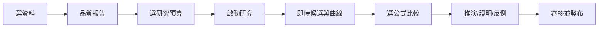

# 畫面線框與互動流程

> AXIOM | 規劃基線 v1.0 | 2026-10-19 | 文件：`08-前端UX/24-畫面線框與互動流程.md`

## 文件目的
用純文字與 Mermaid 說明關鍵畫面，不提供前端程式碼。

## 研究工作台線框

```text
┌──────────────── AXIOM Research Studio ────────────────┐
│ 專案 / 資料版本 / 研究狀態 / 預算 / 匯出             │
├──────────────┬────────────────────────┬──────────────┤
│ 資料與假說樹 │ 散點 + 候選曲線 + 區間  │ 候選公式排名 │
│ 特徵與篩選   │ 縮放/刷選/圖層切換      │ 參數與證據   │
├──────────────┴────────────────────────┴──────────────┤
│ 殘差 | 精度壓測 | 推導步驟 | 反例 | 研究時間軸       │
└───────────────────────────────────────────────────────┘
```

## 操作流程



## 效能體驗

首屏顯示骨架與任務摘要；長任務使用 SSE 推送增量候選；圖表只重繪變動圖層；前端虛擬列表顯示大量實驗；公式排版快取。

## 驗收與交付準則
- 文件內所有決策均有負責角色、驗證方法及可追溯的需求編號。
- 未完成事項不得標示為已實作；未經獨立驗證的數學主張不得標示為已證明。
- 重大設計變更應同步更新索引、架構決策與相關測試計畫。
