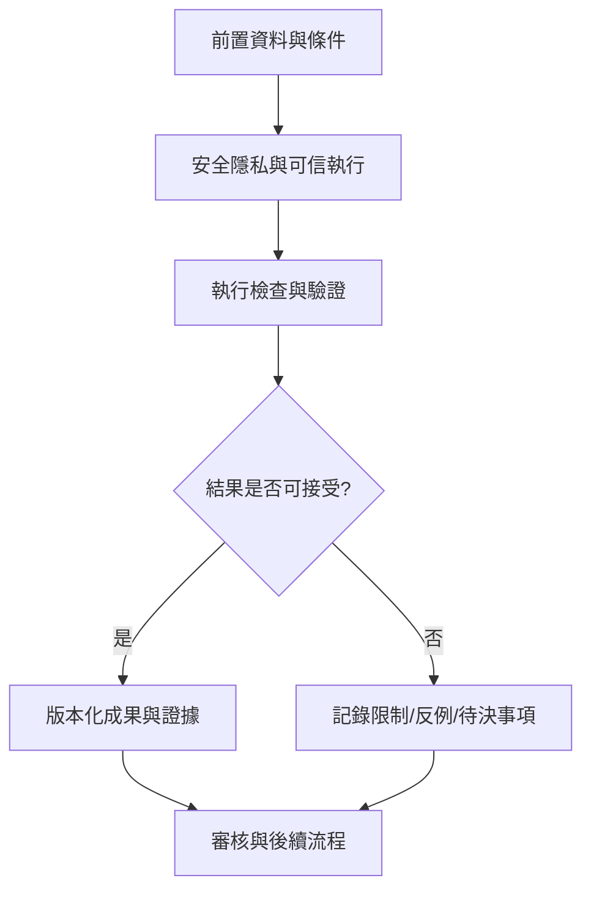

# 26｜安全隱私與可信執行

> AXIOM v2.1 整合基線｜文件 ID AX-26｜狀態：設計基線（未實作）｜2026-10-19

## 1. 文件定位與決策摘要

資料與公式皆不可信：上傳掃描、MIME 驗證、大小限制、DSL AST 白名單、禁任意 eval、容器無特權、預設無網路、唯讀檔案系統、CPU/memory/pids/timeout 限制。

**設計原則**：每個規範都要能轉換成可測試的行為、可追溯的證據或明確的工程決策；凡屬目標數字均非已實測結果。

## 2. 章節專屬規格

### 威脅模型

惡意上傳、公式注入、prompt injection、任意程式碼、資源耗盡、模型輸出污染、測試集洩漏、跨專案越權、資料外傳、依賴供應鏈。

### 控制措施

公式 AST 白名單；獨立 sandbox（非 root、唯讀檔案系統、無網路、seccomp/資源限制）；檔案大小與型別限制；JWT/session 與 RBAC；秘密管理；加密與審計。

### AI 資料治理

資料敏感度決定是否允許傳至 ChatGPT API；Ollama 本地處理可降低外傳但不等於零風險；外部模型的資料處理條款須經正式審核。

### 證明可信鏈

模型提案 → AST 驗證 → 數學執行器 → 獨立驗證器 → 人工審核／證明核心；所有階段可追溯，不允許 LLM 自行核准自己產生的結果。

## 3. 能力分解與詳細規格

### 3.1 效能預算

互動 API 以 p95 延遲與吞吐量驗收；公式搜尋以固定算力下的成功率／耗時衡量；圖形顯示以資料規模與裝置分級驗收。

**強制規則／例外處理**：所有數字先定為目標值，經基準測試後修訂，不假稱已達標。

### 3.2 資源治理

每研究設定 CPU 秒、GPU 秒、記憶體上限、模型 token、候選數、AST 深度、精度升級次數與最長執行時間。

**強制規則／例外處理**：超限後保存 checkpoint、提供部分結果與明確終止原因。

### 3.3 安全與隱私

角色權限、資料分類、秘密管理、上傳檔掃描、公式 DSL 白名單、隔離工作池、外部 AI 出站控制、操作審計。

**強制規則／例外處理**：外部模型不應收到未核准的完整原始資料；所有下載依權限與期限控制。

### 3.4 營運韌性

健康探針、結構化日誌、指標、追蹤、告警、備份、災難復原演練；跨資料庫與物件儲存需一致的恢復點策略。

**強制規則／例外處理**：明訂 RPO/RTO 目標與演練證據，避免只宣稱有備份。

### 3.5 研究倫理

社會與行為資料需避免將相關性說成因果；敏感特徵、樣本偏差、群體公平性及再識別風險納入審核。

**強制規則／例外處理**：可公開研究成果與可公開原始資料是兩種不同授權。

## 4. 執行規範與設計檢查點

1. **前置檢查**：啟動「安全隱私與可信執行」相關功能前，驗證資料版本、權限、依賴服務、研究模式及資源配額。

2. **核心處理**：依本文件第 2、3 節執行，記錄所有關鍵決策、失敗原因、所採用的假設及每一個中間產物的來源。

3. **完成條件**：輸出不僅有成功結果，也有失敗、部分成功、歧義及不可執行狀態；不得默默回退成看似正常的結果。

4. **品質檢查**：用正常、邊界、異常、對抗、重試、並行與取消情境驗證行為；保留對照測試與審核記錄。

## 5. 作業流程圖

## 6. 失敗情境與降級策略

| 失敗或風險 | 系統反應 | 留存證據 |
|---|---|---|
| 輸入不符合「安全隱私與可信執行」要求 | 拒絕執行並提供可修正的欄位錯誤 | 輸入版本、驗證規則、錯誤代碼 |
| 依賴服務中斷或超時 | 有限次重試；超出預算即終止並保存 checkpoint | 服務版本、耗時、重試紀錄 |
| 結果彼此衝突或證據不足 | 保留候選及歧義，不提升證據等級 | 候選集合、反例、驗證集 |
| 資源配額超出 | 中止重運算，保留已完成的可信部分結果 | CPU/GPU 秒、記憶體峰值、任務狀態 |

## 7. 可執行驗收案例

**AC-26-01 正常路徑**：給定完整合法的輸入、固定資料版本與計算預算，執行「安全隱私與可信執行」流程，必須產出可追溯的結果與完成狀態。

**AC-26-02 異常路徑**：故意提供缺欄、錯誤型別、超時或不合法狀態，必須得到明確診斷且不得產生已驗證的假結果。

**AC-26-03 重現性**：在固定輸入、版本、隨機種子與執行環境下重跑，輸出應符合預先定義的決定性或容差標準。

**AC-26-04 權限與審核**：未授權角色不得讀取或發布研究資料；審核者能查詢完整證據鏈。

## 8. 實作任務分解與交付物

| 順序 | 工作項 | 完成定義 |
|---|---|---|
| 1 | 規格與輸入輸出契約 | 完成 schema、狀態與錯誤定義，審查通過 |
| 2 | 核心流程與依賴整合 | 完成可重現的端到端最小流程 |
| 3 | 邊界與反例測試 | 正常、異常、資源限制及證據不足皆有測試 |
| 4 | 視覺化與運維可見性 | 使用者可理解結果、限制、進度與失敗原因 |
| 5 | 發布審核 | 有版本、驗收紀錄、回滾方案及已知限制 |

## 9. 跨文件依賴與審核問題

依賴 [AX-06](<../03-架構/06-總體技術架構.md>) 總體架構、[AX-10](<../04-數學核心/10-公式DSL與等價正規化.md>) 公式 DSL、[AX-20](<../07-資料與API/20-資料模型與儲存規劃.md>) 資料模型、[AX-28](<../10-測試/28-數學基準測試規格.md>) 基準測試與 [AX-29](<../10-測試/29-驗收測試與品質閘門.md>) 品質閘門；涉及 UI 時同時參照 [AX-22](<../08-前端UX/22-設計系統與視覺規範.md>)～24；涉及 AI 記憶時參照 [AX-16](<../05-記憶/16-經驗記憶與檢索架構.md>)～19。

**審核必問**：本文件「安全隱私與可信執行」所描述的結果，是數值近似、統計支持、符號等價，還是形式化證明？是否已清楚標記適用條件、失敗邊界與未決事項？
