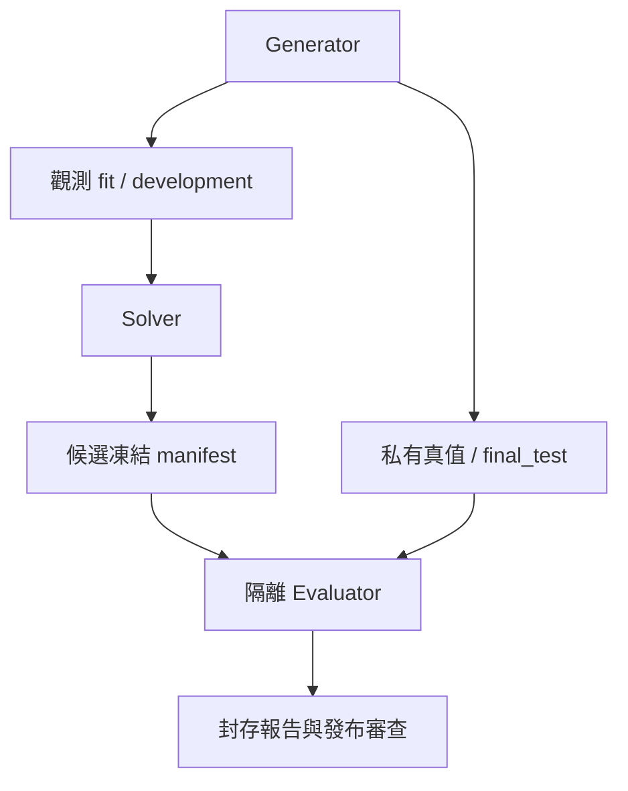

# 28｜數學基準測試規格

> AXIOM v2.7 設計規格｜文件 ID AX-28｜狀態：待實作、待驗收｜2026-10-20

## 評估層級與身份

本章定義方法及公開測試 fixture；公開案例不是未知公式盲測。產品測試尚未執行。盲測資料流與權限以 AX-05 為準。生成公式不進 Solver；Evaluator 讀取凍結候選後以獨立進程執行 AST，不能信任插件自行回報的誤差。

| split | 可用於 | 禁止 |
|---|---|---|
| fit | 參數估計、前處理 fit | 使用 development/final_test 擬合前處理 |
| development | 選家族、參數超參數、早停、Pareto 排名 | 稱為最終獨立泛化結果 |
| final_test | 凍結後一次評分 | 反饋搜尋、再擬合、按測試分數改 Top-k |

## 題目分區與題內觀測切分

BenchmarkPartition 是題目級 TRAIN／DEVELOPMENT／SEALED_TEST 分區：按公式 family 與 source_group 整組隔離，不能只換係數當未知結構。每題有獨立 ObservationSplit，將該題的觀測列分為 fit/development/final_test。題目在 SEALED_TEST 分區仍需給 Solver 該題 fit/development 的觀測；不給真式或 final labels。不能因同題三區來自同一公式就判家族洩漏，家族隔離適用於跨題基準／訓練來源。

ObservationSplit.kind=IID_ROWS／GROUPED_ROWS／TIME_ORDERED／EXPLICIT。IID_ROWS 在單題內用固定 seed 分 60/20/20；GROUPED_ROWS 依 group_column 整組分，記 group_assignment_digest，不把重複觀測的群組拆開。TIME_ORDERED 用 time_column 排序（相同時間不得跨邊界），lookback/horizon 與 gap 先凍結，gap_rows 至少 lookback_rows+horizon_rows。三區 row IDs 須唯一、不交疊且在資料範圍內，gap 列不參與 fit；小樣本不足輸出 INSUFFICIENT_DATA。

ObservationSplit 保存 dataset_version_id、三區 row IDs、row_ids_hash、seed、time/group欄、gap/lookback/horizon、splitter_version、policy_version 與 server 註冊的 sealed_test_id。BenchmarkPartition 保存 case_id/family_id/source_group/partition、generator_version、seed_manifest_hash；同 family 或 source_group 出現在兩個題目分區即拒絕。完整 seed manifest／真值只有評估管理角色讀。正式基準題必須引用有效 partition/case；自有研究的這兩個引用可 null，不因此聲稱未知家族泛化。

前處理在題內切分後，只 fit 訓練列；保存 fit_row_ids，development 選模，final 僅凍結後一次評分。可在凍結前預註冊 fit+development 重新擬合，但必須建立明確新 FitRun，FrozenCandidate 指向它；不可隱式改寫原參數。

## 指標與等價判定

RMSE = sqrt(sum((prediction-observation)^2)/n)，MAE = sum(abs(error))/n；n 是事先要求評估的有效觀測列。缺少預測或域錯誤不得直接從分母移除；同時輸出 valid_coverage，coverage < 1 的 fixture 判失敗。對數分數只適用有合法預測分布的模型。不同資料／單位／split 的 RMSE 不跨題直接平均；報告分家族分布，跨題正規化尺度必須先登錄。

評估凍結包中的 FrozenCandidate，而非單獨 EquationVersion。模型家族、參數估計與最終預測分三項：

| 判定 | 輸入／規則 | 禁止混用 |
|---|---|---|
| family_top_k | EquationVersion 參數仍自由，與真值家族在相同域、參數約束下檢查結構等價；允許顯式保存的參數 alpha-renaming | 家族命中不代表估計參數正確；較高階多項式包含真式不等於同家族 |
| parameter_error | FrozenCandidate 綁定的唯一 FitRun 對比真值參數；只對有已核准參數對應且可識別的項報誤差 | 非識別參數／重參數化無合法映射時報 NOT_APPLICABLE，不任意逐名稱比較 |
| fitted_expression_equivalence | 將凍結參數視為精確十進位有理值代入，再獨立求符號等價 | 2.0000000001 不得偷偷轉成 2；不等價可仍有合格預測 |
| prediction_metrics | 使用凍結參數在 final_test 上數值求值，按容差／噪聲模型算 MAE/RMSE/coverage | 預測通過不提升家族／符號證據 |

主結構指標為 family_hits/all_eligible_cases；UNKNOWN 保留分母並另報，非 DSL v1 題列 out_of_scope。一般參數重參數化與符號工具未知都保留 UNKNOWN，不靠隨機測點冒充證明。真式 2*x+1、候選 a*x+b 且 a=2,b=1 時 family 命中且代入後等價；a=2.0000000001 時 family仍命中，代入後不精確等價，參數誤差及預測依各自門檻判定。凍結包沒有合法 FitRun／完整binding時不得評最終分數。

精確公開 fixture 使用 atol=1e-10、rtol=1e-10，逐點套 AX-10 規則；這是測試容差，不是一般量測精度。帶雜訊案例以預先指定的觀測誤差模型、baseline 與區間評估，不要求任意小誤差。參數多解不得以任意一組參數差當結構失敗，另列 identifiable_parameters。

## 拒答與模型比較協定

比較在 development 上進行。IID 使用預先固定重抽樣 seed 的 paired bootstrap（2,000 次），對逐列 loss 差估計 95% percentile interval；時間相依資料必須指定 block 長度與抽樣方法，缺此設定則不輸出有效信賴區間。預設比較 MAE，以訓練集尺度定義 practical_margin；尺度為 max(IQR(y_fit), measurement_resolution)，兩者皆 0 時需使用者指定正尺度。

候選 A/B 的 loss 差區間全在 [-margin,+margin] 內，只能稱「在指定容差內表現等效」；跨越範圍則為無法下結論；全低於 -margin 才支持 A 的預測損失較低。區間含 0 本身不能證明等效。practical_margin 預設為訓練尺度的 1%，且比較方法／margin 必須在查詢結果前固定。僅是決策預設，領域有量測標準時另建版本。

多候選選擇使用 development folds；最終只評一次凍結 Top-k。若宣稱多個 pairwise 顯著差異，預先定義比較集合並用 Holm 校正；對探索性結果標探索性，不虛構正式 p 值。無候選在開發資料穩定勝過零模型時 outcome=INSUFFICIENT_EVIDENCE；多個非等價候選符合 practical equivalence 且缺乏可區分證據時 outcome=AMBIGUOUS。不能宣稱搜尋未發現其他候選就代表全體公式唯一。

## 公開 fixture 與 MVP 必過案例

[benchmark-v1.json](<../contracts/benchmark-v1.json>) 保存資料、固定候選、切分及預期判定。這些案例驗證實作語義，不能代替私有 blind set。

| ID | 固定輸入 | 必須得到 |
|---|---|---|
| AC-28-01 | B-LINE：x=0..9，y=2x+1，fit 前 6、dev 接 2、final 後 2 | 預先給定候選在三區逐點通過容差，coverage=1 |
| AC-28-02 | B-DOMAIN：候選 x/x，在 x=0 必評 | DOMAIN_VIOLATION，coverage<1，不標整域等價 |
| AC-28-03 | B-AMBIG：x∈[-0.1,0.1]，sin(x) 與 x，誤差界 0.001 | 數值均可相容但結構不同；不宣稱唯一，給 x=1 的區分觀測建議 |
| AC-28-04 | B-NOISE：固定無結構 smoke 資料，候選測試誤差差於常數零 | 不支持候選優於 baseline；不宣稱證明資料隨機 |

MVP 還需 AC-05-01～04、AC-10-01～04 及 AX-36 的端到端案例。正式發現率目標是 AX-37 決策項 D-03；未凍結門檻與 blind generator 前不可將正式數學發布 gate 標 PASS。不以任意公開題成功率代替結構泛化。

## 實驗矩陣與報告

至少覆蓋 5/20/100/1000/10000 點、規則／不規則採樣、窄／廣域、無噪／厚尾／異方差／相關噪聲、缺值／離群／量化、近極點與跨域。依 MVP operator 支援範圍先選代表矩陣，後續遞迴／ODE／多序列另建協定，不能假裝 v1 已支援。

每 family 的開發回歸預設 20 seeds；正式 blind seeds 數與樣本量由 D-03 依精度需求凍結，不公開 seed。報告每組 n、成功／失敗／UNKNOWN／拒答、Top-k、誤差、成本、中位數與 p95，成功率使用 Wilson 95% interval；輸出分子分母及計算版本。拒答率、已回答案例錯誤率與 coverage 一起報，避免全部拒答看似零錯誤。記憶 A/B 同資料同預算並報 paired 差異及負遷移，基準答案不得進記憶。

## 跨契約驗收

| ID | 情境 | 預期 |
|---|---|---|
| AC-28-05 | 同 family 的兩題放 TRAIN 與 SEALED_TEST | BenchmarkPartition 拒絕；同題三區合法不算跨題洩漏 |
| AC-28-06 | 題內 split重疊／群組跨邊界／gap不足 | ObservationSplit語意拒絕，不評樣本外 |
| AC-28-07 | a*x+b 綁 a=2,b=1 | 家族命中、參數誤差0、代入後與2*x+1等價 |
| AC-28-08 | a=2.0000000001，或凍結後換FitRun | 前者分開報家族與精確等價，後者拒絕凍結包 |

## 重新擬合的可追溯輸入

FitRun.split_role 僅允許 FIT 或 FIT_DEVELOPMENT，禁止以 DEVELOPMENT 單獨擬合或以 FINAL_TEST 擬合。FIT 使用 ObservationSplit.fit；FIT_DEVELOPMENT 使用 fit與development的聯集，保留原列ID並按ID升序。兩者均持久化唯一且排序的 fit_row_ids、fit_rows_hash=SHA-256(canonical JSON fit_row_ids)，任務manifest與FitRun完全一致，不得含final或gap列。fit_projection_artifact_id 指向相同列的授權投影。

FIT 的 refit_policy_artifact_id=null；FIT_DEVELOPMENT 必須引用搜尋開始前即不可變登記的同研究政策Artifact，固定是否重擬合、候選選擇方式、optimizer及超參數。不得看final後補登記。重擬合前已固定development選模及排名；聯集擬合後的development誤差屬訓練內指標，不可再聲稱獨立開發驗證或用它重排候選。前處理亦依預註冊政策在相同聯集重fit並記錄輸入列，原FIT模型與前處理產物不覆寫。FrozenCandidate引用新FitRun。

| ID | 情境 | 預期 |
|---|---|---|
| AC-28-09 | 合法預註冊fit+development refit | 新FitRun保存聯集列與hash，凍結引用新參數，原FitRun不變 |
| AC-28-10 | refit含final列／未預註冊／使用重擬合誤差改排名 | 均拒絕；不得把聯集內誤差當獨立驗證 |

預註冊入口為建立研究版本的可選refit_policy：optimizer、optimizer_parameters、candidate_selection=TOP_K_DEVELOPMENT與top_k。省略或null即停用聯集重擬合。伺服器在建立DRAFT時驗證optimizer／設定支援、top_k不大於candidate_limit，保存不可變政策Artifact並回ResearchVersion.refit_policy_artifact_id；使用者不能提交任意Artifact ID替代政策。SEARCH啟動前政策已固定，FIT_DEVELOPMENT必須引用該ID；變更需新研究版本。候選不足top_k時只取實際可用候選，不補造結果。

## 時間切分的排序位置

row_id永遠表示來源列身分，不表示時間順序。TIME_ORDERED先將合法、同一時間基準的觀測按(time_value,row_id)穩定排序，建立row_id→chronological_rank，再按排序位置檢查fit／development／final的前後順序及兩邊界的gap_rows。相同時間不可分到不同評分區，三區列清單各按該穩定順序保存；row_ids_hash仍對保存的原始ID清單計算。gap_rows表示邊界間未參與三區的觀測筆數，非時間長度；時間跨度或不等距窗口需求須另外固定政策，不以列號相減推算。時間缺失／無法正規化時先阻擋PROFILE，不靜默排序。

| ID | 情境 | 預期 |
|---|---|---|
| AC-28-11 | 原檔倒序／任意排列，時間切分正確 | gap依chronological_rank通過；原始row_id仍可追溯 |
| AC-28-12 | 真實排序間隔不足或相同時間跨區 | 前者GAP_TOO_SMALL，後者TIME_LEAK；不能被不連續列號掩蓋 |

## 不可變評估政策

CreateResearchVersion必填evaluation_policy（EvaluationPolicy），ResearchVersion保存完整值及canonical JSON SHA-256的evaluation_policy_hash。政策包含policy_version=1.0、metric_version=2.0、error_model、absolute_error_bound、comparison_method、bootstrap_replicates=2000、bootstrap_seed、block_method／block_length、practical_scale_override／practical_scale_reason、practical_margin_ratio及baseline。建立版本時由可信服務驗證並固定；PROFILE manifest保存同一政策，VALIDATE manifest／ValidationRun及FrozenSubmission保存相同policy hash。不得等看到development或final結果後改政策；改動另建研究版本，並重新檢查觀測曝光資格。

error_model=EXACT表示已確認精確觀測，公開fixture求值容差仍依本章1e-10規則，不代表無限精確浮點計算；ABSOLUTE_BOUND必填嚴格正數absolute_error_bound，定義每點|prediction-observation|不大於該界才與量測相容；UNSPECIFIED明確表示未知，允許探索及原始誤差報告，研究判定只能INSUFFICIENT_EVIDENCE，不能偷偷採公開fixture容差。measurement_resolution是量測解析度，不能自動當成誤差上界。error_model非ABSOLUTE_BOUND時absolute_error_bound必null。需要其他誤差分布、異方差或機率模型須先擴充版本化政策，不能把不支援設定當已完成。

comparison_method=IID_PAIRED_BOOTSTRAP僅適用IID觀測；有時間依賴須BLOCK_BOOTSTRAP，指定block_method=MOVING_BLOCK及正整數block_length，其餘方法兩欄必null。移動區塊在development依時間排序後建立長度L的全部重疊區塊、以固定seed等機率有放回抽區塊至n列後截斷；A/B使用相同索引。L需小於等於development列數，至少兩個不同起始區塊，且預註冊的相依性假設有依據；不足則不輸出有效區間。GROUPED_ROWS不當成IID逐列抽樣，目前若無另行核准的群組bootstrap政策則comparison_method=NONE，回證據不足，不假報有效CI。

實務比較尺度使用max(IQR(y_fit), measurement_resolution)，可空的解析度不提供尺度；尺度為零時必填嚴格正數practical_scale_override，非null覆寫亦須有practical_scale_reason預註冊理由（無覆寫則為null）並寫入研究報告。practical_margin_ratio必須在(0,1]，預設建議0.01但API仍明確保存。baseline=ZERO或FIT_MEAN，只使用fit建立，不能用dev/final均值；記錄選定值與量綱。comparison_method=NONE只輸出描述性指標與不足結論。對候選分布的外推、機制或因果主張仍需額外證據。

| ID | 情境 | 預期 |
|---|---|---|
| AC-28-13 | API提交誤差界、bootstrap block及正尺度 | 政策可保存，重試與最終結果皆引用同policy hash |
| AC-28-14 | 時間資料用IID／L超出dev／誤差界非正數／零尺度無覆寫 | EVALUATION_POLICY_INVALID或不足證據；不產生有效CI／SUPPORTED |
| AC-28-15 | 更換政策但沿用凍結hash或舊ValidationRun | EVALUATION_POLICY_MISMATCH，不可混用評估結果 |

時間相依資料亦可明確選comparison_method=NONE只探索而不計CI，此時block欄位為null；「必須BLOCK_BOOTSTRAP」僅適用宣稱有效時間相依CI時，不禁止描述性不足報告。

## 評估分母、失敗列與選模推論界線

ValidationRun新增selected_count／valid_count／failed_count，必為非負且selected_count=valid_count+failed_count；coverage=valid/selected，selected=0時coverage=0且metrics全null／reason=NO_EVALUABLE_ROWS。完整Artifact保存選定列的身分／split hash、valid mask、每種失敗原因、baseline、policy hash、binding、單位與precision；final明細仍SEALED_DETAIL。任何row計算超時、DOMAIN_VIOLATION或非有限值都計入failed，不准從分母刪除；metrics只在valid子集計算，但valid<selected不能以較低RMSE自動SUPPORTED。valid=0時MAE／RMSE必null及原因，不能填0。

E2只來自匹配已凍結submission的FINAL_TEST。fit分數與development反覆選模結果只作探索；對一批曾被自適應挑選的候選做bootstrap不能自稱選擇後無偏CI。MVP不提供多重比較校正或因果推斷保證，不把IID bootstrap套到時間／群組資料；群組推論未有政策前comparison_method=NONE，結論不足。預測區間、校準度、外插信賴帶若未定義／未算，UI顯示未提供，不畫假區間。E3及P1/P2的後續能力需各自來源與proof契約，不能靠修改enum開啟。
