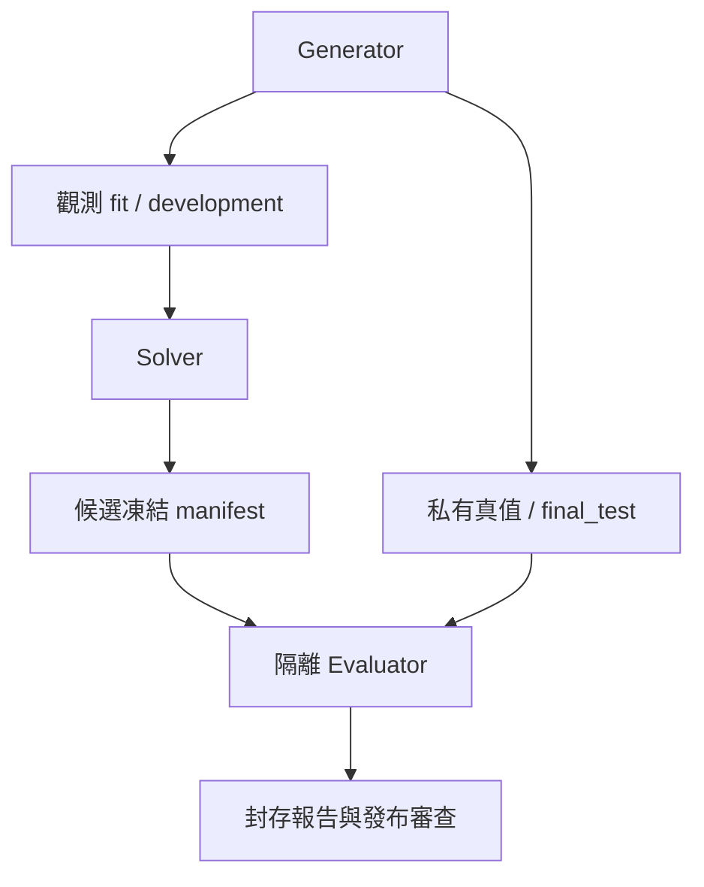

# 28｜數學基準測試規格

> AXIOM v2.2 設計規格｜文件 ID AX-28｜狀態：待實作、待驗收｜2026-10-19

## 評估層級與身份

本章定義方法及公開測試 fixture；公開案例不是未知公式盲測。產品測試尚未執行。盲測資料流與權限以 AX-05 為準。生成公式不進 Solver；Evaluator 讀取凍結候選後以獨立進程執行 AST，不能信任插件自行回報的誤差。

| split | 可用於 | 禁止 |
|---|---|---|
| fit | 參數估計、前處理 fit | 使用 development/final_test 擬合前處理 |
| development | 選家族、參數超參數、早停、Pareto 排名 | 稱為最終獨立泛化結果 |
| final_test | 凍結後一次評分 | 反饋搜尋、再擬合、按測試分數改 Top-k |

## 切分與前處理

IID 預設以案例來源／公式 family 分組，再依預註冊 seed 分 60/20/20；同一 AST 只換參數不算跨族。小樣本不足各分區時明確回 INSUFFICIENT_DATA，不套用空測試。時間資料依時間 60/20/20；可在前 80% 做前推開發 folds，最後 20% 保持封存。窗口重疊需要 gap，gap 至少覆蓋最大特徵 lookback 與 target horizon，定義寫入 SplitPolicy。

SplitPolicy 保存 row_ids hash、family/source group、排序、seed、fold、gap、資料生成器與分割器版本。轉換產物保存 fit_row_ids；檢查任何非 fit 列參與 fit 都阻擋。最終候選包含在 development 上凍結的結構、參數與排名；若要用 development 重新擬合，必須在最終凍結前預先聲明且另記 FitRun，不能碰 final_test。

## 指標與等價判定

RMSE = sqrt(sum((prediction-observation)^2)/n)，MAE = sum(abs(error))/n；n 是事先要求評估的有效觀測列。缺少預測或域錯誤不得直接從分母移除；同時輸出 valid_coverage，coverage < 1 的 fixture 判失敗。對數分數只適用有合法預測分布的模型。不同資料／單位／split 的 RMSE 不跨題直接平均；報告分家族分布，跨題正規化尺度必須先登錄。

結構 Top-k 命中要求 Evaluator 在相同域與前提下，對候選與真式得到 PROVEN_EQUIVALENT；單純測點接近不算結構命中。UNKNOWN 另列並在主指標分母中保留，不能排除以提高恢復率。主報告 structural_hits/all_eligible_cases 及 unknown_rate；已知不在 DSL v1 的案例另列 out_of_scope，不混入 MVP 成功率。恆等證據仍不是實際因果發現。

精確公開 fixture 使用 atol=1e-10、rtol=1e-10，逐點套 AX-10 規則；這是測試容差，不是一般量測精度。帶雜訊案例以預先指定的觀測誤差模型、baseline 與區間評估，不要求任意小誤差。參數多解不得以任意一組參數差當結構失敗，另列 identifiable_parameters。

## 拒答與模型比較協定

比較在 development 上進行。IID 使用預先固定重抽樣 seed 的 paired bootstrap（2,000 次），對逐列 loss 差估計 95% percentile interval；時間相依資料必須指定 block 長度與抽樣方法，缺此設定則不輸出有效信賴區間。預設比較 MAE，以訓練集尺度定義 practical_margin；尺度為 max(IQR(y_fit), measurement_resolution)，兩者皆 0 時需使用者指定正尺度。

候選 A/B 的 loss 差區間全在 [-margin,+margin] 內，只能稱「在指定容差內表現等效」；跨越範圍則為無法下結論；全低於 -margin 才支持 A 的預測損失較低。區間含 0 本身不能證明等效。practical_margin 預設為訓練尺度的 1%，且比較方法／margin 必須在查詢結果前固定。僅是決策預設，領域有量測標準時另建版本。

多候選選擇使用 development folds；最終只評一次凍結 Top-k。若宣稱多個 pairwise 顯著差異，預先定義比較集合並用 Holm 校正；對探索性結果標探索性，不虛構正式 p 值。無候選在開發資料穩定勝過零模型時 outcome=INSUFFICIENT_EVIDENCE；多個非等價候選符合 practical equivalence 且缺乏可區分證據時 outcome=AMBIGUOUS。不能宣稱搜尋未發現其他候選就代表全體公式唯一。

## 公開 fixture 與 MVP 必過案例

[benchmark-v1.json](<../contracts/benchmark-v1.json>) 保存資料、固定候選、切分及預期判定。這些案例驗證實作語義，不能代替私有 blind set。

| ID | 固定輸入 | 必須得到 |
|---|---|---|
| AC-28-01 | B-LINE：x=0..9，y=2x+1，fit 前 6、dev 接 2、final 後 2 | 預先給定候選在三區逐點通過容差，coverage=1 |
| AC-28-02 | B-DOMAIN：候選 x/x，在 x=0 必評 | DOMAIN_VIOLATION，coverage<1，不標整域等價 |
| AC-28-03 | B-AMBIG：x∈[-0.1,0.1]，sin(x) 與 x，誤差界 0.001 | 數值均可相容但結構不同；不宣稱唯一，給 x=1 的區分觀測建議 |
| AC-28-04 | B-NOISE：固定無結構 smoke 資料，候選測試誤差差於常數零 | 不支持候選優於 baseline；不宣稱證明資料隨機 |

MVP 還需 AC-05-01～04、AC-10-01～04 及 AX-36 的端到端案例。正式發現率目標是 AX-37 決策項 D-03；未凍結門檻與 blind generator 前不可將正式數學發布 gate 標 PASS。不以任意公開題成功率代替結構泛化。

## 實驗矩陣與報告

至少覆蓋 5/20/100/1000/10000 點、規則／不規則採樣、窄／廣域、無噪／厚尾／異方差／相關噪聲、缺值／離群／量化、近極點與跨域。依 MVP operator 支援範圍先選代表矩陣，後續遞迴／ODE／多序列另建協定，不能假裝 v1 已支援。

每 family 的開發回歸預設 20 seeds；正式 blind seeds 數與樣本量由 D-03 依精度需求凍結，不公開 seed。報告每組 n、成功／失敗／UNKNOWN／拒答、Top-k、誤差、成本、中位數與 p95，成功率使用 Wilson 95% interval；輸出分子分母及計算版本。拒答率、已回答案例錯誤率與 coverage 一起報，避免全部拒答看似零錯誤。記憶 A/B 同資料同預算並報 paired 差異及負遷移，基準答案不得進記憶。
