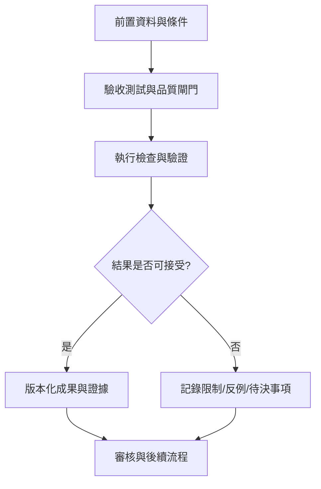

# 29｜驗收測試與品質閘門

> AXIOM v2.1 整合基線｜文件 ID AX-29｜狀態：設計基線（未實作）｜2026-10-19

## 1. 文件定位與決策摘要

發布阻擋：未經驗證的公式標為已證明、洩漏 ground truth、越權讀取、執行任意程式碼、不可重現結果、時間資料洩漏、主要畫面無錯誤回饋。每 gate 保留 CI 證據。

**設計原則**：每個規範都要能轉換成可測試的行為、可追溯的證據或明確的工程決策；凡屬目標數字均非已實測結果。

## 2. 章節專屬規格

### 測試層次

單元：AST、單位、正規化；整合：API/佇列/儲存；數學性質：恆等、邊界、數值穩定；端到端：資料→候選→驗證→發布；回歸：舊研究可重現；負載：P95；安全：sandbox、權限。

### 品質閘門

無高風險資安漏洞；核心數學測試與盲測通過；新版本不得顯著惡化拒答校準與最差群組表現；重要 UI 可鍵盤操作；備份恢復演練成功；未達標禁止發版。

### 驗收案例

TEST-001 無法唯一識別時輸出歧義；TEST-002 惡意公式不可執行；TEST-003 已知公式可被符號等價辨識；TEST-004 新數據反例觸發降權；TEST-005 AI 不可越過驗證；TEST-006 中斷任務可恢復；TEST-007 大量曲線點數 UI 仍可操作。

## 3. 能力分解與詳細規格

### 3.1 基準資料集設計

建立簡單解析式、複合式、近似不可辨、噪聲／缺值、奇異點／病態、離散遞迴、動態系統、純隨機無規律、變點及跨域外插等家族。

**強制規則／例外處理**：生成公式、參數與測試答案隔離；新演算法不得讀取 hidden ground truth。

### 3.2 測試切分

訓練／開發／盲測依公式結構、參數區間、資料生成器版本與案例來源隔離；時間序列採前推驗證。

**強制規則／例外處理**：禁止同公式僅換係數後跨越家族盲測界線。

### 3.3 評估指標

結構等價率、候選 Top-k、樣本外 RMSE/MAE、外插風險、覆蓋率、錯誤自信率、拒答品質、計算成本、重現率與記憶增益。

**強制規則／例外處理**：精度測試必須區分測量精度與算術精度；高精度數值吻合不構成一般證明。

### 3.4 品質閘門

單元、屬性、變形、契約、整合、端到端、效能、資安、可存取性、回歸、盲測；形式化證明須檢查完整假設。

**強制規則／例外處理**：嚴重數學錯誤、資料洩漏或證據等級誤標視為阻擋發布。

## 4. 關鍵技術決策與邊界條件

1. 數學 gate：公式 AST 合法、數值穩定、無資料洩漏、證據等級正確、基準不退化。

2. 工程 gate：安全掃描、依賴授權、API 契約、資源限制、取消恢復、備份復原、監控告警。

3. UX gate：鍵盤操作、公式可讀、圖表可理解、錯誤可恢復、窄螢幕可用。

4. 交付 gate：版本、部署說明、回滾計畫、資料遷移、審核簽核與已知限制清單。

## 5. 作業流程圖

## 6. 失敗情境與降級策略

| 失敗或風險 | 系統反應 | 留存證據 |
|---|---|---|
| 輸入不符合「驗收測試與品質閘門」要求 | 拒絕執行並提供可修正的欄位錯誤 | 輸入版本、驗證規則、錯誤代碼 |
| 依賴服務中斷或超時 | 有限次重試；超出預算即終止並保存 checkpoint | 服務版本、耗時、重試紀錄 |
| 結果彼此衝突或證據不足 | 保留候選及歧義，不提升證據等級 | 候選集合、反例、驗證集 |
| 資源配額超出 | 中止重運算，保留已完成的可信部分結果 | CPU/GPU 秒、記憶體峰值、任務狀態 |

## 7. 可執行驗收案例

**AC-29-01 正常路徑**：給定完整合法的輸入、固定資料版本與計算預算，執行「驗收測試與品質閘門」流程，必須產出可追溯的結果與完成狀態。

**AC-29-02 異常路徑**：故意提供缺欄、錯誤型別、超時或不合法狀態，必須得到明確診斷且不得產生已驗證的假結果。

**AC-29-03 重現性**：在固定輸入、版本、隨機種子與執行環境下重跑，輸出應符合預先定義的決定性或容差標準。

**AC-29-04 權限與審核**：未授權角色不得讀取或發布研究資料；審核者能查詢完整證據鏈。

## 8. 實作任務分解與交付物

| 順序 | 工作項 | 完成定義 |
|---|---|---|
| 1 | 規格與輸入輸出契約 | 完成 schema、狀態與錯誤定義，審查通過 |
| 2 | 核心流程與依賴整合 | 完成可重現的端到端最小流程 |
| 3 | 邊界與反例測試 | 正常、異常、資源限制及證據不足皆有測試 |
| 4 | 視覺化與運維可見性 | 使用者可理解結果、限制、進度與失敗原因 |
| 5 | 發布審核 | 有版本、驗收紀錄、回滾方案及已知限制 |

## 9. 跨文件依賴與審核問題

依賴 [AX-06](<../03-架構/06-總體技術架構.md>) 總體架構、[AX-10](<../04-數學核心/10-公式DSL與等價正規化.md>) 公式 DSL、[AX-20](<../07-資料與API/20-資料模型與儲存規劃.md>) 資料模型、[AX-28](<28-數學基準測試規格.md>) 基準測試與 AX-29 品質閘門；涉及 UI 時同時參照 [AX-22](<../08-前端UX/22-設計系統與視覺規範.md>)～24；涉及 AI 記憶時參照 [AX-16](<../05-記憶/16-經驗記憶與檢索架構.md>)～19。

**審核必問**：本文件「驗收測試與品質閘門」所描述的結果，是數值近似、統計支持、符號等價，還是形式化證明？是否已清楚標記適用條件、失敗邊界與未決事項？

## 延伸閱讀

[AX-46 發布驗收矩陣與交付證據](<../13-專題深化/46-發布驗收矩陣與交付證據.md>)。
