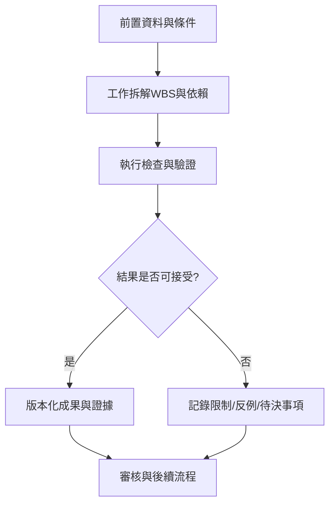

# 31｜工作拆解WBS與依賴

> AXIOM v2.1 整合基線｜文件 ID AX-31｜狀態：設計基線（未實作）｜2026-10-19

## 1. 文件定位與決策摘要

WBS 拆成 Epic→Feature→Task→驗收證據；每任務標示 owner、估算、依賴、測試、文件；先完成基準測試與 DSL，再啟動符號迴歸整合。

**設計原則**：每個規範都要能轉換成可測試的行為、可追溯的證據或明確的工程決策；凡屬目標數字均非已實測結果。

## 2. 章節專屬規格

### 工作包

WBS-01 專案規範與 ADR；02 資料契約；03 數學 DSL；04 基準生成；05 特徵與可識別性；06 搜尋策略；07 參數最佳化；08 獨立驗證；09 經驗庫；10 AI 路由；11 推導證明；12 訓練；13 雙/多序列；14 Vue 工作台；15 安全與可觀測；16 CI/CD 與部署。

### 關鍵依賴

03→06/08/11；02→04/05/09；04+08→06 的品質評估；09→10/12；06+08→14 的研究展示；15 為各階段持續性工作。

### 交付證據

每個工作包需有需求對照、介面契約、測試案例、效能測量、風險與文件更新；不得以「已完成開發」取代驗收。

## 3. 能力分解與詳細規格

### 3.1 階段交付

M0 規格凍結與風險；M1 資料／公式 DSL／驗證；M2 單序列發現；M3 視覺化工作台；M4 記憶與 AI 協作；M5 推演與證明；M6 雙序列；M7 多序列與自動訓練。

**強制規則／例外處理**：每階段以可展示的驗收證據關閉，不以文件完成代替產品完成。

### 3.2 依賴關係

DSL 與驗證先於公式搜尋；基準測試先於策略訓練；經驗品質管理先於微調；單序列驗收先於雙序列；雙序列驗收先於多序列。

**強制規則／例外處理**：關鍵路徑阻塞須升級處理並更新時程。

### 3.3 團隊與責任

產品／研究負責人、數學演算法工程師、Python 後端、Vue 前端、MLOps、DevOps/SRE、QA/資安；小團隊可兼任但不得取消審核分離。

**強制規則／例外處理**：公式證明與證據評級需獨立覆核。

### 3.4 風險與決策

建立 ADR、風險概率×衝擊、緩解、預警、責任人、關閉證據；尚未確定的模型與工具列為待決事項。

**強制規則／例外處理**：高風險項目未有替代方案不得進入正式發布。

## 4. 執行規範與設計檢查點

1. **前置檢查**：啟動「工作拆解WBS與依賴」相關功能前，驗證資料版本、權限、依賴服務、研究模式及資源配額。

2. **核心處理**：依本文件第 2、3 節執行，記錄所有關鍵決策、失敗原因、所採用的假設及每一個中間產物的來源。

3. **完成條件**：輸出不僅有成功結果，也有失敗、部分成功、歧義及不可執行狀態；不得默默回退成看似正常的結果。

4. **品質檢查**：用正常、邊界、異常、對抗、重試、並行與取消情境驗證行為；保留對照測試與審核記錄。

## 5. 作業流程圖

## 6. 失敗情境與降級策略

| 失敗或風險 | 系統反應 | 留存證據 |
|---|---|---|
| 輸入不符合「工作拆解WBS與依賴」要求 | 拒絕執行並提供可修正的欄位錯誤 | 輸入版本、驗證規則、錯誤代碼 |
| 依賴服務中斷或超時 | 有限次重試；超出預算即終止並保存 checkpoint | 服務版本、耗時、重試紀錄 |
| 結果彼此衝突或證據不足 | 保留候選及歧義，不提升證據等級 | 候選集合、反例、驗證集 |
| 資源配額超出 | 中止重運算，保留已完成的可信部分結果 | CPU/GPU 秒、記憶體峰值、任務狀態 |

## 7. 可執行驗收案例

**AC-31-01 正常路徑**：給定完整合法的輸入、固定資料版本與計算預算，執行「工作拆解WBS與依賴」流程，必須產出可追溯的結果與完成狀態。

**AC-31-02 異常路徑**：故意提供缺欄、錯誤型別、超時或不合法狀態，必須得到明確診斷且不得產生已驗證的假結果。

**AC-31-03 重現性**：在固定輸入、版本、隨機種子與執行環境下重跑，輸出應符合預先定義的決定性或容差標準。

**AC-31-04 權限與審核**：未授權角色不得讀取或發布研究資料；審核者能查詢完整證據鏈。

## 8. 實作任務分解與交付物

| 順序 | 工作項 | 完成定義 |
|---|---|---|
| 1 | 規格與輸入輸出契約 | 完成 schema、狀態與錯誤定義，審查通過 |
| 2 | 核心流程與依賴整合 | 完成可重現的端到端最小流程 |
| 3 | 邊界與反例測試 | 正常、異常、資源限制及證據不足皆有測試 |
| 4 | 視覺化與運維可見性 | 使用者可理解結果、限制、進度與失敗原因 |
| 5 | 發布審核 | 有版本、驗收紀錄、回滾方案及已知限制 |

## 9. 跨文件依賴與審核問題

依賴 [AX-06](<../03-架構/06-總體技術架構.md>) 總體架構、[AX-10](<../04-數學核心/10-公式DSL與等價正規化.md>) 公式 DSL、[AX-20](<../07-資料與API/20-資料模型與儲存規劃.md>) 資料模型、[AX-28](<../10-測試/28-數學基準測試規格.md>) 基準測試與 [AX-29](<../10-測試/29-驗收測試與品質閘門.md>) 品質閘門；涉及 UI 時同時參照 [AX-22](<../08-前端UX/22-設計系統與視覺規範.md>)～24；涉及 AI 記憶時參照 [AX-16](<../05-記憶/16-經驗記憶與檢索架構.md>)～19。

**審核必問**：本文件「工作拆解WBS與依賴」所描述的結果，是數值近似、統計支持、符號等價，還是形式化證明？是否已清楚標記適用條件、失敗邊界與未決事項？
