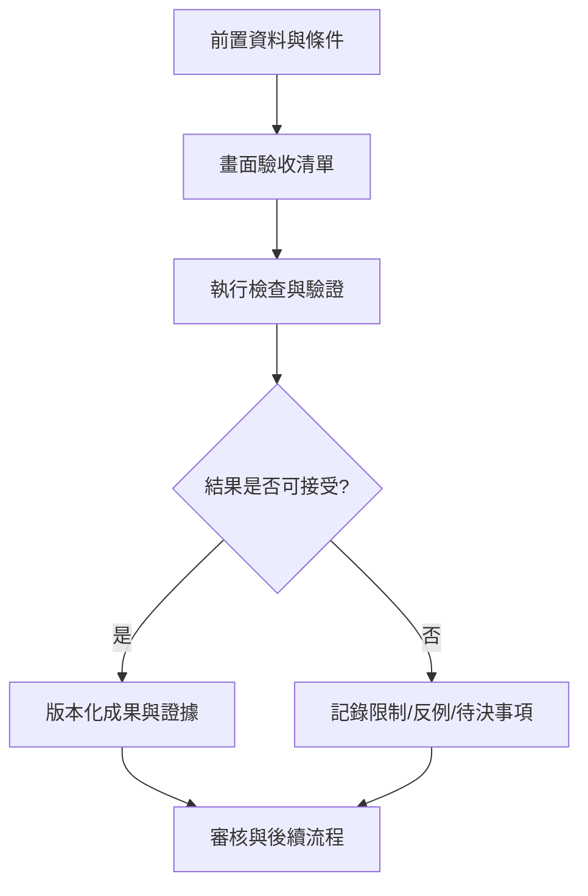

# 35｜畫面驗收清單

> AXIOM v2.1 整合基線｜文件 ID AX-35｜狀態：設計基線（未實作）｜2026-10-19

## 1. 文件定位與決策摘要

每頁驗收：桌機 1440px、筆電 1280px、平板 768px、手機 390px；公式長式不截斷、圖例可辨、焦點可見、錯誤可恢復、任務取消可操作、數據表可鍵盤導覽。

**設計原則**：每個規範都要能轉換成可測試的行為、可追溯的證據或明確的工程決策；凡屬目標數字均非已實測結果。

## 2. 章節專屬規格

### 公式顯示

長公式不裁切；上下標、矩陣、分段、求和、積分與多行對齊正確；LaTeX 複製與匯出一致；不合法公式顯示可理解錯誤；輸入經清理且不允許信任不安全 HTML。

### 研究互動

散點與擬合曲線同步；選擇候選更新殘差與參數；縮放不改動原始資料；大量資料降採樣標示；精度與適用域可視化；失敗與不確定性不被隱藏。

### 響應式與無障礙

桌面優先但平板可閱讀；鍵盤導航、對比、焦點、圖表文字替代、螢幕閱讀器基本支持；空狀態、錯誤狀態、離線與重試有明確回饋。

### 驗收方法

瀏覽器矩陣測試、視覺回歸截圖、Lighthouse／效能追蹤、鍵盤與輔助技術測試、10 萬點以上互動負載情境。

## 3. 能力分解與詳細規格

### 3.1 選型原則

採 Python/Django/DRF、Vue3/TypeScript/Vite/Pinia；數學以 SymPy/SciPy/NumPy/mpmath/PySR 為主；圖形 KaTeX/MathLive/Plotly；儲存 PostgreSQL/pgvector/MinIO/Redis。

**強制規則／例外處理**：第三方套件要驗證版本相容、授權、維護、效能及隔離需求。

### 3.2 證據語彙

PROVEN_FORMAL、VERIFIED_SYMBOLIC、SUPPORTED_EMPIRICAL、LOCALLY_VALID、AMBIGUOUS、FALSIFIED、INSUFFICIENT_EVIDENCE；證明需具假設、工具版本與檢查紀錄。

**強制規則／例外處理**：不要以通用 confidence 百分比混合不同意義的證據。

### 3.3 典型案例

衰減正弦、兩個近似等價模型、遞迴數列、變點時間序列、雙序列滯後關係、純隨機序列、病態有理函數等。

**強制規則／例外處理**：每案例要有輸入、預期行為、反例、成功與失敗驗收條件。

### 3.4 待決與變更

單機或叢集、Ollama 模型、GPU 規格、API 配額、資料保留期限、證明器範圍、SLO 與合規要求需在設計審查確認。

**強制規則／例外處理**：未決事項以 owner、deadline、決策依據及預設安全選項管理。

## 4. 執行規範與設計檢查點

1. **前置檢查**：啟動「畫面驗收清單」相關功能前，驗證資料版本、權限、依賴服務、研究模式及資源配額。

2. **核心處理**：依本文件第 2、3 節執行，記錄所有關鍵決策、失敗原因、所採用的假設及每一個中間產物的來源。

3. **完成條件**：輸出不僅有成功結果，也有失敗、部分成功、歧義及不可執行狀態；不得默默回退成看似正常的結果。

4. **品質檢查**：用正常、邊界、異常、對抗、重試、並行與取消情境驗證行為；保留對照測試與審核記錄。

## 5. 作業流程圖

## 6. 失敗情境與降級策略

| 失敗或風險 | 系統反應 | 留存證據 |
|---|---|---|
| 輸入不符合「畫面驗收清單」要求 | 拒絕執行並提供可修正的欄位錯誤 | 輸入版本、驗證規則、錯誤代碼 |
| 依賴服務中斷或超時 | 有限次重試；超出預算即終止並保存 checkpoint | 服務版本、耗時、重試紀錄 |
| 結果彼此衝突或證據不足 | 保留候選及歧義，不提升證據等級 | 候選集合、反例、驗證集 |
| 資源配額超出 | 中止重運算，保留已完成的可信部分結果 | CPU/GPU 秒、記憶體峰值、任務狀態 |

## 7. 可執行驗收案例

**AC-35-01 正常路徑**：給定完整合法的輸入、固定資料版本與計算預算，執行「畫面驗收清單」流程，必須產出可追溯的結果與完成狀態。

**AC-35-02 異常路徑**：故意提供缺欄、錯誤型別、超時或不合法狀態，必須得到明確診斷且不得產生已驗證的假結果。

**AC-35-03 重現性**：在固定輸入、版本、隨機種子與執行環境下重跑，輸出應符合預先定義的決定性或容差標準。

**AC-35-04 權限與審核**：未授權角色不得讀取或發布研究資料；審核者能查詢完整證據鏈。

## 8. 實作任務分解與交付物

| 順序 | 工作項 | 完成定義 |
|---|---|---|
| 1 | 規格與輸入輸出契約 | 完成 schema、狀態與錯誤定義，審查通過 |
| 2 | 核心流程與依賴整合 | 完成可重現的端到端最小流程 |
| 3 | 邊界與反例測試 | 正常、異常、資源限制及證據不足皆有測試 |
| 4 | 視覺化與運維可見性 | 使用者可理解結果、限制、進度與失敗原因 |
| 5 | 發布審核 | 有版本、驗收紀錄、回滾方案及已知限制 |

## 9. 跨文件依賴與審核問題

依賴 [AX-06](<../03-架構/06-總體技術架構.md>) 總體架構、[AX-10](<../04-數學核心/10-公式DSL與等價正規化.md>) 公式 DSL、[AX-20](<../07-資料與API/20-資料模型與儲存規劃.md>) 資料模型、[AX-28](<../10-測試/28-數學基準測試規格.md>) 基準測試與 [AX-29](<../10-測試/29-驗收測試與品質閘門.md>) 品質閘門；涉及 UI 時同時參照 [AX-22](<../08-前端UX/22-設計系統與視覺規範.md>)～24；涉及 AI 記憶時參照 [AX-16](<../05-記憶/16-經驗記憶與檢索架構.md>)～19。

**審核必問**：本文件「畫面驗收清單」所描述的結果，是數值近似、統計支持、符號等價，還是形式化證明？是否已清楚標記適用條件、失敗邊界與未決事項？

## 延伸閱讀

[AX-44 研究工作台畫面詳細規格](<../13-專題深化/44-研究工作台畫面詳細規格.md>)。
