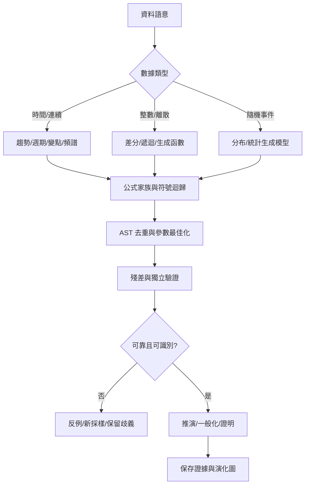

# 42｜公式搜尋與推演決策樹

> AXIOM v2.4 設計規格｜文件 ID AX-42｜狀態：待實作、待驗收｜2026-10-20

## 能力階段

本樹描述完整路線，MVP 僅走實數顯式函數分支及三基線。離散遞迴、ODE／隨機生成模型、一般化證明與主動採樣須先完成對應擴充契約，未啟用時輸出 UNSUPPORTED_OPERATOR／FEATURE_DISABLED，不強制所有研究走完全部分支。

## 決策入口

1. 判定資料是時間序列、整數序列、橫斷面、事件計數、機率或多維量測。
2. 檢查等距採樣、單位、邊界、量測誤差、時間順序與缺值機制。
3. 先建立零模型、常數、線性、多項式等簡單基線；保存樣本外結果。
4. 若有週期，評估頻譜與 aliasing，再試 Fourier、阻尼震盪與調變；若有變點，先分段再擬合。
5. 若為離散序列，優先測試遞迴與差分；若為動態系統，嘗試 ODE/SINDy；若為隨機過程，試分布或狀態空間模型。
6. 符號迴歸作結構探索；搜尋候選以 AST 去重、受限參數優化與 Pareto 選擇。
7. 殘差有結構才考慮加片段；無結構則避免無限加項。
8. 進入推演：求導、積分、變數代換、一般化、極限、不變量、穩定性；每一步保存前提。
9. 最終由獨立驗證器給證據等級；證據不足則輸出多候選與新採樣建議。

## 搜尋效率控制

以分層計算預算限制各家族的嘗試次數，策略選擇器只影響順序，不得關閉獨立探索；任務隨時可取消並保存可重用 checkpoint。搜尋評分不得只用訓練誤差。

## 工程落地細則與邊界驗收

### 補充規格 1

搜尋規劃器以候選效益/成本分配計算預算，先執行低成本篩選，再投入昂貴的符號迴歸。

### 補充規格 2

變點與非平穩序列不得強迫使用單一全域解析式；應允許分段模型並標示變點不確定性。

### 補充規格 3

對相近候選設計區分測試，優先建議在分歧最大且可行的區域採樣；不可控輸入時不宣稱可主動實驗。

### 補充規格 4

搜尋停止條件包括預算耗盡、長時間無改善、數值不穩定、不可識別與使用者取消；每種狀態都有不同的結果報告。

## 策略選擇與可驗收輸出

| 資料訊號 | 前置檢查 | 首選策略 | 不可接受的結果 |
|---|---|---|---|
| 連續趨勢 | 單位、尺度與極端值 | 常數／線性／低階多項式基線 | 只報訓練集誤差 |
| 週期與衰減 | 等距性、混疊、觀測長度 | 頻譜候選、阻尼正弦，保留替代週期 | 未檢查採樣便宣稱唯一頻率 |
| 整數序列 | 索引起點、整數精確性、樣本量 | 差分、低階遞迴、閉式比較 | 把有限項插值當成唯一通式 |
| 變點 | 時序切分、變點附近樣本 | 分段模型及變點區間 | 使用未來資料決定過去切分 |
| 隨機過程 | 殘差、相關性、平穩假設 | AR／狀態空間，評估預測區間 | 強迫產生精確確定性公式 |
| 無可辨識結構 | 零模型與樣本外表現 | 停止加項，輸出證據不足 | 因模型複雜就提升證據 |

### 預算帳本與停止原因

提交前固定總時間、候選數、AST 深度與記憶體上限；各策略以 `allocated`、`consumed`、`remaining` 記錄預算。保留獨立探索份額，實際比例由 P0 基準決定，未決前不得宣稱已最佳化。一次嘗試包含生成、擬合與驗證成本；重試不能重置研究總預算。

停止原因使用 `BUDGET_EXHAUSTED`、`NO_IMPROVEMENT`、`NUMERICAL_FAILURE`、`AMBIGUOUS`、`USER_CANCELLED`、`COMPLETED`。每個原因都附最後有效 checkpoint、已驗證候選數及未完成項目；`COMPLETED` 表示計畫執行完畢，證據仍需獨立評級。

### 對抗驗收

在狹窄區間提供 sin(x) 與低階近似均可擬合的資料，要求保留候選及分歧區域，禁止回報唯一真式。提供白噪聲時比較零模型的樣本外表現，允許拒答。取消高成本策略後，已驗證結果仍可查詢，未完成候選不得顯示為驗證通過。

## 延伸閱讀

[AX-09 數據語意與前處理](<../04-數學核心/09-數據語意與前處理.md>)；[AX-10 公式DSL與等價正規化](<../04-數學核心/10-公式DSL與等價正規化.md>)；[AX-11 搜尋策略與公式組合](<../04-數學核心/11-搜尋策略與公式組合.md>)；[AX-12 參數最佳化與數值精度](<../04-數學核心/12-參數最佳化與數值精度.md>)；[AX-13 可識別性不確定性與主動採樣](<../04-數學核心/13-可識別性不確定性與主動採樣.md>)；[AX-14 推演一般化與形式化證明](<../04-數學核心/14-推演一般化與形式化證明.md>)。

## 共用規則

版本、錯誤、證據與審查規則見 [AX-48 共用契約與文件治理](<../00-總覽/48-共用契約與文件治理.md>)；本章的專屬限制及驗收條件仍須同時滿足。

## 章節驗收案例

| ID | 情境 | 預期 |
|---|---|---|
| AC-42-01 | 分歧最大點出安全域 | 只建議可行點 |
| AC-42-02 | 所有策略預算耗盡 | stop_reason=BUDGET_EXHAUSTED、保存部分產物 |
| AC-42-03 | 線性資料三策略執行 | 輸出基線／去重及成本 |
| AC-42-04 | 以 final_test 排名候選 | 拒絕並標污染 |
