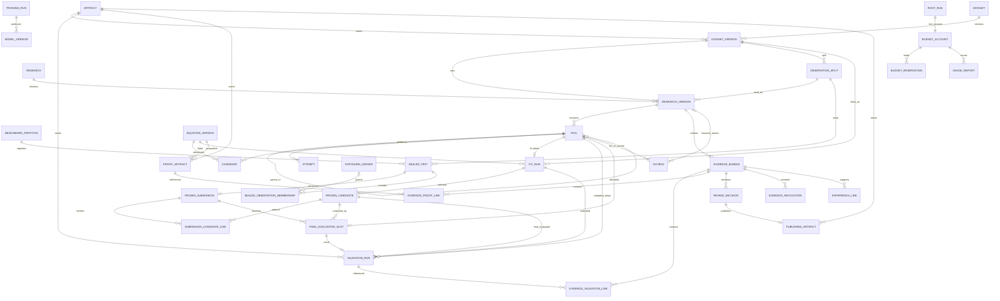

# 43｜資料庫ERD與關係約束

> AXIOM v2.8 設計規格｜文件 ID AX-43｜狀態：待實作、待驗收｜2026-10-20

## 權威關係圖

所有受保護表以 (tenant_id,id) 複合唯一鍵供外鍵引用，id 為 UUID。下圖與 AX-47 同名，DOMAIN 欄位形狀見 research-v2 schema；圖表示關係，不省略版本層。Dataset、Research 容器可改名；版本內容與證據不可原地修改。

Derived feature、memory、training snapshot 是 M4/M7 的擴充表，所有引用必須具來源版本與授權，不能讓 pgvector 成為權威有效性來源。

## 唯一性、索引與刪除

| 表／欄位 | 約束／索引 | 理由 |
|---|---|---|
| DatasetVersion | unique(tenant_id,dataset_id,sha256)，FK dataset | 同檔重送不重建；不同租戶不可共享 metadata |
| ResearchVersion | FK research/dataset_version 皆含 tenant_id；research+created_at 索引 | 可追溯及版本列表 |
| EquationVersion | unique(tenant_id,identity_hash,dsl_version) | hash 按 AX-10 包括域與宣告，非全域跨租戶去重 |
| Run / Attempt | unique(run_id,generation)，(tenant_id,status,created_at) 索引 | 租約世代及排隊查詢 |
| Candidate | unique(search_run_id,equation_version_id)，rank 索引 | 同搜尋結構候選去重；擬合另表 |
| FitRun | unique(run_id)、同租戶FK；id為FitRun識別，資料／公式版本FK | 不混合不同參數估計 |
| ValidationRun | 開發評估unique(tenant_id,run_id,observation_split_id,split_role,metric_version)；FINAL_TEST另partial unique(tenant_id,submission_id,frozen_candidate_id,metric_version) | 更換run_id仍不能重複最終結果；final需非null提交引用 |
| Evidence links | unique(bundle_id,validation_id/proof_id)；tenant 複合 FK | 防止外租戶或重複證據 |
| ReviewDecision | unique(research_version_id,expected_revision) | 同 revision 僅一個審核決定 |
| Outbox | event_id 唯一、unique(stream_scope,stream_id,sequence) | 至少一次投遞＋消費去重 |
| IdempotencyRecord | unique(tenant_id,actor_id,method,path,key) | request_hash、HTTP 結果與資源引用原子保存 |

歷史版本與證據 FK 預設 RESTRICT，不級聯刪掉已發布來源。可重建暫存才可 TTL 清理。敏感刪除依 AX-26 專用流程，對保留稽核只留政策允許欄位。owner/admin 權限不靠外鍵自動取得，API ACL 與 DB 租戶約束均須驗證。

## 物件儲存提交與交易

1. 上傳到不可執行且不可公開的暫存 key，檢查檔案型別、大小、hash、schema 與掃描。
2. 將已驗證物件放正式不可覆寫 key；確認可讀與 checksum，暫存不作有效版本。
3. DB 交易新增 DatasetVersion、INGEST run 完成狀態與 outbox；提交後才可查到 AVAILABLE。
4. 若第 3 步失敗，正式物件可能是孤兒；清理器經至少 24 小時寬限與 DB 無引用檢查後回收。
5. DB 已提交後物件遺失則標版本不可用、阻擋新研究並復原，不以空檔或新內容覆蓋原 hash。

跨 DB／MinIO 無共同交易；checksum 不能替代可恢復流程。發布、撤銷、預算扣帳、租約裁決皆鎖權威列並同交易寫 outbox。使用者大檔不放 DB blob。

## Schema 升級與驗收

採 expand→相容雙讀→回填→驗證→contract。舊 DSL parser 在歷史保留期內保留；移除舊欄位前必須證明舊產物可讀。回滾不相容時用 AX-27 配對快照，不能只降應用映像。

| ID | 操作 | 預期 |
|---|---|---|
| AC-43-01 | 重送同檔、相同事件及相同 idempotency key | 唯一約束生效，版本／副作用各只有一次 |
| AC-43-02 | A 的 FitRun 引用 B 的資料版本 | DB 複合 FK 拒絕，即使 UUID 真實存在 |
| AC-43-03 | MinIO 成功後 DB rollback | API 不顯示 AVAILABLE，孤兒延遲回收且無有效引用 |
| AC-43-04 | 升級後讀舊 DSL 產物並模擬回滾 | 內容 hash 不變、相容 parser 可讀，否則阻擋部署 |

Artifact registry 以 (tenant_id,id) 供外鍵，uri/hash/size 不可改寫；檔案變更需新 Artifact。連到 registry 的版本物件不得引用外租戶或不存在物件，下載先查 registry 與證據有效性，不直接暴露物件服務帳號。

## v2 執行與評估關係補充

ROOT_RUN 是 RunRecord 中 parent_run_id IS NULL 的子集合，不是另建可分歧的資料表。RunRecord的parent/root複合外鍵同租戶，服務在root鎖內驗證無循環、同研究、同BudgetAccount；公開Run投影不含這些私有控制欄位。AttemptRecord獨立保存heartbeat/start/finish與累計Usage。

ObservationSplit、BenchmarkPartition、SealedTest各有獨立id及版本；SealedTest的來源內容／case／final rows／protocol指紋唯一，不依Dataset容器id。FrozenSubmission透過link表固定有序FrozenCandidate；一個FrozenCandidate精確引用一個FitRun，不能只引用Candidate的fit陣列。最終ValidationRun必須同FrozenCandidate資料／split與binding。

BudgetReservation.id與UsageReport.usage_event_id唯一；另unique(attempt_id,sequence)，相同序號不同內容拒絕。Public DTO的budget_usage由帳本投影，不與limit共用型別。Outbox的sequence按stream_scope/stream_id分配，RESEARCH流不因任一Run終態關閉。

## 最終評估結果槽位與曝光帳本

FinalEvaluationSlot為內部持久化表／runtime物件，以unique(tenant_id,submission_id,frozen_candidate_id,metric_version)為業務鍵，保存固定run_id、status=PENDING／COMPLETED／FAILED及可null的validation_run_id。凍結包的SubmissionCandidateLink以同租戶submission／candidate成員鍵約束；slot及最終ValidationRun皆須複合FK引用該成員，metric_version等於submission固定值。FINAL_TEST的submission_id／frozen_candidate_id必非null；其他split兩者均null，不能共用最終唯一鍵。

首次派送在root lock內以槽位業務鍵insert-on-conflict，與建立唯一VALIDATE run／input manifest／outbox同交易。競爭者讀既有slot，回同run_id或已完成ValidationRun，不另建評估run；租約恢復只建原run的新attempt。不可對含NULL的通用唯一索引誤認為已保護final結果。最終ValidationRun、slot=COMPLETED、validation_run_id及結果outbox同交易提交；PENDING／FAILED的結果引用必null，FAILED slot不以新run重啟已終止根。結果提交仍經AX-38 fencing、根取消及artifact校驗；衝突不能以新UUID繞過。

SealedObservationMembership保存每個SealedTest的final_observation_tokens／final_lineage_tokens；ExposureLedger以unique(tenant_id,fingerprint_version,token_kind,token)保護觀測級資格，token_kind區分CONTENT／LINEAGE，狀態RESERVED／CONSUMED／RETIRED並綁submission_id。正式blind的穩定來源namespace／observation ID由Generator登記，不能從Dataset容器或使用者自填case_id取得。登記、變更來源及新切分都查token重疊，不只比整包hash。預留時先root、SealedTest，再以固定token順序鎖／insert ledger，最後建立slot／run／outbox；同提交可重試，不同提交碰撞拒絕。資料讀取前SealedTest與全部成員ledger同交易CONSUMED；退役同樣保留成員紀錄，不能靠刪原版本重新登記。私有token只存Evaluator控制域，不透過普通API／日誌外洩。

| ID | 情境 | 預期 |
|---|---|---|
| AC-43-05 | 同提交／候選／metric並行建立兩個不同run | 只有一個slot及評估run；衝突讀回原run／結果 |
| AC-43-06 | 不同run_id寫同一final結果或引用非包成員 | 最終partial unique／複合FK拒絕，無第二份有效結果 |
| AC-43-07 | 改訓練列／重排原檔／換容器後預留相同或部分final觀測 | 觀測ledger命中；不同提交不可重新取得盲測資格 |

全域鎖順序統一為root→既有ancestor／run（深度序）→SealedTest→ExposureLedger（token_kind/token排序）→FinalEvaluationSlot→ResearchBudgetAccount→root BudgetAccount；沒有該資源時略過，不能持帳本鎖再回頭取曝光／槽位鎖。原AX-38的root→ancestor/run→budget順序在此細化，取消與純計量不反向取其他鎖。

## v2.6 累計預算與政策關係

ResearchBudgetAccount以unique(tenant_id,research_version_id)一對一連ResearchVersion；root BudgetAccount／RunRecord的research_budget_account_id為同租戶FK，PROFILE／SEARCH／FIT／VALIDATE必非null且對應同研究版本，INGEST／REVOKE必null。預留及用量明細唯一鍵同時保護兩層投影，根額度與研究額度不能各自在獨立交易扣帳。先root／ancestor等控制鎖、再研究帳本、最後root帳本；舊「最後BudgetAccount」敘述均以此細化順序為準。

ResearchVersion的evaluation_policy、hash及SemanticProfile.source_column不可變。ValidationRun／FrozenSubmission的evaluation_policy_hash必與研究相同；最終結果槽位仍以submission／frozen candidate／metric唯一，因submission已固定policy hash，不以新policy繞過舊槽位。ExposureJournal與應用DB不是共同交易，保守先記intent後更新DB的復原條件依AX-27，不只備份ExposureLedger資料表。

## v2.7 持久約束與資料生命週期

新增私有ResourceProvenance、ExecutionManifest、UploadRecord、SummaryLineage，對應runtime schema；公開新增PublicationClaim／ReleasedSummary。PublicationClaim.review_id與PublishedArtifact.publication_claim_id為同tenant FK；SummaryLineage.released_summary_id唯一且所有來源FK同tenant。資源建立與provenance／registry同交易，provenance append-only且resource_type/resource_id唯一；作者集合按AX-26保存不可變責任閉包，刪帳號不cascade刪歷史。

UploadRecord COMPLETED必非null object_version／ingest_run_id；一session一INGEST，以business unique保證超過冪等TTL仍重用。dispatch key按AX-38設唯一鍵並保存payload hash，不能讓不同payload使用相同key。Evaluation計數、單位比例、publication claim資格與政策來源屬跨物件語意約束，DB CHECK／FK、可信服務與故障注入需共同驗收，JSON shape通過不代表這些不變條件已實作。

MVP不提供資料硬刪除API。D-05未定保留及刪除政策前只允許受審查的隔離／tombstone；操作需先dry-run計算原始檔、projection、report、memory、cache及備份的lineage影響，不能讓失去來源的摘要仍有效。GC只處理確定無引用的暫存，資料庫刪除成功不代表備份／下載副本已消失。私有內容刪除與最少必要audit／曝光ledger保留必分開裁決，無政策就阻擋，不悄悄選擇永久保留或全部刪光。

## 軌跡與學習lineage約束

Run.research_trace_artifact_ids為授權投影，內部以(run_id,chunk_sequence)及node_id唯一、payload hash不可變，前chunk及parent需已存在／同tenant並保證DAG；遲到診斷不寫合法證據關聯。新payload中evidence、row依賴、case family、模型與訓練來源均為同租戶受控FK／registry引用，不能因都是UUID就放行。

批次以(tenant,policy_hash,input_high_watermark)唯一、提交結果後才CAS前移水位；壓縮manifest切換不改Artifact內容身分，原bytes／hash仍可還原。ExperienceVersion append-only、supersedes不成環；模型／規則release與來源撤銷有持久影響索引，不能只靠向量庫刪embedding。M4／M7實作需實際DB遷移與併發驗收，payload schema不代替關係約束。
