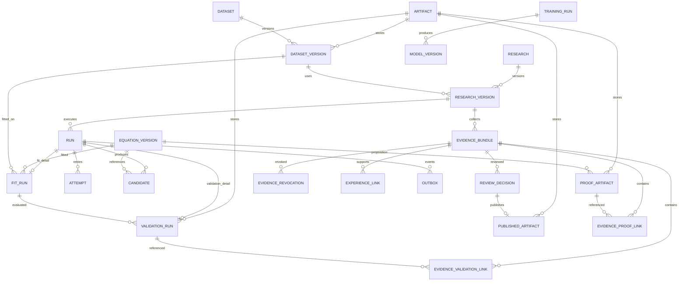

# 43｜資料庫ERD與關係約束

> AXIOM v2.2 設計規格｜文件 ID AX-43｜狀態：待實作、待驗收｜2026-10-19

## 權威關係圖

所有受保護表以 (tenant_id,id) 複合唯一鍵供外鍵引用，id 為 UUID。下圖與 AX-47 同名，DOMAIN 欄位形狀見 research-v1 schema；圖表示關係，不省略版本層。Dataset、Research 容器可改名；版本內容與證據不可原地修改。

Derived feature、memory、training snapshot 是 M4/M7 的擴充表，所有引用必須具來源版本與授權，不能讓 pgvector 成為權威有效性來源。

## 唯一性、索引與刪除

| 表／欄位 | 約束／索引 | 理由 |
|---|---|---|
| DatasetVersion | unique(tenant_id,dataset_id,sha256)，FK dataset | 同檔重送不重建；不同租戶不可共享 metadata |
| ResearchVersion | FK research/dataset_version 皆含 tenant_id；research+created_at 索引 | 可追溯及版本列表 |
| EquationVersion | unique(tenant_id,identity_hash,dsl_version) | hash 按 AX-10 包括域與宣告，非全域跨租戶去重 |
| Run / Attempt | unique(run_id,generation)，(tenant_id,status,created_at) 索引 | 租約世代及排隊查詢 |
| Candidate | unique(search_run_id,equation_version_id)，rank 索引 | 同搜尋結構候選去重；擬合另表 |
| FitRun | PK/FK run_id；資料／公式版本 FK | 不混合不同參數估計 |
| ValidationRun | unique(run_id,split_id,metric_version) | 重送不重複評分；所有必評點計 coverage |
| Evidence links | unique(bundle_id,validation_id/proof_id)；tenant 複合 FK | 防止外租戶或重複證據 |
| ReviewDecision | unique(research_version_id,expected_revision) | 同 revision 僅一個審核決定 |
| Outbox | event_id 唯一、unique(run_id,sequence) | 至少一次投遞＋消費去重 |
| IdempotencyRecord | unique(tenant_id,actor_id,method,path,key) | request_hash、HTTP 結果與資源引用原子保存 |

歷史版本與證據 FK 預設 RESTRICT，不級聯刪掉已發布來源。可重建暫存才可 TTL 清理。敏感刪除依 AX-26 專用流程，對保留稽核只留政策允許欄位。owner/admin 權限不靠外鍵自動取得，API ACL 與 DB 租戶約束均須驗證。

## 物件儲存提交與交易

1. 上傳到不可執行且不可公開的暫存 key，檢查檔案型別、大小、hash、schema 與掃描。
2. 將已驗證物件放正式不可覆寫 key；確認可讀與 checksum，暫存不作有效版本。
3. DB 交易新增 DatasetVersion、INGEST run 完成狀態與 outbox；提交後才可查到 AVAILABLE。
4. 若第 3 步失敗，正式物件可能是孤兒；清理器經至少 24 小時寬限與 DB 無引用檢查後回收。
5. DB 已提交後物件遺失則標版本不可用、阻擋新研究並復原，不以空檔或新內容覆蓋原 hash。

跨 DB／MinIO 無共同交易；checksum 不能替代可恢復流程。發布、撤銷、預算扣帳、租約裁決皆鎖權威列並同交易寫 outbox。使用者大檔不放 DB blob。

## Schema 升級與驗收

採 expand→相容雙讀→回填→驗證→contract。舊 DSL parser 在歷史保留期內保留；移除舊欄位前必須證明舊產物可讀。回滾不相容時用 AX-27 配對快照，不能只降應用映像。

| ID | 操作 | 預期 |
|---|---|---|
| AC-43-01 | 重送同檔、相同事件及相同 idempotency key | 唯一約束生效，版本／副作用各只有一次 |
| AC-43-02 | A 的 FitRun 引用 B 的資料版本 | DB 複合 FK 拒絕，即使 UUID 真實存在 |
| AC-43-03 | MinIO 成功後 DB rollback | API 不顯示 AVAILABLE，孤兒延遲回收且無有效引用 |
| AC-43-04 | 升級後讀舊 DSL 產物並模擬回滾 | 內容 hash 不變、相容 parser 可讀，否則阻擋部署 |

Artifact registry 以 (tenant_id,id) 供外鍵，uri/hash/size 不可改寫；檔案變更需新 Artifact。連到 registry 的版本物件不得引用外租戶或不存在物件，下載先查 registry 與證據有效性，不直接暴露物件服務帳號。
