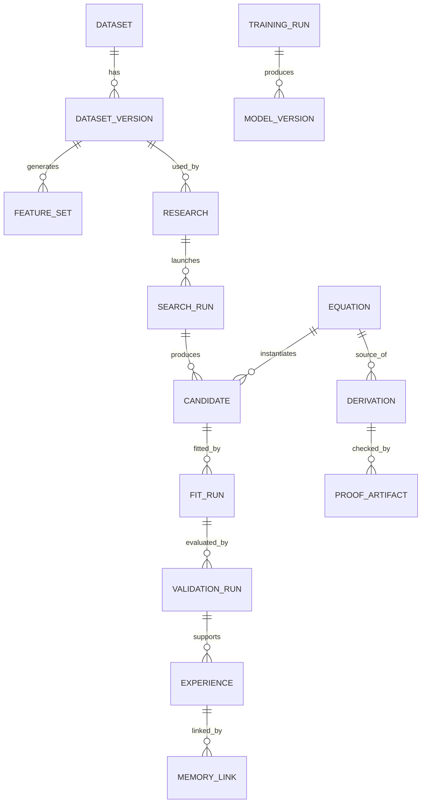

# 43｜資料庫 ERD 與關係約束

> AXIOM v2.1 整合基線｜文件 ID AX-43｜狀態：設計基線（未實作）｜2026-10-19

## 一致性與索引
所有主表採 UUID、created_at、schema_version、owner_scope；版本物件採 content hash 防止重複；search_run 按 research_id、status、created_at 建索引；validation_run 按 candidate_id 與 split_id 查詢；pgvector 只負責召回，不取代權威資料關係。

## 交易邊界
上傳大檔先寫 MinIO 暫存，再驗證 checksum 與 schema，最後在資料庫交易內提交 DatasetVersion；失敗則清理暫存。任務事件使用 outbox pattern，避免資料已提交但事件遺失。

## 刪除與撤銷
資料刪除須清查原始物件、衍生特徵、記憶索引、訓練資料引用；已發布研究若須保留稽核紀錄，僅保留符合法規與政策的非敏感證據摘要。

## 工程落地細則與邊界驗收

### 補充規格 1

唯一性約束：Equation(canonical_hash,dsl_version) 唯一；ValidationRun(run_id,split_id,metric_version) 唯一；事件以 event_id 去重。

**驗收方法**：建立可重現的測試案例，固定輸入版本與環境，記錄正常結果、錯誤結果、例外診斷及回滾證據。審核者應能追溯結果來源，而不是只看到成功提示。

### 補充規格 2

索引規劃：資料集以 tenant_id+created_at，研究以 owner_scope+status，候選以 search_run_id+rank，經驗以 domain+quality_status 查詢。

**驗收方法**：建立可重現的測試案例，固定輸入版本與環境，記錄正常結果、錯誤結果、例外診斷及回滾證據。審核者應能追溯結果來源，而不是只看到成功提示。

### 補充規格 3

遷移策略：資料表 schema 升級先新增相容欄位，背景回填，讀取雙版本，最後才移除舊欄位；公式 DSL 升級需保留舊 parser。

**驗收方法**：建立可重現的測試案例，固定輸入版本與環境，記錄正常結果、錯誤結果、例外診斷及回滾證據。審核者應能追溯結果來源，而不是只看到成功提示。

### 補充規格 4

交易與冪等：研究任務重送必須回傳相同 run_id 或明確的衝突結果，不能重複扣配額或重複發表證據。

**驗收方法**：建立可重現的測試案例，固定輸入版本與環境，記錄正常結果、錯誤結果、例外診斷及回滾證據。審核者應能追溯結果來源，而不是只看到成功提示。

## 外鍵、唯一性與存取邊界

ERD 為概念圖；實作時 EquationVersion、ResearchVersion 與 EvidenceBundle 必須拆為可引用的版本物件，不能只靠可變的父表指向「最新」結果。

| 關係／約束 | 資料庫要求 | 失敗情境驗收 |
|---|---|---|
| Dataset → DatasetVersion | 複合唯一鍵 (tenant_id, dataset_id, content_hash) | 相同租戶重送相同檔案不重建版本 |
| ResearchVersion → DatasetVersion | NOT NULL 外鍵，驗證租戶一致 | 跨租戶 UUID 即使存在也不可引用 |
| EquationVersion → Equation | 保存 dsl_version、canonical_hash、定義域及假設 | 不同定義域不可只因表面化簡就合併 |
| FitRun → EquationVersion / DatasetVersion | 兩者不可缺；保留 optimizer、seed、precision | 參數不能被其他資料版本的擬合覆寫 |
| ValidationRun → FitRun / split_id | (run_id, split_id, metric_version) 唯一 | 重送結果不重複列入統計 |
| EvidenceBundle → ValidationRun / ProofArtifact | 逐項證據引用；發布檢查有效性 | 無 checker 產物不能通過形式化發布 |
| TrainingRun → ModelVersion | 一次訓練可產多個模型 checkpoint；各模型記錄來源訓練 | 模型可追溯資料快照與訓練組態 |
| Outbox → 消費紀錄 | event_id 唯一，記錄投遞／消費狀態 | 重複投遞不得重複扣配額 |

### 大物件提交與故障復原

1. 上傳寫入暫存位置，計算 hash 並完成內容檢查；此時版本不可供研究使用。
2. 將已驗證物件置於受保護的正式位置，確認可讀與 checksum 一致。
3. 同一資料庫交易新增 DatasetVersion 與 outbox 記錄；僅交易提交後對外可見。
4. 若資料庫交易失敗，該正式物件可能成為孤兒，交由有寬限期的清理器確認無引用後回收。
5. 若物件遺失，相關版本標記不可用、阻止新任務，透過備份復原；不得以空檔案替代。

物件儲存與 PostgreSQL 沒有共同交易；需要上述可恢復流程。歷史證據引用預設限制級聯刪除，資料刪除依政策執行專用工作流並保留允許的審計紀錄。

## 延伸閱讀

[AX-20 資料模型與儲存規劃](<../07-資料與API/20-資料模型與儲存規劃.md>)；[AX-21 API與任務契約](<../07-資料與API/21-API與任務契約.md>)；[AX-47 完整研究物件契約](<47-完整研究物件契約.md>)。
