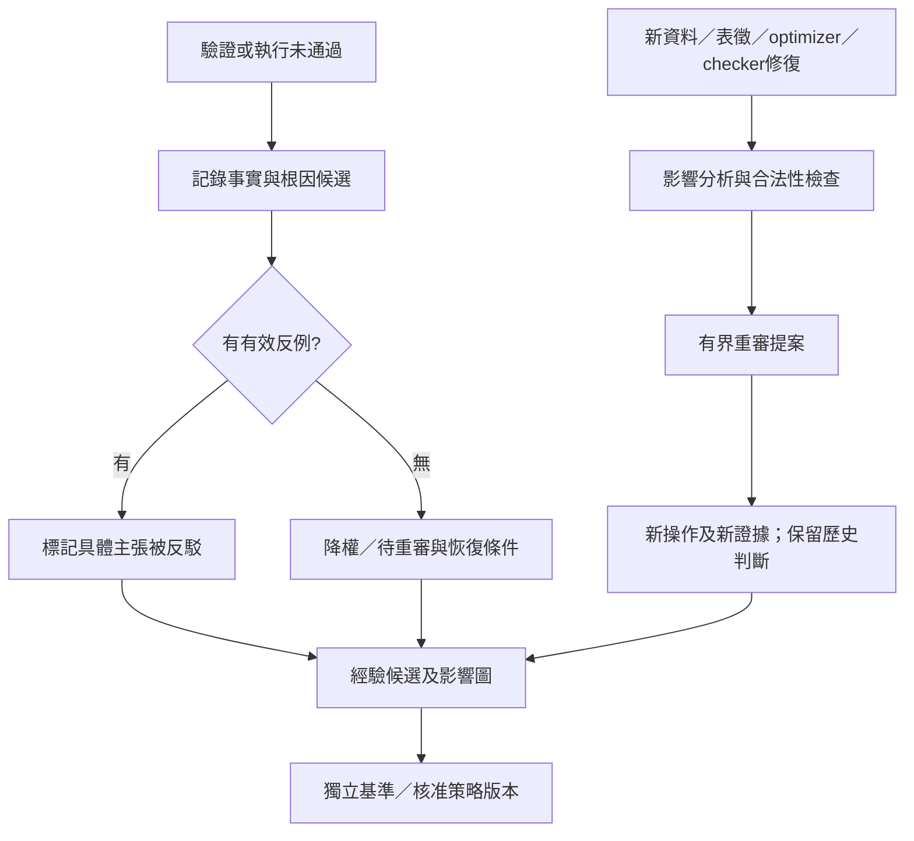

# 50｜研究決策軌跡與錯誤恢復

> AXIOM v2.8 設計規格｜文件 ID AX-50｜狀態：待實作、待驗收｜2026-10-20

## 記錄對象與責任

REQ-012要求保存**外部可驗證的研究決策與證據鏈**：輸入／語意、表徵、假設、選法理由摘要、工具呼叫、可檢查推導、參數診斷、驗證、反例、資源分配、排除／重審與最終判斷。ARTE是研究決策圖的責任模組，與Run／Attempt、audit、SSE及理論演化圖分工；不是把應用log改名，也不宣稱取得模型所有內部思考或隱藏狀態。

M1起即保存最小TraceChunk與數學工具診斷；M4起啟用經驗根因建議、分支策略及HRR自動重審。模型可輸出rationale_summary與推導Artifact，但自述理由是待檢查主張，不是證明或真實內部運算軌跡。正確結論、有效推導及有效率策略分三軸記錄：錯誤推導碰巧得到正確答案不能升P；推導失敗也不抹掉候選公式的獨立研究價值。

## 決策圖與持久提交

TraceChunk包含run／attempt／generation、tenant、ResearchVersion、chunk sequence、前chunk hash及節點列表；TraceNode固定node_id、event_kind、parent_node_ids、source Artifact IDs、input/output hashes、actor及時間、method/environment、assumptions、rationale_summary、evidence IDs、branch_id及action。parent可指前chunk或本chunk較早節點；全圖無環、來源必已提交且同tenant，不用時間戳猜因果。數學推導可核對Artifact，不能只保存自然語言的「所以成立」。

工具執行與決策採有界journal：開始前持久記工具請求／輸入hash及預留，完成後同業務提交交易連結結果及TraceChunk registry；外部副作用以唯一operation key去重，crash後保存STARTED／UNKNOWN／reconciled，不捏造SUCCEEDED。過期attempt不能提交新研究結果，但supervisor可保存標為late／invalid的診斷，不提升證據；同node_id不同內容必衝突，不能覆寫歷史。

Run.research_trace_artifact_ids提供已提交chunk的ACL投影，所有型別Run都必填列表，尚無chunk可空。chunk immutable、hash鏈連續；持久run snapshot與registry一致後才回應已記錄。讀取沿既有GET Run／Artifact端點，重開由研究runs列表找到，不依賴七天SSE。trace追加不改控制revision，不新增虛構的公開PAUSED／resume端點；執行中的進度可重讀snapshot。敏感／final節點整個chunk繼承SEALED_DETAIL，PROJECT chunk只含可讀開發來源及安全摘要，不能因理由看似無害就漏出final評估結果。

## 失敗分類與判斷強度

| failure_class | 需要排查的問題 | 可導致的結論 |
|---|---|---|
| STRUCTURE | 具體模型／參數／域與可驗證反例 | 只反駁該具體主張，不能全域禁公式家族 |
| OPTIMIZATION／NUMERICAL | 初值、收斂、精度、溢位／消去 | NUMERICALLY_UNCERTAIN，另用新合法attempt或研究重驗 |
| DATA_QUALITY／SAMPLING | 錯型、噪聲、缺測、aliasing | 前提不足，不等同模型為假 |
| REPRESENTATION／PREPROCESSING | 映射、單位、窗口、資訊損失、洩漏 | 修正來源／新版本，不回寫舊證據 |
| DOMAIN／ASSUMPTION | 超出固定域、初值或觀測假設不符 | 條件性結果；不能事後縮域洗掉反例 |
| VERIFICATION_DESIGN | 檢驗目標、資料依賴、多重選擇或checker缺陷 | 舊證據隔離及後代重審 |
| INFRASTRUCTURE／RESOURCE | 網路／租約、timeout、預算／記憶體上限 | 未完成／不足，不能當數學反駁 |
| UNKNOWN | 尚未有根因證據 | 保留可能原因集合與下一步檢查 |

FailureAssessment將觀測事實、root_cause_hypotheses與已驗證原因分開；status為CONFIRMED_COUNTEREXAMPLE、LIKELY_INAPPLICABLE、PROVISIONAL_FAILURE、INSUFFICIENT_EVIDENCE、NUMERICALLY_UNCERTAIN、CONDITIONAL、SUPPORTED或REASSESS。CONFIRMED_COUNTEREXAMPLE必附同域、同binding、單位／精度／誤差模型均有效的反例；噪聲超界也須核對測量誤差假設，不用單次大殘差否定整個家族。沒有有效反例只能降權或暫停**研究分支**；Run生命週期仍用AX-04／38現有狀態。

## HRR假設恢復與反偏見

恢復條件須可機器判斷，列trigger_type、source version、minimum_change及max_revisits；不能只有「以後再看看」。來源變更需新ResearchVersion；同版本只有未終結且允許派送的探索階段可重分配。FAILED／CANCELLED不復活，final已消耗不重用；盲化歷史標籤的重審須用新的未曝光資料或開發資料，不能把舊final當新盲測。任何證明／反例撤銷都新增REASSESS事件並隔離依賴後代，歷史CONFIRMED紀錄不改。

資源分exploit／explore／revisit，保存實際allocation及selection propensity；比例由預註冊政策決定，70/20/10僅原貼文示例。需要探索與重審的政策不得把兩者配成0；若總額不足啟用最低探索，標證據不足而非假稱已全面比較。max_branch_count／max_revisits／無進展checkpoint限制循環，任何自我修正都計成本。新策略離線評估→no-memory對照→小規模試行→獨立核准→啟用或回退，不能因一次失敗即自改全域政策。

## 決策品質指標

在已知ground truth且未作訓練的case／family上定義TP/FP/TN/FN；誤殺率=錯誤排除有效方向／全部真有效方向，誤留率=保留無效方向／全部真無效方向，明列決策時點、機會數與可比較預算。恢復率的分母是曾錯誤暫停且滿足恢復條件的有效方向；恢復延遲從條件可用時計，不從最初失敗時計。根因辨識率需有已知故障注入或獨立標註；未知真值任務不顯示虛構精確率。另報探索家族coverage、無效探索成本、有效發現/CPU與token、負向遷移和校準；所有比較按來源／家族分組，報不確定性及缺失分母。

## 驗收（產品 NOT_RUN）

| ID | 情境 | 預期 |
|---|---|---|
| AC-50-01 | 工具成功、crash、晚到結果與重送同node ID | 可重建已知／未知狀態；去重且fencing有效，不覆寫歷史 |
| AC-50-02 | 依賴環／跨tenant／前提先撤銷後完成 | 拒絕合法圖提交或隔離後代，無假證據 |
| AC-50-03 | timeout／optimizer失敗卻要求永久排除家族 | 只記不足／數值不確定，禁止升為有效反證 |
| AC-50-04 | 合法反例、域外反例、噪聲未定 | 只前者可否定具體主張；保存假設／誤差界 |
| AC-50-05 | 新optimizer／新資料觸發重審、重審超限 | 新合法操作與完整來源；不復活終態、不重置final／預算 |
| AC-50-06 | 經驗策略過度集中／有限預算耗盡 | 探索與重審額度受控；保留未比較方向，不宣稱全面否定 |
| AC-50-07 | 正確結論經錯誤步驟得出 | 分開結論／推導／策略，不能標該路徑已證明 |
| AC-50-08 | 重開研究及普通reader讀final trace | 可恢復授權chunk；封存chunk不洩漏，誤殺率未知則不捏造 |
