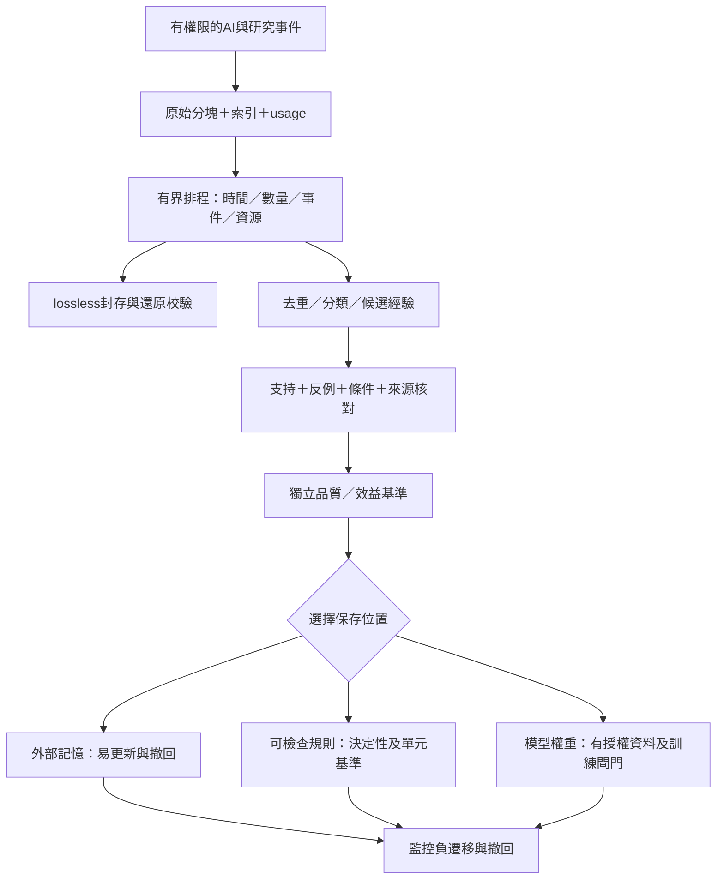

# 52｜AI紀錄封存與經驗演化

> AXIOM v2.8 設計規格｜文件 ID AX-52｜狀態：待實作、待驗收｜2026-10-20

## ATME的三層責任

REQ-014包含指定儲存位置、AI研究紀錄及成本、定期壓縮／整理、反例保留、外部記憶／規則／模型權重的選擇與可回退發布。M1起規劃共用儲存／記錄能力；AI Gateway啟用的M4必交付執行紀錄、RAG及整理品質閘門；M7才啟用受控策略訓練／選配微調。保存文字、token統計或摘要都不會自行更新模型權重。

| 層 | 保存內容 | 更新與撤回 |
|---|---|---|
| 原始紀錄 | 可授權prompt／output、tool calls、決策、usage、訓練log | immutable分塊、hash、保留政策及ACL；非公開log |
| 經驗與知識 | 去重索引、條件主張、支持／反對例、統計與不確定性 | 新版本／撤銷與lineage；摘要不得取代原始證據 |
| 能力提升 | RAG、經基準的規則／策略、資料集及模型版本 | offline→對照→canary→獨立核准→啟用／回退 |

Ollama是推論／模型匯入服務，微調由另行核准的訓練框架執行。推論model digest、可訓練基礎權重及tokenizer版本分開登錄，不能把下載的量化推論檔直接當任意LoRA訓練基礎。Ollama匯入流程與版本需鎖定實測；原貼文中的ADAPTER指令不作通用相容保證，能否原生掛載adapter／是否需合併匯出，以該runtime及架構驗收。官方[模型匯入](https://docs.ollama.com/import)與[Modelfile](https://docs.ollama.com/modelfile)列出目前操作，AXIOM不自動下載／安裝或替換模型。

## 儲存位置與物件生命週期

管理端以StoragePolicy設定AXIOM_STORAGE_ROOT或受控object-store prefix，預設規劃為專案外掛載的`storage/`，並gitignore，不能把使用者prompt及訓練產物提交Git。子目錄ai-runtime/raw、usage、trace、archives、research-memory/{observations,hypotheses,failures,experiences}及training/{datasets,manifests,checkpoints,adapters}是邏輯分類；部署可映射本機／NAS／物件儲存。DB保存索引／狀態／ACL／hash及reference；Redis只作排程，不作唯一紀錄。每個tenant使用不可猜的獨立prefix，禁止由request任填本機絕對路徑。

StoragePolicy固定root／backend、容量上限、max_chunk_bytes、max_raw_record_bytes、high/low watermarks、retention_policy_artifact_id及加密金鑰版本；路徑resolve後必在允許root內，防`../`、symlink跳脫及檔名注入。設定變更用copy→checksum驗證→原子切registry pointer，不移動完才失去舊引用。NAS不可用、磁碟滿或權限不足時，先持久記錄capture失敗並停止需要audit的AI呼叫；可繼續不依賴AI的已授權數學工作，不能丟紀錄卻宣稱完整。

## 執行紀錄與token語意

AIRuntimeRecord每次呼叫固定call_id、Run／Attempt及operation key、provider/model manifest digest、prompt template／options hash、輸入／輸出Artifact IDs、status、capture_status與usage。usage包含prompt_eval_count、eval_count、total_duration_ns、eval_duration_ns及usage_source；未取得最後統計時可null並記incomplete／estimated，不填0、不把重送最後chunk再次入帳。token/sec只在eval_duration_ns>0且count可用時計，單位為count×10^9/ns，未知不顯示Infinity。

Ollama[chat API](https://docs.ollama.com/api/chat)提供計數與duration等欄位；[串流格式](https://docs.ollama.com/api/streaming)為NDJSON。AXIOM保存原樣分塊與接收序號／hash，但分塊不視為token邊界；token IDs預設不保存，若特定模型提供或另用tokenizer重建，必標SERVER_EXACT／RETOKENIZED及tokenizer digest，兩者不可混稱。輸出token logprob不是公式真實性機率。模型可見的thinking欄位若有，僅是供應商輸出且依政策最小化保存，不宣稱為內部思考全貌；secret與不准保留內容不得因「全紀錄」落盤。

收到stream end前先寫有界staging，最終狀態及Artifact manifest同交易提交；斷線保留PARTIAL及已接收區段，重試是另一attempt／call並計真實消耗。request已送但無usage／服務狀態不可知標UNKNOWN，需對帳；不能假設零成本或安全重送有外部副作用的工具。工具呼叫執行沿trusted白名單及idempotency，不直接執行模型內容。

## 壓縮、整理與排程

lossless壓縮可用Zstandard，ArchiveManifest保存codec/version、archive sha、每個member原Artifact ID／原bytes／sha、加密／policy、壓縮前後大小及校驗狀態。先驗解壓後原hash、上限、防archive path traversal／decompression bomb，再原子登記archive位置；未驗證前不刪原檔，crash可重試同manifest不重複建立。archive members不是任意本機路徑。原檔是否到期移除由D-05決定，保留tombstone／撤銷及檢索禁用，不能因語意摘要完成就清除原始證據。

語意摘要與經驗歸納是有損轉換，另建ExperienceVersion，必帶適用／不適用條件、支持案例、反對案例、來源群組／版本、n及不確定性、selection偏差、驗證狀態、supersedes。去重保存case identity及occurrence_count，不將同一次研究重送的100份輸出算100個成功；稀少反例不可因聚類而消失。根因推測仍為候選，未驗證生成文字不能自動晉級為規則或訓練truth。

CompactionPolicy含trigger_mode（ANY／ALL）、period_seconds、min_event_count、max_batch_bytes、max_concurrent_jobs、重試／deadline與root budget；每個批次以(tenant,policy_hash,input_high_watermark)唯一，先取得租約及資源預留，成功後才前移水位。水位前事件仍受撤銷清單影響。排程先受max_batch及保留期限硬限制，再判斷時間／數量／run完成與CPU/GPU可用性；不以GPU閒置作唯一條件，不把貼文1～6小時／每日／每週當已核准生產排程。AI整理不與研究無限制搶資源；積壓有界告警、背壓與人工介入，不靜默丟資料。

## 記憶、規則與權重的晉級／撤回

優先保留可更新／可撤回的外部記憶；只有明確可執行、domain／單位及反例測試完備的策略才成規則。要進權重，TrainingDatasetManifest先固定有權使用的來源Artifact／family／資料依賴、去重及train/dev/test partition、tokenizer/base weights、抽取與labeler版本、sampling policy、negative例、排除的sealed來源及授權政策。模型自產內容不可僅因被摘要就當正確標註；原始已檢查證據優先，因作者／來源不同並不保證資料獨立。

LearningRelease固定destination、candidate／baseline manifest、benchmark／ablation結果、資料政策、獨立核准、canary／rollback版本。記憶、規則、模型分別驗收更新速度、可撤回性與成本，歷史高使用量不等於高成功率；以固定機會與資源比較並保留探索。訓練、校準、策略選擇及正式盲測按原觀測／case family隔離，SEALED_DETAIL及RELEASED_AGGREGATE都不進Solver/RAG/訓練；所有來源撤銷立即阻止檢索與新訓練，受污染adapter／模型隔離或回退，不能宣稱刪原文便能遺忘權重。

## 本地模型候選與路由驗收

下表是來源貼文提議的**待測候選角色**，2026-10-20核對官方tag頁存在，不是AXIOM勝出名單或固定最低硬體。以實際model manifest digest鎖版本，tag可變；先檢測部署runtime版本、架構／量化、context、tools／structured output／embedding能力，不因家族名稱假設每tag具備全部能力。

| 待測tag | AXIOM候選角色 | 官方來源 |
|---|---|---|
| qwen3:8b | 高頻分類、研究事件／經驗候選整理 | [Ollama tag](https://ollama.com/library/qwen3:8b) |
| qwen3:30b | 計畫整合與協調提案 | [Ollama tag](https://ollama.com/library/qwen3:30b) |
| deepseek-r1:32b | 數學假設、替代路徑及反例提案 | [Ollama tag](https://ollama.com/library/deepseek-r1:32b) |
| gpt-oss:20b | 另一家族的挑戰／交叉檢查提案 | [Ollama tag](https://ollama.com/library/gpt-oss:20b) |
| qwen3-embedding:4b | PROJECT經驗的文字檢索向量 | [Ollama tag](https://ollama.com/library/qwen3-embedding:4b) |

第一步可先測一個小生成模型＋embedding的必要性，再以固定研究品質／成本基準決定是否增加大模型，不要求五個同時常駐。數學運算交可信引擎，checker依AX-14／D-07；embedding相似度不判AST等價。路由先按授權、role能力、context及實測記憶體作硬篩選，再按品質／延遲／成本和受控探索排序；無可用本地模型則退回規則或停AI，D-04未定絕不自動雲端回退。完整記錄選／未選模型與理由摘要。

採購及下載前需以實際macOS／Windows WSL2部署測peak memory、KV cache、context、batch／concurrency、warm/cold latency及CPU/GPU競爭，釋放模型後確認回收；量化檔大小不能當可用RAM需求。M5晶片、特定記憶體、Ubuntu及NAS只是原貼文假設，未作本專案已確認部署事實；D-02硬體／授權及D-08人力待決。120B及其他備選只在相同程序下另案評估，不先列必需。具體授權、基礎權重／訓練工具相容性、導出及回退證據存model manifest，不以官方tag存在代替可訓練或可部署保證。

## 驗收（產品 NOT_RUN）

| ID | 情境 | 預期 |
|---|---|---|
| AC-52-01 | 指定本機／NAS root、symlink越界、磁碟滿 | registry可定位；越界拒絕，必需audit無法保存則停該AI呼叫 |
| AC-52-02 | NDJSON分塊、缺done、usage重送、不同tokenizer | PARTIAL／UNKNOWN及來源標記；不以chunk數當token、不重複計帳 |
| AC-52-03 | 壓縮成功但原hash錯、解壓超限或途中crash | 不切換／刪原檔，安全還原且可重試；完整manifest可驗 |
| AC-52-04 | 80成功20失敗摘要成「總是成功」或重送100次 | 品質拒絕，保留20反例與真case分母、來源次數 |
| AC-52-05 | 同水位批次重送、排程積壓／GPU忙 | 一個邏輯批次、有界背壓與預留，CPU工作不盲等GPU |
| AC-52-06 | 未驗文字入訓練、sealed／摘要入RAG、來源撤銷 | 拒絕／隔離；後代模型／規則與記憶可追溯停用 |
| AC-52-07 | 小模型勝出、工具能力不足、OOM及本地離線 | 實測選擇、硬篩選／降級；不必五模型常駐、不自動外送 |
| AC-52-08 | 記憶／規則／adapter更新後負遷移 | no-memory／baseline及獨立gate拒絕發布或回退，歷史版本保留 |
