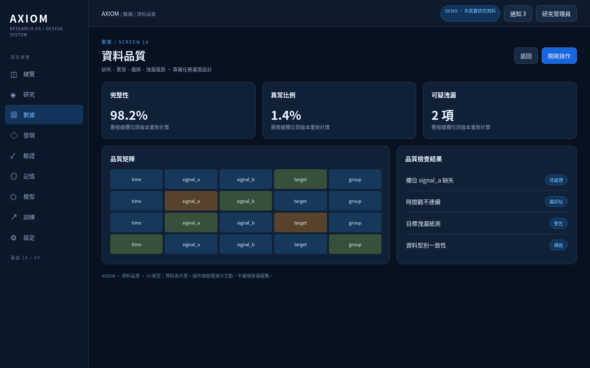
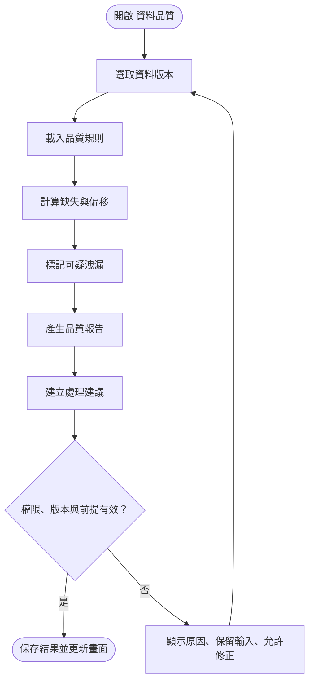
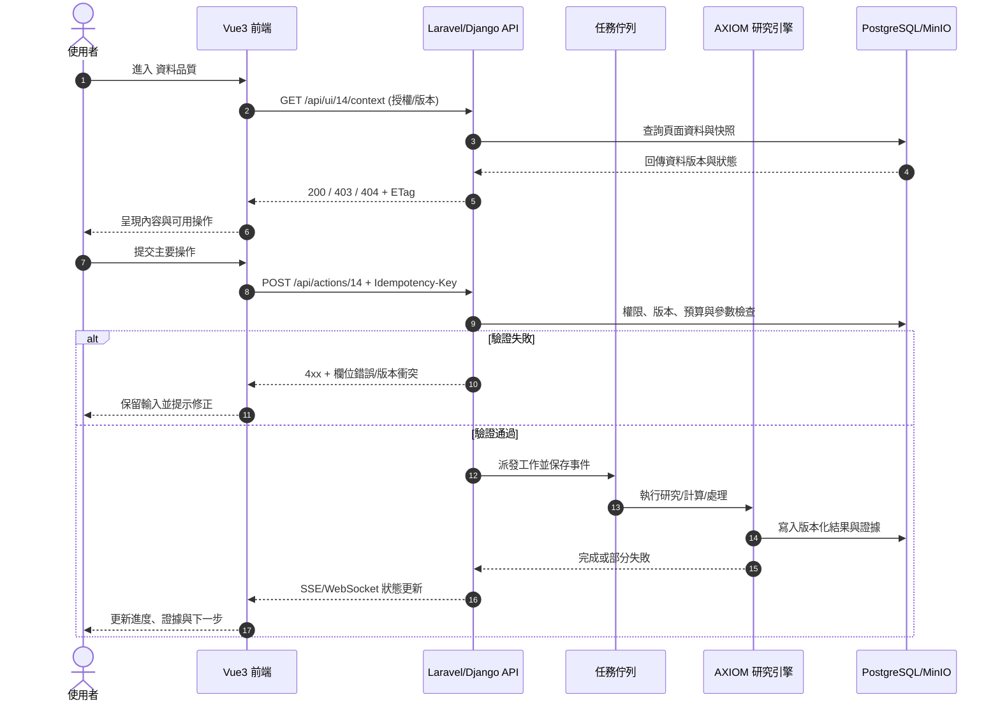

# AXIOM 14｜資料品質

> 模組：數據｜UI 類型：quality｜交付物：`images/14_資料品質.png`、`html/14_資料品質.html`｜設計版本：v3.0

## 1. 使用目的與邊界

缺失、異常、偏移、洩漏風險。此畫面必須讓使用者在不混淆「候選假設」「已驗證證據」「數學證明」「實證支持」的前提下完成任務。畫面示意資料不可被解讀為真實研究結論。

**入口**：左側「數據」主選單；其他研究頁可透過研究 ID、資料版本或證據 ID 深連結進入。**出口**：返回上層、開啟關聯研究、匯出當前視圖。**角色**：檢視者只讀；研究者可提交研究操作；管理員可管理系統層級設定。

## 2. 獨立 UI 畫面與資訊架構

本頁採用 **quality 專屬版型**，不是通用 KPI 模板。主要資訊區聚焦於「缺失、異常、偏移、洩漏風險」。頂部提供頁面脈絡、權限識別與主要動作；主內容依任務顯示圖形、編輯表單、證據清單或版本比較。操作結果不得直接覆蓋既有研究事實。

### 2.1 元件清單與互動契約

| 元件 | 顯示與操作 | 驗證規則 | 錯誤與回饋 |
|---|---|---|---|
| 頁首與麵包屑 | 顯示模組、頁面、研究/資料 ID | 深連結 ID 必須存在且有權限 | 無權限 403；已刪除 404 |
| 主工作區 | 顯示與本頁任務直接相關的資料 | 綁定不可變資料版本與時間戳 | 空狀態、骨架載入、部分資料提示 |
| 篩選與輸入 | 使用者指定查詢、條件、參數 | 型別、上下界、語意、必要欄位 | 欄位旁即時提示，保留已填內容 |
| 主要操作按鈕 | 觸發本頁的核心工作 | RBAC、研究狀態、資源與前提 | 禁用原因、確認對話框、可取消狀態 |
| 結果與證據區 | 顯示輸出、來源、版本、適用條件 | 不得混用實證分數與證明狀態 | 結果不完整需顯式標記 |
| 版本與歷程 | 查看執行快照、審計事件、關聯資料 | 版本衝突採樂觀鎖定 | 提示刷新、建立新分支，不覆寫 |

### 2.2 頁面狀態

`initial → loading → ready → editing → validating → queued → running → partial_success / success / failed / cancelled`。對於只讀頁，略過編輯與任務狀態。刷新時從伺服器重新取得權威狀態，不依賴瀏覽器記憶。長任務使用 SSE/WebSocket 更新並以輪詢補償斷線。

## 3. 操作步驟（含必要分支）

1. **選取資料版本**：完成後紀錄操作者、研究/資料版本、執行時間、關聯 ID 與輸出狀態。
2. **載入品質規則**：完成後紀錄操作者、研究/資料版本、執行時間、關聯 ID 與輸出狀態。
3. **計算缺失與偏移**：完成後紀錄操作者、研究/資料版本、執行時間、關聯 ID 與輸出狀態。
4. **標記可疑洩漏**：完成後紀錄操作者、研究/資料版本、執行時間、關聯 ID 與輸出狀態。
5. **產生品質報告**：完成後紀錄操作者、研究/資料版本、執行時間、關聯 ID 與輸出狀態。
6. **建立處理建議**：完成後紀錄操作者、研究/資料版本、執行時間、關聯 ID 與輸出狀態。

### 3.1 使用者操作流程圖

## 4. 系統時序圖

> 端點為設計契約示例，不宣稱既有後端已實作。寫入需採 Idempotency-Key，非同步事件需攜帶 task_id、version、timestamp、status、correlation_id。

## 5. 異常、邊界與恢復

- **無資料：顯示空狀態與建立入口**。需提供可理解的提示、操作紀錄及下一步。
- **API 逾時：保留輸入，提供重試與狀態查詢**。需提供可理解的提示、操作紀錄及下一步。
- **權限不足：禁止寫入並說明授權範圍**。需提供可理解的提示、操作紀錄及下一步。
- **版本衝突：提示刷新，不默默覆寫**。需提供可理解的提示、操作紀錄及下一步。
- **任務部分失敗：保留成功部分與錯誤診斷**。需提供可理解的提示、操作紀錄及下一步。

- **網路中斷**：顯示最後同步時間；避免重複提交；恢復連線後核對服務端任務狀態。
- **資料安全**：禁止在錯誤訊息與日誌洩露 Token、金鑰、個資或未授權研究資料。
- **研究正確性**：所有候選結果須標明證據類型、前提、適用範圍、反例與尚未完成的驗證。

## 6. 前端實作與無障礙

- Vue 3 + TypeScript + Pinia；以 route-level code splitting 拆分頁面；圖表/研究 DAG 採可替換的專屬元件。
- 表格支援鍵盤操作、排序、搜尋與資料量較大時的虛擬捲動；圖表須有文字替代資訊與下載資料。
- 操作結果使用非阻斷提示；高風險操作使用確認對話框與影響預覽；所有表單具備明確 label、錯誤訊息與焦點管理。
- 桌面以 1440px 為設計基準；窄螢幕改為單欄與可收合導覽，禁止截斷重要數學式與證據狀態。

## 7. 測試與驗收案例

| 編號 | 驗收條件 | 預期結果 |
|---|---|---|
| AC-14-01 | 有權限使用者進入頁面 | 正確呈現 資料品質 專屬主工作區 |
| AC-14-02 | 查詢無資料 | 顯示可操作空狀態而非空白畫面 |
| AC-14-03 | 提交不合法參數 | 不發出工作，指出欄位原因並保留輸入 |
| AC-14-04 | 連續雙擊提交 | 僅建立一筆任務或事件 |
| AC-14-05 | 執行中重新整理或斷線 | 可恢復服務端狀態與結果 |
| AC-14-06 | 資料或研究版本衝突 | 阻止覆寫並提示新版本 |
| AC-14-07 | 權限不足 | 無法讀取未授權資料或執行寫入 |
| AC-14-08 | 研究結果不完整 | 清楚標記未證明、未驗證與證據限制 |

## 8. 此頁專屬設計評審

- 核心任務：**缺失、異常、偏移、洩漏風險**。
- 必須檢查：主要工作區是否真正服務本頁核心任務，而不是僅替換通用卡片內容。
- 跨頁一致性：研究 ID、資料版本、候選公式 ID、證據 ID、任務 ID 與模型版本必須可交叉追溯。
- 此交付是可檢視的前端原型與開發規格，**尚未接上正式 API、數學研究引擎與權限系統**。
