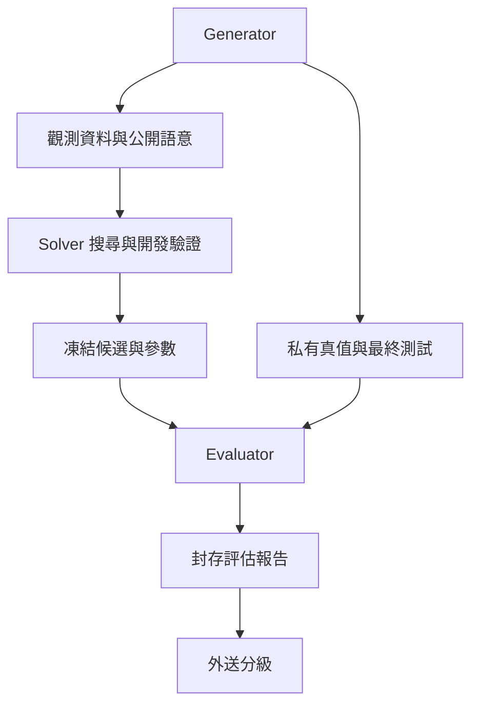

# 05｜基準測試與持續學習流程

> AXIOM v2.9 設計規格｜文件 ID AX-05｜狀態：待實作、待驗收｜2026-10-20

## 文件定位與決策摘要

Generator 產生觀測與真值，Solver 只讀公開觀測與訓練／開發 split，Evaluator 讀封存真值與最終盲測。三者用不同服務帳號、bucket/prefix 與憑證，Solver 不持有 evaluator 憑證，不能透過日誌、報告或檢索取得真值。

## 三種身分與資料流

Generator 可產生觀測與真值；Solver 只可讀公開觀測與訓練／開發 split；Evaluator 可讀封存真值與最終盲測。三者使用不同服務帳號、bucket/prefix 與憑證；Solver 不持有 evaluator 憑證，不能透過日誌、報告或檢索取得真值。

## 搜尋內驗證與最終盲測

fit 用來擬合參數，development 用於模型結構、超參數、早停及片段選擇；final_test 只供凍結後一次最終評估。任何被搜尋反覆查詢的 split 都不得稱獨立最終盲測。

切分在前處理前完成；補值、標準化、特徵選擇、變點定位等有學習參數的轉換只能 fit 在訓練 fold。時間序列用前推／blocked folds，資料洩漏檢查包含滯後與重疊窗口。AX-28 固定切分及評分協定。

FrozenCandidate 明確固定唯一FitRun、全部參數binding、候選DSL hash、development rank與資料／觀測切分；FrozenSubmission再固定候選排序、sealed_test_id與metric_version，snapshot計算依AX-47；Evaluator 以 FrozenSubmission.snapshot_hash 與 SealedTest ledger 保證一個封存測試版本只接受一個候選提交包。內含所有 Top-k 候選，不能看結果後換排名。因 evaluator 崩潰而重送必須同 key／同內容，回傳同一評估；任何更改視為測試已消耗，需新未曝光測試版本。

## 評估資料不得直接回訓

final_test 的公式、參數、觀測、種子、逐題分數與失敗反例不進檢索／訓練；只有隔離評估身分可見詳細報告。開發者若已查看最終題目，該測試版本退役，後續不再報作未知測試。可輸出聚合報告，但反覆比較同一封存集合也會形成適應性選擇；新版本正式判定必須使用未消耗集合。

開發集經驗可納入記憶，仍保留 source_split 與 generator family。封存題轉成訓練資料前須正式退役且另建 blind set；無授權資料永不因退役自動取得訓練權。訓練模型的來源資料快照可追溯，刪除與隔離見 AX-26。

## 章節驗收案例

以下為預定測試，狀態皆 NOT_RUN；實際證據依 AX-46 登錄。

| ID | 輸入／操作 | 預期 |
|---|---|---|
| AC-05-01 | Solver 請求真值 bucket、報告 API 或向量索引 | 一律拒絕，審計保留且不洩漏物件是否存在 |
| AC-05-02 | 開發驗證後改候選再讀 final_test | 凍結前不可讀；評估後更改需新測試版本 |
| AC-05-03 | 匯出訓練資料含 final_test lineage | DATASET_CONTAMINATION 阻擋整批匯出 |
| AC-05-04 | Evaluator crash，重送相同 snapshot | 只生成一份同 evaluation_id 報告，不重複計分 |

封存測試身分 sealed_test_id 由 Evaluator 依來源內容sha、不可變case/family身分、固定final row IDs與protocol hash登記，獨立於ResearchVersion及可重建的Dataset容器ID，客戶端不可藉換 ResearchVersion 重新取得同一集合的未消耗狀態。多個研究版本引用同一 sealed_test_id 共用消耗 ledger；正常操作重試只允許同 snapshot_hash。對已由使用者提供的已知資料，隔離只保證 Solver 不讀 final，不宣稱使用者本身未知真值。

BenchmarkPartition是跨題家族／來源隔離，ObservationSplit是單題觀測分區；不能用前者取代後者。私有真值、seed manifest與完整partition管理資訊僅評估管理身分可讀，Solver只拿該題允許的觀測投影。新Dataset容器若引用相同內容／case與封存列，仍命中既有SealedTest，不重新取得未消耗資格。

## 封存評估交易與故障恢復

SealedTest 狀態採保守且不可逆的消耗政策：

| 起始 | 觸發／交易 | 目標及恢復 |
|---|---|---|
| AVAILABLE | 引用、hash及租戶／分類檢查通過，綁定唯一submission_id | RESERVED；同交易持久化FrozenSubmission及評估工作/outbox |
| RESERVED | Evaluator首次取得final labels讀取資格之前 | CONSUMED；先提交消耗交易，再開放受限資料讀取 |
| RESERVED | 尚未讀取但取消或永久失敗 | RETIRED；保守退役，不回AVAILABLE |
| CONSUMED | 評估成功 | 維持CONSUMED；結果Artifact、ValidationRun、submission=EVALUATED與outbox同一權威提交 |
| CONSUMED | 崩潰、取消或永久失敗 | 維持CONSUMED；不得為其他提交重新開放 |
| AVAILABLE／CONSUMED | 維運正式退役 | RETIRED；保留ledger及全部既有結果，不刪消耗歷史 |

RESERVED 無自動到期解鎖。同一 submission_id／snapshot_hash 重送：已有結果即回同一組不可變結果引用；仍執行中回 REQUEST_IN_PROGRESS；租約過期由可信回收器在相同評估 run 建新 attempt、使用相同 manifest／輸入／seed／環境與固定結果槽位。CONSUMED 表示不能換候選，不禁止同一提交的技術恢復；重試不能暴露中間final分數給搜尋。先消耗後讀取的崩潰也保持CONSUMED，無法證明未曝光時不回收盲測資格。RETIRED 不再讀final或重新執行，但授權者仍可讀已有結果。

根取消或已永久FAILED的 run 不復活；若沒有完成結果，該封存評估終止，重做需新未曝光測試。與取消競爭的完成、lease fencing及結果唯一提交依AX-38。多個Top-k子評估共用同一封存包：第一筆讀取前消耗整包；結果以(submission_id,frozen_candidate_id,metric_version)唯一，包全部必要結果齊備才EVALUATED。未完成結果不得用來改Top-k。

封存身分包含protocol以重現評估，但曝光資格另按觀測內容／可信來源token的重疊追蹤（詳見下節），不以整檔SHA或final列號清單作唯一依據；僅改protocol、metric或Dataset容器不能重置已曝光資料。新protocol若重用已曝光final只能標非盲測分析，不計正式一次盲測。

| ID | 情境 | 預期 |
|---|---|---|
| AC-05-05 | 預留後崩潰、消耗後但讀取前崩潰 | 同提交可技術恢復；不同提交拒絕；不回AVAILABLE |
| AC-05-06 | 部分Top-k結果已寫入後重試 | 已有結果原樣回傳，缺項補齊，無重複結果／新排名 |
| AC-05-07 | RESERVED取消或CONSUMED永久失敗 | 前者RETIRED、後者維持CONSUMED；舊根不復活 |
| AC-05-08 | 換protocol但使用相同已曝光final | 不重置盲測資格，不計正式blind得分 |

## 觀測級曝光資格與內容保密

source_content_sha256只用於整檔可重現性，不再作曝光資格的唯一依據。每個SealedTest保存私有final_observation_tokens、final_lineage_tokens與exposure_fingerprint_version=1.0，對應AX-43觀測ledger；任何一筆與其他已預留／已消耗／退役提交重疊都阻擋正式blind資格。重排、子集、換case／protocol或只改fit/development資料不能洗掉曝光；同submission的技術恢復仍依原slot及snapshot，不允許修改提交內容。

CONTENT token由Evaluator以租戶範圍穩定密鑰HMAC-SHA256計算canonical觀測payload，內容含固定欄位意義與順序的inputs、target、SI量綱及必要time/group；有限數值正規化為精確約分有理數字串，時間為UTC，缺失與型別顯式標記。排除檔案SHA、Dataset ID、來源列號、排列、split與protocol。LINEAGE token另對可信來源namespace＋不可變原始observation ID計算HMAC，不含可改的數值，避免更正／四捨五入原觀測後重新視為未知。兩種token都查，集合內重複token去重但不改原評分列；token不是可公開的真值hash。

正式基準必須有可信Generator來源ID；一般自有資料缺可信lineage時只能做Solver隔離驗證，不宣稱對使用者未知的正式blind。來源合併／格式轉換保留原ID關係，不能自行新造來源namespace洗去lineage。指紋規則或密鑰輪替需保留舊token或建立別名並聯查所有保留版本，不能重置ledger。退役與刪除依敏感政策保留不可逆資格tombstone；不保留原始labels作資格查詢。

完整final報告只對AX-26隔離評估身分／Evaluator開放；一般工作台只顯示符合分級的聚合產物。任何授權不足均不能從Artifact、ValidationRun、EvidenceBundle、事件或錯誤取得詳細final資訊。

| ID | 情境 | 預期 |
|---|---|---|
| AC-05-09 | 只改訓練列或改final原始列號／包裝格式 | final內容／lineage token仍重疊，不重新取得資格 |
| AC-05-10 | 將已曝光final子集與新觀測混成新集合 | 任一token重疊即阻擋正式blind，不只查整包相等 |
| AC-05-11 | 兩個不同submission同時預留重疊觀測 | ledger唯一鍵裁決，僅一方成功；無雙重讀取資格 |

## 表徵、重審與學習的污染界線

表徵參數、分支恢復策略、候選prior、機率校準及摘要／模型選擇都算學習，不能從final結果反覆調整。case/family／原始觀測依賴需貫穿representation、trace、experience、training manifest及model lineage，避免嵌入窗口或重包裝訓練集洗白。HRR盲化過往評價不產生新的未知final；策略評估及外送要分隔未曝光基準，no-memory對照採相同總成本並披露機會分配。

## T03 檔案隔離 canary

單一隔離 Linux 容器中，不同 UID 的公開投影可讀、封存 canary 拒絕／可讀與反例驗證見 [T03 技術文件](<../../技術文件/M0/T03-公開基準與盲測隔離基線.md>)。這是 POSIX 檔案權限的實測基線，不是產品不同服務帳號、bucket、API／DB／事件／日誌、曝光 ledger 或正式盲測的驗收；沒有真實答案或種子保存到版本庫。

## 共用規則

版本、錯誤、證據與審查規則見 [AX-48 共用契約與文件治理](<../00-總覽/48-共用契約與文件治理.md>)；本章的專屬限制及驗收條件仍須同時滿足。
