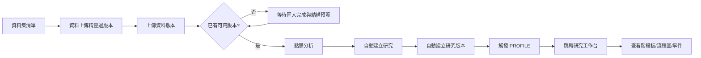
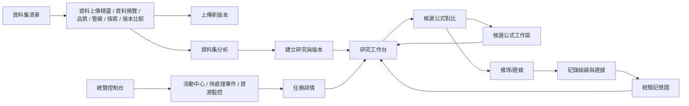

# 24｜畫面線框與互動流程

> AXIOM v2.9 設計規格｜文件 ID AX-24｜狀態：待實作、待驗收｜2026-10-20

## 文件定位與決策摘要

`/docs/AXIOM_UIUX_重製版` 為前台畫面、模組資訊架構、逐頁功能與流程的主規格來源（40 頁 SSOT）；現行容器前台必須以 Vue 真頁逐步落地這套規格，不再以 `frontend/public/uiux-remastered` 或 `/uiux/:screen` 承載正式執行畫面。AX-24 保留跨頁互動原則與已落地的資料驅動規則，不再單獨充當完整逐頁畫面來源。

前台外殼採「頂部主導覽＋左側工作空間＋右側內容區」；研究工作台主體維持資料/流程/證據三段式閱讀。數據模組拆為七頁真頁（SSOT SCREEN 11–17）：資料集清單負責建立與導覽並提供明確的 `分析` 入口，其上傳精靈、資料預覽、資料品質、前處理管線、多維探索與資料版本比較各自以 `id` 為路徑參數並共用頁籤導覽；`分析` 以最新可用資料版本自動建立研究、建立研究版本並觸發 PROFILE。研究頁則以研究階段板、流程圖、節點紀錄與事件流呈現進程。發現、驗證、記憶、模型、訓練與設定已各自落地為獨立 Vue 真頁，不再共用單一模組殼。選候選時同步更新公式、參數、驗證引用與證據檢視；對比模式最多四條候選並排。研究工作台、發現中心與驗證中心已形成 URL Query 驅動的跨頁閉環：`run`、`pins`、`submission`、`submissions`、`focuscandidates`、`focussubmissions`、`ref` 共同承接來源頁、版本、候選集合與提交集合。數據模組以 `version`、`q`、`node`、`dimension`、`base`、`target` 承接選定版本、欄位搜尋、選定快照、座標軸與比較對象。

## 章節專屬規格

### 研究工作台線框

```text
┌──────────────── AXIOM Workbench ──────────────────────┐
│ 頂部主導覽 / 搜尋 / 使用者 / 主要操作                 │
├──────────────┬───────────────────────────────────────┤
│ 左側工作區   │ 研究階段板 / 版本摘要 / 流程圖         │
│ 研究清單     │ 節點紀錄 / 候選比較 / 證據 / 事件流     │
│ 數據管理     │                                       │
├──────────────┴───────────────────────────────────────┤
│ SSE 續接、版本還原、任務詳情深連結、證據檢視          │
└───────────────────────────────────────────────────────┘
```

### 操作流程



### 數據模組七頁（資料集清單／資料上傳精靈／資料預覽／資料品質／前處理管線／多維探索／資料版本比較）

```text
┌──────────────── AXIOM Dataset Catalog ───────────────────┐
│ 模組：數據 / SCREEN 11 ｜ 頂部主導覽 / 頁籤導覽 / 重新載入  │
├─────────────────────────────────────────────────────────┤
│ 資料集 / 版本 / 總列數 / 可分析資料集 統計                 │
├─────────────────────────────────────────────────────────┤
│ 資料來源型別 / 存取權限與角色 / 資料集品質評分：未取得      │
├─────────────────────────────────────────────────────────┤
│ 篩選：名稱／關鍵字（按「搜尋」套用，寫入 `q`）             │
│ 建立資料集：名稱 + 建立                                        │
├─────────────────────────────────────────────────────────┤
│ 資料集清單：名稱／編號 / 版本（`+` 表截斷、不可用 N）/ 格式 │
│ / 總列數 / 最新可分析版本 / 操作（上傳精靈、資料預覽、分析） │
└─────────────────────────────────────────────────────────┘

┌──────────────── AXIOM Upload Wizard ─────────────────────┐
│ 模組：數據 / SCREEN 12 ｜ 頁籤導覽 / 返回資料集清單 / 重新載入│
├─────────────────────────────────────────────────────────┤
│ 精靈程序（四道，逐項判定）：1 匯入與不可變登記 /            │
│ 2 欄位映射 / 3 完整性檢核 / 4 不可變快照                   │
├──────────────────────────┬──────────────────────────────┤
│ 上傳資料檔（CSV／JSON／   │ 版本與不可變快照：建立時間 /   │
│ PARQUET，上限 50 MiB）    │ 格式 / 列數 / 狀態 / 檢視程序  │
│ 傳輸階段以 aria-live 提示 │ 匯入任務：狀態 / 開啟任務詳情   │
├──────────────────────────┴──────────────────────────────┤
│ 未取得：研究目標與問題定義 / AUTO／DEEP 與預算設定 /        │
│ 外部傳輸與權限審核                                        │
└─────────────────────────────────────────────────────────┘

┌──────────────── AXIOM Dataset Preview ───────────────────┐
│ 模組：數據 / SCREEN 13 ｜ 頁籤導覽 / 重新載入              │
├─────────────────────────────────────────────────────────┤
│ 宣告列數 / 結構預覽列數 / 欄位數 / 資料字典條目 統計        │
├──────────────────────────┬──────────────────────────────┤
│ 選定資料版本（`version`） │ 未取得：取樣列 / 量測單位與    │
│ 欄位搜尋 + 🔍 搜尋（`q`）  │ 語意定義 / 欄位值域與分布摘要  │
│ 欄位表：欄位 / 實體型別 /  │                              │
│ 標記（名稱重複、型別未提供）│                              │
└──────────────────────────┴──────────────────────────────┘

┌──────────────── AXIOM Data Quality ──────────────────────┐
│ 模組：數據 / SCREEN 14 ｜ 頁籤導覽 / 重新載入              │
├─────────────────────────────────────────────────────────┤
│ 通過 / 未通過 / 未取得 / 統計類品質面向 統計               │
├──────────────────────────┬──────────────────────────────┤
│ 可判定檢核（依版本與結構  │ 品質面向：缺失 / 異常值 /     │
│ 預覽逐項列出 PASS／FAIL／ │ 分布偏移 / 洩漏風險            │
│ UNKNOWN）                 │ （一律「未取得」，不以推測補值）│
└──────────────────────────┴──────────────────────────────┘

┌──────────────── AXIOM Pipeline ──────────────────────────┐
│ 模組：數據 / SCREEN 15 ｜ 頁籤導覽 / 重新載入              │
├──────────────────────────┬──────────────────────────────┤
│ 快照節點鏈（時間序，可選定│ 程序階段：選取資料版本 /       │
│ `node`）：格式 · 列數 /   │ 轉換節點 DAG / 參數與適用欄位 /│
│ 建立時間 · 指紋            │ 前後差異預覽 / 執行與品質檢查 /│
│ 選定快照：格式、狀態、結構 │ 發布新資料版本                 │
│ 預覽；連結預覽與版本比較   │                               │
└──────────────────────────┴──────────────────────────────┘

┌──────────────── AXIOM Explore ───────────────────────────┐
│ 模組：數據 / SCREEN 16 ｜ 頁籤導覽 / 重新載入              │
├─────────────────────────────────────────────────────────┤
│ 候選座標軸 / 數值軸 / 選定軸（`dimension`）/ 投影種類 統計  │
├──────────────────────────┬──────────────────────────────┤
│ 選定資料版本（`version`） │ 投影與圖形：時間序列 / 相空間 /│
│ 座標軸表：名稱 / 實體型別 /│ 頻域 / 高維投影                │
│ 判定（數值／文字／未取得） │ （四類皆需後端產物，標示「未取得」）│
└──────────────────────────┴──────────────────────────────┘

┌──────────────── AXIOM Version Diff ──────────────────────┐
│ 模組：數據 / SCREEN 17 ｜ 頁籤導覽 / 重新載入              │
├─────────────────────────────────────────────────────────┤
│ 比較對象：基準版本（`base`） / 對照版本（`target`）        │
├──────────────────────────┬──────────────────────────────┤
│ 版本差異（變更項目 N / M）：│ 血緣與回復：版本時間序清單     │
│ 列數 / 格式 / 狀態 / 指紋 /│ 未取得：父版本與派生關係 /     │
│ 新增欄位 / 移除欄位 / 時間 │ 回復流程與還原點 / 下游影響範圍 │
├──────────────────────────┴──────────────────────────────┤
│ 列數差異（對照 − 基準）                                    │
└─────────────────────────────────────────────────────────┘
```

七頁共用頁籤導覽；資料集清單不需資料集識別碼，其餘六頁以 `id` 為必要路徑參數，未選定資料集時頁籤僅顯示說明而不可點。四道精靈程序與可判定檢核只依後端已揭露欄位計算：版本狀態、SHA-256 指紋、列數、結構預覽內容與匯入任務狀態。缺少結構預覽或無法解析時一律標示「未取得」，不以推測補值；欄位差異需兩邊結構預覽皆可解析才呈現。權限與角色、品質評分、來源型別、取樣列、統計類品質面向、轉換節點 DAG 與參數、投影座標、父版本血緣與回復流程後端皆未揭露，一律標示「未取得」，其中血緣只取已讀取版本的時間序，不推測父子關係。

### 效能體驗

首屏顯示工作台骨架、研究階段板與任務摘要；長任務使用 SSE 推送增量事件並保留游標續接；重新整理後依 URL `?version=` 還原研究版本；圖表只重繪變動圖層；候選與證據檢視延後載入。

### 跨頁分支接力

1. 研究工作台可將目前可見的候選集合送往發現中心，或將提交集合送往驗證中心。
2. 發現中心保留 `run` 與 `pins`，提供「目前比較集」與「整個 SEARCH 分支」兩種回工作台入口。
3. 驗證中心保留 `submission` 與 `submissions`，並先按 `research_version_id` 分組，再把同版本 submission 子集送回工作台，避免跨版本聚焦失真。
4. 三頁都必須保留 `ref` 來源頁，讓使用者可返回前一個工作區而不遺失操作脈絡。
5. 工作台右側詳情區必須能接住集合焦點：當 `focuscandidates` 或 `focussubmissions` 存在時，右側顯示集合導覽面板，可在同一頁逐筆切換成員並同步更新節點詳情。
6. 集合導覽面板之下必須提供集合彙總：整組成員的產物與事件分群呈現，標示跨成員共用的產物標籤與事件類型，成員分布可直接點選切換聚焦成員。

## 關鍵技術決策與邊界條件

1. 資料集頁需提供明確的 `分析` 動作，且僅在存在「可用且具結構預覽」的資料版本時啟用；不得要求使用者先跳到研究頁手動建立多個中介物件。

2. 研究工作台不得用假百分比表示完成度；應以研究階段板、流程圖節點、事件流與實際 run/status 呈現進度。

3. 選擇公式片段時可在公式 AST 樹與圖形中的對應成分之間雙向高亮。

4. 候選對比視圖至少提供公式、參數、RMSE、複雜度、穩定性、適用域、反例與成本。

5. 推導工作台逐步顯示前提、變換規則、數學結果與 proof status，不將 AI 說明視為證明。

## 架構／流程圖



### 候選公式工作區

```text
┌──────────────── AXIOM Candidate Workspace ───────────────┐
│ 頂部主導覽 / 返回來源頁 / 重新載入                        │
├──────────────────────────┬──────────────────────────────┤
│ 識別：名次 / 來源 / 狀態  │ 公式：AST 渲染 / 定義域 / 變數│
│ 公式版本 / 身分雜湊       │                              │
│ 所屬 SEARCH 任務          │                              │
├──────────────────────────┼──────────────────────────────┤
│ 參數（單位 / 上下界 /     │ 擬合執行（優化器 / 切分角色 / │
│ 擬合值）                  │ 精度位元 / 表徵產物）         │
├──────────────────────────┴──────────────────────────────┤
│ 驗證執行：判定 / 等級 / MAE・RMSE / 覆蓋率 / 拒答理由      │
├─────────────────────────────────────────────────────────┤
│ 同任務候選：名次 / 來源 / 狀態 / 複雜度 / 有效位數         │
└─────────────────────────────────────────────────────────┘
```

後端未提供單筆候選讀取，因此候選公式工作區以 SEARCH 任務的候選分頁為來源，並以 `?run=` 帶入來源任務；任務詳情與發現中心皆提供進入點。公式、參數、擬合與驗證結果只呈現契約已揭露欄位，未取得時標示「未取得」或「載入中」，不以推測補值。

### 總覽控制台三頁

```text
┌──────────────── AXIOM Activity Center ───────────────────┐
│ 頂部主導覽 / 返回總覽 / 重新載入                          │
├─────────────────────────────────────────────────────────┤
│ 已讀取任務 / 進行中任務 / 服務狀態                        │
├──────────────────────────┬──────────────────────────────┤
│ 活動時間軸（來源 / 狀態） │ 事件分析（依型別 / 依狀態）    │
│ 逐列可開啟任務詳情        │ 長條 + 文字替代資料表          │
├──────────────────────────┴──────────────────────────────┤
│ 讀取邊界：僅涵蓋已讀取的研究容器與資料集                   │
└─────────────────────────────────────────────────────────┘

┌──────────────── AXIOM Pending Inbox ─────────────────────┐
│ 頂部主導覽 / 返回總覽 / 活動中心 / 重新載入               │
├─────────────────────────────────────────────────────────┤
│ 待處理總數 / 高優先 / 中・低優先                          │
├─────────────────────────────────────────────────────────┤
│ 優先級篩選（全部 / 高 / 中 / 低）                         │
├─────────────────────────────────────────────────────────┤
│ 待處理佇列：優先級 / 事件 / 來源 / 狀態 / 判讀依據 / 下一步 │
├─────────────────────────────────────────────────────────┤
│ 決策邊界：批准／駁回／要求補充證據需稽核 API，尚未提供    │
└─────────────────────────────────────────────────────────┘

┌──────────────── AXIOM Resource Monitor ──────────────────┐
│ 頂部主導覽 / 返回總覽 / 活動中心 / 重新載入               │
├─────────────────────────────────────────────────────────┤
│ CPU 即時 / GPU 即時 / RAM 即時（後端未提供，標示未取得）   │
├──────────────────────────┬──────────────────────────────┤
│ 用量彙總（已揭露欄位）    │ 儲存與容量（資料集版本列數）   │
├──────────────────────────┴──────────────────────────────┤
│ 任務用量明細：CPU / GPU / Token / 牆鐘 / 峰值記憶體        │
├─────────────────────────────────────────────────────────┤
│ 研究版本預算帳本：用量與上限，超限以警示色標示            │
└─────────────────────────────────────────────────────────┘
```

三頁共用同一份快照，來源為「研究 → 版本 → 任務」與「資料集 → 版本／匯入任務」的逐層讀取結果。後端沒有全域任務端點與即時硬體觀測端點，因此活動統計只涵蓋已讀取頁面、即時使用率固定標示「未取得」；待處理佇列只由後端狀態與停止理由推導，不代替使用者決策。

### 研究清單與新建研究

```text
┌──────────────── AXIOM Research Catalog ───────────────────┐
│ 頂部主導覽 / 重新載入 / 新建研究                          │
├─────────────────────────────────────────────────────────┤
│ 搜尋名稱／ID ｜ 最新版本狀態 ｜ 排序                      │
│ 清空篩選 / 匯出目前視圖                                   │
│ 顯示 N / M 筆；任務統計只涵蓋本頁已讀取的版本             │
├─────────────────────────────────────────────────────────┤
│ 批次工作區（已選 N 筆）                                   │
│ 已讀取版本數 / 已讀取任務數 / 進行中任務 / 失敗任務        │
│ 匯出已選 / 前往待處理事件 / 清除選取                      │
├─────────────────────────────────────────────────────────┤
│ 研究清單：勾選 / 研究 / 最新版本 / 版本數 / 任務（範圍）/   │
│ 最近任務時間 / 進入工作台                                 │
├─────────────────────────────────────────────────────────┤
│ 邊界：後端沒有批次刪除或批次派送端點                       │
└─────────────────────────────────────────────────────────┘

┌──────────────── AXIOM New Research Wizard ───────────────┐
│ 返回研究清單 / 重新開始                                   │
├─────────────────────────────────────────────────────────┤
│ 步驟 1 研究目標 → 步驟 2 資料來源與語意 → 步驟 3 排入佇列  │
├─────────────────────────────────────────────────────────┤
│ 步驟 1：研究名稱 / 研究目的（附中文說明）                 │
│ 步驟 2：ResearchVersionForm（資料集版本、欄位映射、值域、 │
│         切分、研究帳本限額）                              │
│ 步驟 3：版本 ID / 狀態與 revision / 固定切分 / 預算上限 /  │
│         評估政策雜湊；排入 PROFILE 佇列 / 前往工作台       │
├─────────────────────────────────────────────────────────┤
│ 邊界：自治理策略（AUTO／DEEP）與外部傳輸審核無後端欄位     │
└─────────────────────────────────────────────────────────┘
```

研究清單與新建研究共用研究線查詢狀態與 `ref` 回跳；清單的任務統計以版本 ID 明示讀取範圍，未讀取的版本不列入、也不以 0 筆代替。新建研究精靈只送後端已定義的欄位，PROFILE 排入失敗（例如後端未啟用而回 503）時保留已建立的研究與版本，並顯示後端回覆供稍後重試。

### 發現模組四頁（候選公式庫／公式比較／隱藏變數探索／研究推演）

```text
┌──────────────── AXIOM Discovery Catalog ─────────────────┐
│ 模組：發現 / SCREEN 18 ｜ 頂部主導覽 / 頁籤導覽 / 重新載入 │
├─────────────────────────────────────────────────────────┤
│ 已讀取候選 / 進行中驗證 / 已驗證 / 未取得 統計             │
├──────────────────────────┬──────────────────────────────┤
│ 篩選：名稱或 ID ｜ 狀態   │ 排序：名次 / 複雜度 / 狀態     │
├──────────────────────────┴──────────────────────────────┤
│ 候選清單：勾選並排 / 名次 / 候選 ID / 來源 SEARCH 任務 /   │
│ 公式 / 複雜度 / 變數數 / 驗證狀態 / 進入候選工作區         │
├─────────────────────────────────────────────────────────┤
│ 匯出目前視圖（CSV）；後端沒有全域候選端點，範圍明示        │
└─────────────────────────────────────────────────────────┘

┌──────────────── AXIOM Formula Compare ───────────────────┐
│ 模組：發現 / SCREEN 19 ｜ 頁籤導覽 / 重新載入              │
├──────────────────────────┬──────────────────────────────┤
│ SEARCH 任務選擇           │ 公平比較前提：切分與評估政策   │
│ （來源研究版本 ）          │ （14 欄；未取得標示未取得）    │
├──────────────────────────┴──────────────────────────────┤
│ 並排比較（最多 4 條）：公式 / 參數 / 複雜度 / 變數 / 定義域 │
├─────────────────────────────────────────────────────────┤
│ 誤差與泛化指標對照：final_test 凍結前不揭露、泛化判定未取得 │
├─────────────────────────────────────────────────────────┤
│ 匯出比較集 CSV                                             │
└─────────────────────────────────────────────────────────┘

┌──────────────── AXIOM Latent Exploration ─────────────────┐
│ 模組：發現 / SCREEN 20 ｜ 頁籤導覽 / 重新載入              │
├─────────────────────────────────────────────────────────┤
│ 已識別版本 / 結構產物可讀 / 未取得產物 / 契約不符 統計     │
├─────────────────────────────────────────────────────────┤
│ 讀取範圍：涵蓋哪些研究與版本，未讀取頁面如何標示           │
├──────────────────────────┬──────────────────────────────┤
│ 研究版本與結構評估（逐列） │ 選定版本結構評估：            │
│ 已識別 / 僅中介資料 /      │ 內在維度 / 結構候選 / 時間基準 │
│ 未取得 / 解析失敗          │ 週期性 / 分析範圍 / 存取等級   │
│                          │ fit 雜湊 / 來源列數與欄位      │
├──────────────────────────┴──────────────────────────────┤
│ 免責：後端未揭露的內在維度一律「未取得」，不以推測或 0 補值 │
└─────────────────────────────────────────────────────────┘

┌──────────────── AXIOM Derivation Graph ──────────────────┐
│ 模組：發現 / SCREEN 21 ｜ 頁籤導覽 / 重新載入              │
├─────────────────────────────────────────────────────────┤
│ 研究選擇 ｜ 版本選擇                                       │
├─────────────────────────────────────────────────────────┤
│ 流程圖（節點 / 邊 / 狀態色調；可點選節點）                 │
├─────────────────────────────────────────────────────────┤
│ 節點種類分布 chips ｜ 分支來源（多後續節點）               │
├──────────────────────────┬──────────────────────────────┤
│ 節點紀錄（契約欄位）       │ 依賴前提 / 後續推演（上下游行進）│
│ 關聯產物                   │ 事件紀錄                       │
├──────────────────────────┴──────────────────────────────┤
│ 連結：查看任務詳情 / 在研究室中開啟（`ref` 回跳）           │
└─────────────────────────────────────────────────────────┘
```

四頁共用頁籤導覽。候選公式庫與公式比較以 `candidate`、`run`、`pins`、`ref` 承接選定候選、來源 SEARCH 任務與並排比較集合；隱藏變數探索以 `version` 承接選定研究版本；研究推演以 `research`、`version`、`node` 承接研究、版本與選定節點。後端沒有全域候選端點，候選公式庫與公式比較的統計一律以實際讀取的頁面為範圍並在畫面明示；公式 AST 尚未載入時公式欄位標示「未取得」，不以推測補值。隱藏變數探索只呈現後端 `StructureAssessment` 已揭露欄位，`intrinsic_dimension_estimate` 為 null 時標示「未取得」而非 0，契約不符的產物標示「解析失敗（契約不符）」。研究推演的依賴前提與後續推演只以圖中實際存在的邊計算，節點不存在時不捏造推演。

### 驗證模組五頁（驗證中心／反例搜尋／逆向推導／形式化證明／證據關聯圖）

```text
┌──────────────── AXIOM Verification Center ───────────────┐
│ 模組：驗證 / SCREEN 22 ｜ 頂部主導覽 / 頁籤導覽 / 重新載入 │
├─────────────────────────────────────────────────────────┤
│ 已讀取評估 / 支持 / 模糊 / 證據不足 / 被否證 統計           │
├──────────────────────────┬──────────────────────────────┤
│ 多面向證據矩陣：          │ 選定評估：                    │
│ fit / development /       │ 結果狀態 / 經驗等級 / 證明等級 │
│ final_test（缺欄未取得）  │ 失敗數 / 有效數 / 選定數      │
│                          │ 指標理由                      │
├──────────────────────────┴──────────────────────────────┤
│ 證據與品質：證據包版本 / 品質報告 / 未取得標示             │
├─────────────────────────────────────────────────────────┤
│ 最終評估與接力：把提交集合送往工作台（`submissions`、`ref`）│
└─────────────────────────────────────────────────────────┘

┌──────────────── AXIOM Counterexample Search ─────────────┐
│ 模組：驗證 / SCREEN 23 ｜ 頁籤導覽 / 重新載入              │
├─────────────────────────────────────────────────────────┤
│ 失效案例 / 被否證 / 有失敗列 / 拒答 統計                   │
├─────────────────────────────────────────────────────────┤
│ 反例空間 / 邊界條件 / 反例預算：後端未揭露一律「未取得」    │
├──────────────────────────┬──────────────────────────────┤
│ 失效案例清單（僅列被否證 │ 選定案例：失效理由 / 失敗數 /   │
│ 且有失敗列者）            │ 有效數 / 選定數 / 來源       │
├──────────────────────────┴──────────────────────────────┤
│ 工作台連結以 `validation` 承接選定失效案例                 │
└─────────────────────────────────────────────────────────┘

┌──────────────── AXIOM Inverse Derivation ────────────────┐
│ 模組：驗證 / SCREEN 24 ｜ 頁籤導覽 / 重新載入              │
├─────────────────────────────────────────────────────────┤
│ SEARCH 任務 / 候選解 / 多解跡象 / 可讀擬合 統計            │
├─────────────────────────────────────────────────────────┤
│ 可識別性 / 逆問題求解器 / 觀測設定：未揭露一律「未取得」    │
├──────────────────────────┬──────────────────────────────┤
│ SEARCH 任務選擇           │ 候選解表 / 參數觀測表         │
│                          │ （多解跡象以 distinct > 1 判定）│
├──────────────────────────┴──────────────────────────────┤
│ 承接狀態：`run` 選定任務 / `candidate` 選定候選解          │
└─────────────────────────────────────────────────────────┘

┌──────────────── AXIOM Formal Proof ──────────────────────┐
│ 模組：驗證 / SCREEN 25 ｜ 頁籤導覽 / 重新載入              │
├─────────────────────────────────────────────────────────┤
│ 證明產物 / 可用 / 隔離 / 已刪除 統計                       │
├─────────────────────────────────────────────────────────┤
│ 命題 / 前提：後端未揭露一律「未取得」                       │
├──────────────────────────┬──────────────────────────────┤
│ 證明產物清單              │ 選定產物：狀態 / 存取等級 /   │
│                          │ 經驗等級 / 證明等級           │
├──────────────────────────┴──────────────────────────────┤
│ 承接狀態：`artifact` 選定證明產物                          │
└─────────────────────────────────────────────────────────┘

┌──────────────── AXIOM Evidence Graph ────────────────────┐
│ 模組：驗證 / SCREEN 26 ｜ 頁籤導覽 / 重新載入              │
├─────────────────────────────────────────────────────────┤
│ 證據包 / 共享依賴 / 獨立性 / 節點邊 統計                   │
├─────────────────────────────────────────────────────────┤
│ 節點種類分布 chips（研究/版本/提交/證據包/評估/證明產物）   │
├──────────────────────────┬──────────────────────────────┤
│ 節點清單 / 共享依賴       │ 選定節點：上下游行進         │
│ 獨立性評估                │ 引用關係邊表格               │
├──────────────────────────┴──────────────────────────────┤
│ 承接狀態：`node` 選定節點；不足兩個證據包不宣告獨立         │
└─────────────────────────────────────────────────────────┘
```

五頁共用頁籤導覽（驗證中心／反例搜尋／逆向推導／形式化證明／證據關聯圖）。驗證中心以 `submission`、`submissions`、`ref` 承接選定提交與集合焦點，多面向證據矩陣以 `splitRole`（`FIT`／`DEVELOPMENT`／`FINAL_TEST`）為欄，缺欄一律標示「未取得」；證據包或品質報告讀取失敗時保留空集合並標記不可讀，不以推測補值。反例搜尋只列 `FALSIFIED` 且有失敗數的失效案例（`validation` 承接選定案例）；反例空間、邊界條件與反例預算後端未揭露，一律「未取得」。逆向推導的參數恢復由 `distinct > 1` 判定多解跡象，可識別性／逆問題求解器／觀測設定一律「未取得」（`run`、`candidate` 承接）。形式化證明的命題與前提後端未揭露，一律「未取得」（`artifact` 承接選定證明產物）。證據關聯圖的獨立性需在至少兩個證據包且無共享依賴時才宣告，否則維持 Fail-Closed（`node` 承接選定節點）。

### 記憶模組五頁（知識庫／研究經驗／失敗案例／假設恢復／知識演化）

```text
┌──────────────── AXIOM Knowledge Base ────────────────────┐
│ 模組：記憶 / SCREEN 27 ｜ 頂部主導覽 / 頁籤導覽 / 重新載入 │
├─────────────────────────────────────────────────────────┤
│ 已驗證結論 / 有證據底 / 證據已隔離 / 品質未通過 統計        │
├─────────────────────────────────────────────────────────┤
│ 檢索主題標籤 / 語意檢索 / 跨研究連結：未揭露一律「未取得」  │
├──────────────────────────┬──────────────────────────────┤
│ 知識條目（研究/版本/證據 │ 選定條目：版本狀態 / 證據包 /  │
│ 包/證明產物/品質/結論）   │ 品質與就緒 / 結論分布四類     │
├──────────────────────────┴──────────────────────────────┤
│ 連結：在研究室中開啟（`version`、`node`、`ref` 回跳）       │
└─────────────────────────────────────────────────────────┘

┌──────────────── AXIOM Research Experience ───────────────┐
│ 模組：記憶 / SCREEN 28 ｜ 頁籤導覽 / 重新載入              │
├─────────────────────────────────────────────────────────┤
│ 成功 / 失敗 / 中止 / 進行中 統計                           │
├─────────────────────────────────────────────────────────┤
│ 策略名稱 / 經驗摘要 / 建議下一步：未揭露一律「未取得」      │
├──────────────────────────┬──────────────────────────────┤
│ 經驗時間軸（結果篩選：   │ 選定經驗：任務型別 / 狀態 /   │
│ 選擇後按「套用」）        │ 結果 / 停止理由 / 階段 / 條件 │
├──────────────────────────┴──────────────────────────────┤
│ 承接狀態：`run` 選定任務 / `verdict` 結果篩選               │
└─────────────────────────────────────────────────────────┘

┌──────────────── AXIOM Failure Cases ─────────────────────┐
│ 模組：記憶 / SCREEN 29 ｜ 頁籤導覽 / 重新載入              │
├─────────────────────────────────────────────────────────┤
│ 任務失敗 / 提交評估失敗 / 假設被否證 / 品質阻擋 / 證據隔離  │
├─────────────────────────────────────────────────────────┤
│ 根因分析 / 修復建議 / 影響範圍：未揭露一律「未取得」        │
├──────────────────────────┬──────────────────────────────┤
│ 失敗案例清單（類別篩選： │ 選定案例：理由 / 已揭露細節 / │
│ 選擇後按「套用」）        │ 修復建議（未取得）             │
├──────────────────────────┴──────────────────────────────┤
│ 承接狀態：`case` 選定案例 / `category` 類別篩選             │
└─────────────────────────────────────────────────────────┘

┌──────────────── AXIOM Hypothesis Recovery ───────────────┐
│ 模組：記憶 / SCREEN 30 ｜ 頁籤導覽 / 重新載入              │
├─────────────────────────────────────────────────────────┤
│ 待恢復版本 / 品質阻擋 / 證據隔離 / 可用搜尋任務 統計        │
├─────────────────────────────────────────────────────────┤
│ 恢復條件 / 恢復預算 / 候選佇列優先序：未揭露一律「未取得」  │
├──────────────────────────┬──────────────────────────────┤
│ 恢復清單（僅含實際失敗 │ 選定恢復項：阻擋類別 / 證據就緒 /│
│ 的版本）                 │ 重新評估狀態 / 既有 SEARCH 數 │
├──────────────────────────┴──────────────────────────────┤
│ 承接狀態：`version` 選定版本                               │
└─────────────────────────────────────────────────────────┘

┌──────────────── AXIOM Knowledge Evolution ───────────────┐
│ 模組：記憶 / SCREEN 31 ｜ 頁籤導覽 / 重新載入              │
├─────────────────────────────────────────────────────────┤
│ 版本數 / 修訂累計 / 隔離證據 / 撤回版本 統計               │
├─────────────────────────────────────────────────────────┤
│ 節點種類分布 chips（研究/版本/證據包/品質報告/凍結提交）    │
├──────────────────────────┬──────────────────────────────┤
│ 演化節點清單              │ 選定節點：關聯邊與上下游      │
├──────────────────────────┴──────────────────────────────┤
│ 演化時間軸（修訂/證據/品質/提交）＋ 引用關係邊表格          │
└─────────────────────────────────────────────────────────┘
```

五頁共用頁籤導覽（知識庫／研究經驗／失敗案例／假設恢復／知識演化）。後端沒有專屬知識庫、經驗庫或知識圖譜端點，因此五頁一律只由研究、研究版本、任務、證據包、品質報告、最終評估與驗證結果推導，統計範圍以實際讀取的頁面為限並在畫面明示。知識庫以 `version` 承接選定版本，已驗證結論以 validation run 的 `SUPPORTED` 計數推導；一份版本的證據包混合 `ACTIVE` 與 `QUARANTINED` 時有效狀態視為 `ACTIVE`，只有全部隔離才計為已隔離。研究經驗以任務狀態對應 `SUCCESS`／`FAILURE`／`ABORTED`／`ACTIVE`，執行條件以所屬版本的評估政策雜湊表示；結果篩選以 `verdict` 承接且需按「套用」才變更清單。失敗案例固定五類，修復建議與根因一律「未取得」；類別篩選以 `category` 承接並按「套用」生效。假設恢復只納入實際出現失敗的版本，恢復條件與優先序一律「未取得」，不以推測代替後端結論。知識演化的節點與邊只由實際引用關係建立，未讀到的節點不補造，版本差異與撤回流程一律「未取得」。

## 章節驗收案例

以下為預定測試，狀態皆 NOT_RUN；實際證據依 AX-46 登錄。

| ID | 固定情境／操作 | 預期判定 |
|---|---|---|
| AC-24-01 | 在資料集頁選到可用版本後按 `分析` | 自動建立研究、研究版本並跳轉到工作台 |
| AC-24-02 | 重新整理研究頁 | 保留研究與 `?version=` 指定版本的選取 |
| AC-24-03 | 新資料到來 | 新建版本，不暗中更新已開結果 |
| AC-24-04 | 事件重播或重連 | 不重複顯示既有事件，並保留缺口提示 |
| AC-24-05 | 按取消但 worker 尚未停止 | 顯示停止中，確認後才顯 CANCELLED |
| AC-24-06 | 從工作台把候選集合送往發現中心後返回 | 保留 `run/pins/ref`，可在工作台恢復同一組候選節點高亮與焦點卡 |
| AC-24-07 | 驗證中心同時出現多個研究版本的 submission | 先按版本分組，再以同版本 submission 子集回工作台，不得混用不同版本的提交 |
| AC-24-08 | 從發現或驗證頁帶回集合焦點後查看右側詳情 | 右側顯示集合導覽、上下切換與整組事件/產物統計，切換成員時同步更新節點詳情 |
| AC-24-09 | 集合成員各自帶有產物與事件 | 集合彙總顯示分群後的產物與事件，並標示跨成員共用的產物標籤與事件類型，成員列可點選切換 |
| AC-24-10 | 從資料集清單開啟資料上傳精靈（`/datasets/:id/upload`） | 顯示四道程序並依後端狀態逐項判定（匯入與不可變登記、欄位映射、完整性檢核、不可變快照）；版本清單可逐筆檢視並以 `?version=` 保留選取；匯入任務可開啟任務詳情；研究目標與問題定義、AUTO／DEEP 與預算設定、外部傳輸與權限審核標示「未取得」 |
| AC-24-11 | 開啟資料版本比較（`/datasets/:id/diff`）並選兩個版本 | 顯示列數差異、指紋是否相同、格式與狀態變更；欄位差異在兩邊皆無結構預覽時標示「未取得」；`base`／`target` 寫入 URL 且重開可還原；父版本與派生關係、回復流程與還原點、下游研究影響範圍標示「未取得」 |
| AC-24-12 | 從任務詳情或發現中心的候選清單開啟候選公式工作區 | 以 `?run=` 讀取該 SEARCH 任務候選分頁並定位候選，顯示公式、參數、擬合與驗證；未取得時標示「未取得」 |
| AC-24-13 | 任務詳情為 SEARCH 任務且候選超過一頁 | 顯示已載入筆數與是否仍有下一頁，載入更多時以後端簽章游標續接且不重複顯示既有候選 |
| AC-24-14 | 開啟活動中心 | 只統計實際讀到的任務並標示讀取邊界；重新載入會重取權威狀態 |
| AC-24-15 | 開啟待處理事件並切換優先級篩選 | 佇列依高／中／低排序，篩選只影響顯示集合；沒有可判讀項目時顯示可行空狀態 |
| AC-24-16 | 開啟資源監控 | 即時 CPU／GPU／RAM 標示「未取得」；用量只加總已揭露值，未揭露時顯示「未取得」而非 0 |
| AC-24-17 | 開啟研究清單並勾選多筆研究 | 批次工作區顯示已選筆數與已讀取版本的彙總；不在目前視圖的已選項目只計入缺失數，不列入彙總 |
| AC-24-18 | 研究清單的版本任務尚未讀取 | 任務欄顯示「未取得（未讀取任務）」；後端仍有未讀取版本頁面時版本數旁標示 `+` 與「後端仍有未讀取頁面」 |
| AC-24-19 | 完成新建研究精靈的步驟 1 與步驟 2 | 研究容器建立後才能進入版本步驟；步驟 3 顯示後端回傳的切分摘要、帳本上限與評估政策雜湊，PROFILE 排入失敗時保留既有實體並顯示後端回覆 |
| AC-24-20 | 在候選公式庫勾選候選後進入公式比較 | `run`、`pins` 寫入 URL 並可重開還原並排比較集；超過 4 條時不予加入；公式 AST 未載入時公式欄位標示「未取得」 |
| AC-24-21 | 開啟公式比較並選定 SEARCH 任務 | 顯示切分與評估政策 14 欄，未取得欄位標示「未取得」；`final_test` 樣本外誤差在凍結前標示「尚未評估（凍結前不揭露）」，泛化判定標示「未取得」 |
| AC-24-22 | 開啟隱藏變數探索 | 後端回 `intrinsic_dimension_estimate: null` 時標示「未取得」而非 0；契約不符的結構產物標示「解析失敗（契約不符）」，不以推測補值 |
| AC-24-23 | 開啟研究推演並點選節點 | 依賴前提與後續推演只以圖中實際存在的邊計算；節點不存在時不顯示推演，僅保留節點紀錄與事件 |
| AC-24-24 | 開啟驗證中心並檢視多面向證據矩陣 | 以 `fit`／`development`／`final_test` 為欄；缺少該角色證據時該欄標示「未取得」；證據包或品質報告讀取失敗時保留空集合並標記不可讀，不以推測補值 |
| AC-24-25 | 開啟反例搜尋 | 只列 `FALSIFIED` 且有失敗數的失效案例；反例空間、邊界條件與反例預算後端未揭露時一律「未取得」，選定失效案例以 `validation` 承接並提供工作台連結 |
| AC-24-26 | 開啟逆向推導並選定 SEARCH 任務 | 多解跡象僅在參數存在大於一個相異值時標示；可識別性／逆問題求解器／觀測設定一律「未取得」，選定任務與候選以 `run`／`candidate` 承接 |
| AC-24-27 | 開啟形式化證明 | 命題與前提後端未揭露時一律「未取得」；證明產物顯示狀態與存取等級，選定產物以 `artifact` 承接 |
| AC-24-28 | 開啟證據關聯圖並選定節點 | 節點與邊只以實際資料建構；證據包少於兩個時不宣告獨立性（Fail-Closed）；選定節點以 `node` 承接並顯示上下游行進與引用關係 |
| AC-24-29 | 開啟知識庫並選定知識條目 | 已驗證結論只由 validation run 的 `SUPPORTED` 計數推導；檢索標籤、語意檢索與跨研究連結一律「未取得」；版本證據包混合 `ACTIVE`／`QUARANTINED` 時有效狀態為 `ACTIVE`，全數隔離才計為已隔離 |
| AC-24-30 | 開啟研究經驗並切換結果篩選 | 時間軸只由已讀取任務推導，狀態對應 `SUCCESS`／`FAILURE`／`ABORTED`／`ACTIVE`；執行條件以評估政策雜湊表示，策略名稱與經驗摘要一律「未取得」；篩選按下「套用」才變更清單並寫入 `verdict` |
| AC-24-31 | 開啟失敗案例並切換類別篩選 | 只列五類失敗（任務失敗／提交評估失敗／假設被否證／品質阻擋／證據隔離）；根因、修復建議與影響範圍一律「未取得」；篩選按下「套用」才變更清單並寫入 `category` |
| AC-24-32 | 開啟假設恢復 | 只納入實際出現失敗的研究版本；恢復條件、恢復預算與候選優先序一律「未取得」；以 `version` 承接選定版本並提供工作台連結 |
| AC-24-33 | 開啟知識演化並選定節點 | 節點與邊只以實際引用關係建立，未讀到的節點不補造；版本差異與撤回流程一律「未取得」；以 `node` 承接選定節點並可開啟對應版本 |
| AC-24-34 | 開啟資料集清單（`/datasets`） | 七頁頁籤導覽以 SSOT SCREEN 11–17 對應；版本數以 `+` 標示後端仍有未讀取頁面；後端仍有未讀取資料集時明示讀取範圍；資料來源型別、存取權限與角色、資料集品質評分標示「未取得」 |
| AC-24-35 | 在資料集清單搜尋關鍵字 | 需按下「搜尋」才套用並寫入 `q`；關鍵字比對資料集名稱或編號；無符合結果時顯示可行空狀態 |
| AC-24-36 | 開啟資料預覽（`/datasets/:id/preview`）並搜尋欄位 | 欄位與列數取自不可變版本的結構預覽產物；`version` 與 `q` 寫入 URL；名稱重複或型別未提供以標記呈現；取樣列、量測單位與語意定義、欄位值域與分布摘要標示「未取得」 |
| AC-24-37 | 開啟資料品質（`/datasets/:id/quality`） | 可判定檢核依版本狀態、指紋、列數與結構預覽逐項顯示 PASS／FAIL／UNKNOWN；缺失、異常值、分布偏移與洩漏風險四個統計面向一律「未取得」，不以推測補值 |
| AC-24-38 | 開啟前處理管線（`/datasets/:id/pipeline`）並選定快照 | 節點鏈只由不可變版本快照依時間序推導，`node` 寫入 URL；轉換節點 DAG 與參數一律「未取得」；差異預覽需兩個以上可解析結構預覽才標示通過；發布階段依最新版本狀態判定 |
| AC-24-39 | 開啟多維探索（`/datasets/:id/explore`）並選定座標軸 | 候選座標軸只取結構預覽已揭露欄位，`dimension` 寫入 URL；時間、相空間、頻域與高維投影四類皆需後端產物，一律標示「未取得」；未取得結構預覽時不列任何座標軸 |
| AC-24-40 | 未選定資料集時檢視數據模組任一頁籤 | 頁籤以停用樣式顯示並附「請先從資料集清單選擇資料集」提示，不產生無法解析的路由連結 |

## 延伸閱讀

[AX-44 研究工作台畫面詳細規格](<../13-專題深化/44-研究工作台畫面詳細規格.md>)。

## 共用規則

版本、錯誤、證據與審查規則見 [AX-48 共用契約與文件治理](<../00-總覽/48-共用契約與文件治理.md>)；本章的專屬限制及驗收條件仍須同時滿足。

## 研究域確認與封存視圖

建立版本時必填確認ResearchDomain的變數、有限上下界與開閉旗標；快速分析入口僅能自動填入資料列數、前兩欄位的語意草稿與預設 split，仍不得繞過後端驗證。fit資料範圍僅作建議。圖表分開標示固定允許域、fit支撐範圍與域內外插；域外不求值，拖曳不變更研究設定。研究域修改建立新版本。規則與錯誤依AX-10／21。

一般登入身分不直接取得封存逐點／逐題結果；final 卡片在未有聚合產物時顯示「詳細評估受限」，不是「不存在／零誤差」。封存明細視圖由服務端政策與 access_class（SEALED_DETAIL）判定，跨租戶回 404；一般報告頁只呈現 Solver 投影後的聚合結果。
