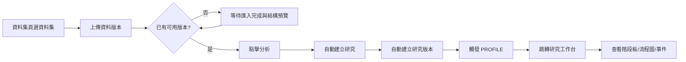
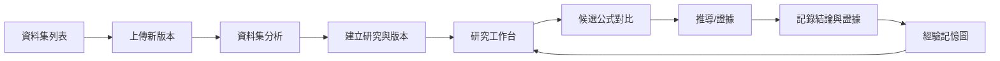

# 24｜畫面線框與互動流程

> AXIOM v2.9 設計規格｜文件 ID AX-24｜狀態：待實作、待驗收｜2026-10-20

## 文件定位與決策摘要

`/docs/AXIOM_UIUX_重製版` 為前台畫面、模組資訊架構、逐頁功能與流程的主規格來源（40 頁 SSOT）；現行容器前台必須以 Vue 真頁逐步落地這套規格，不再以 `frontend/public/uiux-remastered` 或 `/uiux/:screen` 承載正式執行畫面。AX-24 保留跨頁互動原則與已落地的資料驅動規則，不再單獨充當完整逐頁畫面來源。

前台外殼採「頂部主導覽＋左側工作空間＋右側內容區」；研究工作台主體維持資料/流程/證據三段式閱讀。資料集頁提供明確的 `分析` 入口，以最新可用資料版本自動建立研究、建立研究版本並觸發 PROFILE；研究頁則以研究階段板、流程圖、節點紀錄與事件流呈現進程。發現、驗證、記憶、模型、訓練與設定已各自落地為獨立 Vue 真頁，不再共用單一模組殼。選候選時同步更新公式、參數、驗證引用與證據檢視；對比模式最多四條候選並排。研究工作台、發現中心與驗證中心已形成 URL Query 驅動的跨頁閉環：`run`、`pins`、`submission`、`submissions`、`focuscandidates`、`focussubmissions`、`ref` 共同承接來源頁、版本、候選集合與提交集合。

## 章節專屬規格

### 研究工作台線框

```text
┌──────────────── AXIOM Workbench ──────────────────────┐
│ 頂部主導覽 / 搜尋 / 使用者 / 主要操作                 │
├──────────────┬───────────────────────────────────────┤
│ 左側工作區   │ 研究階段板 / 版本摘要 / 流程圖         │
│ 研究清單     │ 節點紀錄 / 候選比較 / 證據 / 事件流     │
│ 數據管理     │                                       │
├──────────────┴───────────────────────────────────────┤
│ SSE 續接、版本還原、任務詳情深連結、證據檢視          │
└───────────────────────────────────────────────────────┘
```

### 操作流程



### 效能體驗

首屏顯示工作台骨架、研究階段板與任務摘要；長任務使用 SSE 推送增量事件並保留游標續接；重新整理後依 URL `?version=` 還原研究版本；圖表只重繪變動圖層；候選與證據檢視延後載入。

### 跨頁分支接力

1. 研究工作台可將目前可見的候選集合送往發現中心，或將提交集合送往驗證中心。
2. 發現中心保留 `run` 與 `pins`，提供「目前比較集」與「整個 SEARCH 分支」兩種回工作台入口。
3. 驗證中心保留 `submission` 與 `submissions`，並先按 `research_version_id` 分組，再把同版本 submission 子集送回工作台，避免跨版本聚焦失真。
4. 三頁都必須保留 `ref` 來源頁，讓使用者可返回前一個工作區而不遺失操作脈絡。

## 關鍵技術決策與邊界條件

1. 資料集頁需提供明確的 `分析` 動作，且僅在存在「可用且具結構預覽」的資料版本時啟用；不得要求使用者先跳到研究頁手動建立多個中介物件。

2. 研究工作台不得用假百分比表示完成度；應以研究階段板、流程圖節點、事件流與實際 run/status 呈現進度。

3. 選擇公式片段時可在公式 AST 樹與圖形中的對應成分之間雙向高亮。

4. 候選對比視圖至少提供公式、參數、RMSE、複雜度、穩定性、適用域、反例與成本。

5. 推導工作台逐步顯示前提、變換規則、數學結果與 proof status，不將 AI 說明視為證明。

## 架構／流程圖



## 章節驗收案例

以下為預定測試，狀態皆 NOT_RUN；實際證據依 AX-46 登錄。

| ID | 固定情境／操作 | 預期判定 |
|---|---|---|
| AC-24-01 | 在資料集頁選到可用版本後按 `分析` | 自動建立研究、研究版本並跳轉到工作台 |
| AC-24-02 | 重新整理研究頁 | 保留研究與 `?version=` 指定版本的選取 |
| AC-24-03 | 新資料到來 | 新建版本，不暗中更新已開結果 |
| AC-24-04 | 事件重播或重連 | 不重複顯示既有事件，並保留缺口提示 |
| AC-24-05 | 按取消但 worker 尚未停止 | 顯示停止中，確認後才顯 CANCELLED |
| AC-24-06 | 從工作台把候選集合送往發現中心後返回 | 保留 `run/pins/ref`，可在工作台恢復同一組候選節點高亮與焦點卡 |
| AC-24-07 | 驗證中心同時出現多個研究版本的 submission | 先按版本分組，再以同版本 submission 子集回工作台，不得混用不同版本的提交 |

## 延伸閱讀

[AX-44 研究工作台畫面詳細規格](<../13-專題深化/44-研究工作台畫面詳細規格.md>)。

## 共用規則

版本、錯誤、證據與審查規則見 [AX-48 共用契約與文件治理](<../00-總覽/48-共用契約與文件治理.md>)；本章的專屬限制及驗收條件仍須同時滿足。

## 研究域確認與封存視圖

建立版本時必填確認ResearchDomain的變數、有限上下界與開閉旗標；快速分析入口僅能自動填入資料列數、前兩欄位的語意草稿與預設 split，仍不得繞過後端驗證。fit資料範圍僅作建議。圖表分開標示固定允許域、fit支撐範圍與域內外插；域外不求值，拖曳不變更研究設定。研究域修改建立新版本。規則與錯誤依AX-10／21。

一般登入身分不直接取得封存逐點／逐題結果；final 卡片在未有聚合產物時顯示「詳細評估受限」，不是「不存在／零誤差」。封存明細視圖由服務端政策與 access_class（SEALED_DETAIL）判定，跨租戶回 404；一般報告頁只呈現 Solver 投影後的聚合結果。
