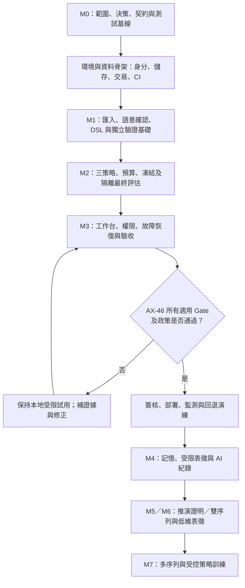

# 31｜工作拆解WBS與依賴

> AXIOM v2.9 設計規格｜文件 ID AX-31｜狀態：待實作、待驗收｜2026-10-20

## 文件定位與決策摘要

WBS 拆成 Epic→Feature→Task→驗收證據；每任務標示 owner、估算、依賴、測試、文件；先完成基準測試與 DSL，再啟動符號迴歸整合。

## 章節專屬規格

### 工作包

WBS-01 專案規範與 ADR；02 資料契約；03 數學 DSL；04 基準生成；05 特徵與可識別性；06 搜尋策略；07 參數最佳化；08 獨立驗證；09 經驗庫；10 AI 路由；11 推導證明；12 訓練；13 雙/多序列；14 Vue 工作台；15 安全與可觀測；16 CI/CD 與部署。

### 關鍵依賴

03→06/08/11；02→04/05/09；04+08→06 的品質評估；09→10/12；06+08→14 的研究展示；15 為各階段持續性工作。

### 交付證據

每個工作包需有需求對照、介面契約、測試案例、效能測量、風險與文件更新；不得以「已完成開發」取代驗收。

## 章節驗收案例

以下為預定測試，狀態皆 NOT_RUN；實際證據依 AX-46 登錄。

| ID | 固定情境／操作 | 預期判定 |
|---|---|---|
| AC-31-01 | WBS-03 DSL 尚未凍結 | 依賴的正式搜尋介面驗收 BLOCKED |
| AC-31-02 | WBS 任務無需求／AC | 不可關閉，補 AX-46 追溯 |
| AC-31-03 | WBS 把 M3 改記憶階段 | 要求回 AX-30 唯一表 |
| AC-31-04 | 任務只有已開發聲明 | 缺輸入／結果／覆核證據，NOT_RUN |

## 共用規則

版本、錯誤、證據與審查規則見 [AX-48 共用契約與文件治理](<../00-總覽/48-共用契約與文件治理.md>)；本章的專屬限制及驗收條件仍須同時滿足。

## 整體修訂的交付依賴

本輪新增契約不是純文件工作。交付順序為：資料層provenance／policy registry／upload及dispatch唯一鍵 → import與canonical轉換 → manifest／quota／有界supervisor → Evaluator分母與claim裁決 → API列表／摘要／ACL → UI還原及安全renderer → AX-29整合故障注入。每項WBS驗收需把schema、服務、DB遷移及UI投影一起列入，不能只交新增欄位。

D-01影響解析／容量配額，D-03影響正式研究通過門檻，D-05影響發布政策、摘要釋出及刪除，D-06影響復原承諾；未決可用公開fixture及阻擋行為開發，不能先啟用對外發布。正式政策需具名負責人核准，文件維護者不能代簽。其餘D-02／04／07／08／09維持AX-37的階段阻擋，不因首期表單完成自動關閉。

## 自主研究需求交付工作包

REQ-011：Backend/Math交結構報告、有限表徵recipe及row依賴；REQ-012：Backend/QA交決策journal／圖、失敗分類、HRR與故障注入；REQ-013：Math/QA交分軸證據、VerificationPlan、逆解／proof及競爭解釋；REQ-014：Platform/AI/Data交儲存policy、capture、封存／批次、資料集及LearningRelease。Frontend交自動建議確認、表徵比較、決策圖、重審與封存狀態。目前各技術角色均由使用者本人兼任；D-08的人數已確認為1，預算、領域與排程未決前不承諾新日期。

順序：M1 registry／trace／結構確認→M4 Gateway capture及有限表徵／記憶→M5 proof與多路徑→M6／M7新major多維／多序列／訓練。每包同時交DB約束、API／payload、UI投影、權限、取消／恢復、預算及測試；原貼文的數字與硬體例子不代替D-01～09決策。

## 單人開發基線

使用者已確認只有本人開發。Backend／Frontend／Math／QA／SRE／Security 是工作責任分類，均由本人兼任；不要求先招募團隊或找另一位程式 reviewer 才能開工。日常交付依序為技術文件→代碼→測試→代碼檢測→自我檢查→commit／push。AI 提供協助，不計為獨立人員。

研究成果 PublishedArtifact 的作者／審核隔離與 final_test 的服務權限是產品規則，不等於程式必須有第二人開發。未滿足成果發布條件時保留該操作 BLOCKED；不限制日常開發或有權限的本地研究。不能藉第二帳號或 AI 假冒獨立審核。

## 依企劃案落地的開發流程

本節規定從企劃、契約與檢查工具走到產品的執行順序。階段名稱與範圍仍以 [AX-30](<30-里程碑與分階段開發計畫.md>) 為準；工程目錄與提交品質依 [AX-53](<../15-工程/53-工程治理與開發者工作流.md>)。T01～T06 已陸續交付工程與本機受限基線，實測範圍見[技術文件索引](<../../技術文件/README.md>)；下表仍是完整產品工作要求，不代表各項均已驗收。責任均由使用者本人承擔。



圖表示整體交付主線；UI mock、測試設計與維運可依下列依賴提早並行。M5／M6 仍依 AX-30 各自審查後排程，圖中合併節點不表示兩者必須同時完成。正式對外開放另受 D-09 限制。

### M0：先建立可開工的基線

1. 依 AX-02／30／46 列出當期 MUST、後續能力與禁用能力，每個工作包由本人擔任 owner 並執行自我檢查，記錄可用資源；D-08 未關閉時保留待估。
2. 逐項盤點 AX-37：先收集 D-01 的開發環境容量、D-03 的基準審查資料；D-05 未核准期間只使用有權使用的公開／合成資料。未決不阻止 fixture、mock 或拒絕行為的可逆開發，但不能宣告相關 Gate 通過。
3. 審查 AX-47／43 的物件與資料庫約束、AX-21 的 API／事件、DSL v1 及三份 registry。逐個定義公開 DTO、內部紀錄、欄位來源、錯誤、權限與狀態轉移；將不一致先修回權威契約。
4. 依 AX-33 做相容性小型驗證，鎖定產品 Python／Node、Django／DRF／Celery、數值套件與映像版本、授權及 SBOM。文件工具現用 Python 3.14，不直接視為全部產品依賴已相容；AX-41 的示意版本需在實作前核對並同步。
5. 準備 AX-28 的公開 fixture 與獨立 oracle；正式 blind generator 由隔離 QA 管理，不將測試答案、種子或題目提交到一般開發路徑。先約定實測結果與 AX-46 證據的存放、讀取權及保留政策。

交付物：範圍清單、具名責任表、依賴鎖檔、基準環境記錄、決策證據與初版 backlog。M0 結束審查依 AX-30／37；缺少必要決策時記錄 BLOCKED，不以公開 fixture 成功代替正式基準核准。

### M0 至 M1：先做工程與資料骨架

| 順序／工作包 | 實作步驟 | 交付與完成檢查 |
|---|---|---|
| 1／WBS-01、16 | 依 AX-53 建 backend、frontend、infra、tests 骨架，建立依賴鎖檔、環境範本、CI 與測試入口 | 全新 checkout 可依 README 重建；秘密不入 Git；文件 CI 與產品 CI 分開回報 |
| 2／WBS-02、15 | 建立 Django／DRF、身分／租戶授權、PostgreSQL migration、物件儲存 adapter；Redis 只作佇列／快取 | 空庫遷移、租戶隔離、未授權拒絕、物件 hash 與不可變版本測試通過 |
| 3／WBS-15、16 | 依 AX-41 實作 Compose、healthcheck、一次性 migration／bucket 初始化、web／worker 啟動 | macOS 與 Windows WSL2 分別留 smoke 證據；尚未驗的平台保持 NOT_RUN；預設僅 loopback |
| 4／WBS-02、15 | 建立 Run、TaskInput、事件、dispatch 唯一鍵、outbox 派送與權威交易邊界，補結構化日誌與 trace | 真實 DB＋broker 測重複派送、交易失敗、逾期租約、舊 attempt 寫入與事件重播；不可只跑參考裁決 |

`contracts/` 若作產品產生物，須由 `docs/企劃案/contracts/` 受控產生並在 CI 比對；權威契約只維護一份，禁止人工複製後各自修改。本機產品與測試命令已列於根目錄 README；公開服務、正式盲測及產品 Gate 仍未啟用。

### M1：先跑通資料與可信數學核心

| 順序／工作包 | 實作步驟 | 實際驗收與參考章 |
|---|---|---|
| 5／WBS-02 | 上傳至不可變 object version，校驗大小、格式、checksum、解析資源及 provenance；INGEST 只產生結構預覽 | 缺欄、惡意檔、上傳後置換、跨租戶引用拒絕；登入後可重新找到匯入，AX-09／21／43 |
| 6／WBS-02、05 | 讓使用者確認資料型態、source_column、單位、時間／群組、domain、切分與 EvaluationPolicy，再建 ResearchVersion | 切分按時間排序位置檢查 gap；觀測／來源曝光追蹤；PROFILE 僅 fit，AX-09／47／49 |
| 7／WBS-03 | 實作 DSL parser、schema、canonical 格式、hash、型別／域／單位檢查及受限 evaluator；禁止直接 eval／exec | round-trip、等價 fixture、未知符號、越域、深度／時間／記憶體上限與惡意輸入，AX-10／26 |
| 8／WBS-04、08 | 先以已知公式完成 oracle、誤差／容差、完整分母、拒答及分軸證據；建立 Evaluator 的隔離身分與儲存權限 | 開發者與搜尋 worker 無法讀 final_test；未知不能提升為已證明，AX-05／28／34／51 |
| 9／WBS-15 | 接入不可變執行 manifest、決策 journal／trace、取消、重試上限與預算結算；只做當期需要的基線 | 重啟不重置用量；公開／封存 trace 分流；錯誤有分類與追溯，AX-25／38／50 |

M1 展示：公開合成檔案→結構預覽→人工確認→研究版本→已知 DSL 求值與證據查詢。此時不要求搜尋出未知公式，也不啟用 AI、記憶或訓練。API／CLI 可以先驗收，工作台完整互動屬 M3。

### M2：用同一條管線逐一加入搜尋策略

1. 先實作線性基線，再加入多項式與固定頻率諧波；各策略共用 AX-38 插件介面、DSL、參數最佳化、成本帳及候選輸出，不能各自定義評分與失敗格式。
2. 每加入一策略，先用 fit 擬合、development 排名；保存實際資料列、seed、環境 digest、轉換及參數。PROFILE／SEARCH 不讀 final_test，表徵 recipe 及評估計畫必須可追溯。
3. 完成 root／child 排程、租約、checkpoint、取消世代、deadline、租戶准入與研究累計預算。測試搜尋途中停止、worker 消失、重複訊息與並發完成，確認只有權威交易可結算。
4. 固定 FrozenCandidate／FrozenSubmission、policy／representation／VerificationPlan 的 ID 與 hash。零候選產生診斷並正常結束，不建立空提交包；若預註冊 refit，保存實際 fit＋development 列與 hash。
5. 以持久最終評估槽位派隔離 Evaluator；同提交故障恢復不重開盲測資格，不因改檔名、重跑或更換研究版本洗掉曝光。結果完整保存分母、失敗列、拒答理由與證據。
6. 依 AX-28／36 做正例、噪音、歧義、域外及拒答回歸，固定各策略同等預算比較。未達門檻回查匯入、DSL、策略或評估；不得看過正式盲測答案後調參再報同批成績。

交付物：三策略引擎、候選與凍結 API、隔離驗證服務、重現報告及故障注入證據。D-03 未核准時正式 G2 仍 BLOCKED，公開案例只作開發證據。

### M3：接上工作台，完成可運作 MVP

1. 前端依 AX-22～24／44 接入已凍結 OpenAPI，先做資料匯入與語意確認，再做研究／Run 清單、搜尋進度、候選比較、證據檢視與審核發布。mock 開發可提早，功能完成需真實後端整合證據。
2. 實作 SSE 斷線重連、游標過期後 snapshot 還原、動態權限、取消確認及長任務重入；不以按鈕顯示成功代替後端終態。
3. 發布固定 PublicationClaim、作者責任鏈與獨立覆核，政策未核准展示明確 BLOCKED；安全摘要獨立授權，不能由一般讀取權推定可看封存內容。
4. 補公式安全渲染、惡意 Markdown／CSV、鍵盤操作、長公式及大候選列表測試；UI 只能展示實際證據級別與已啟用能力。
5. 以 AX-29／45／46 執行整合、E2E、資安、壓測、備份／還原、取消競態、撤銷 ledger 及曝光 journal 恢復演練；D-01／06 的正式上限與承諾以實測決策為準。
6. 保存 release manifest、映像與依賴 digest、遷移／回退方案、BackupSet、已知限制及獨立覆核。G1～G7 按 AX-30／46 驗收，MVP 的 G3 驗證外部 AI 停用且不會意外轉雲端。缺 gate 保留本地受限測試，不稱正式發布；D-09 未核准不得對外開放。

交付展示必須使用同一版程式／組態完成「上傳→確認→搜尋→比較→獨立驗證→證據→符合政策的審核與發布」。發布被政策阻擋的示範可以驗證拒絕行為，但不代表發布能力或整個 M3 已通過。

### M4 至 M7：依啟動條件擴充

| 階段／工作包 | 開始前須具備 | 開發步驟與交付證據 |
|---|---|---|
| M4／WBS-05、09、10 | 可驗收 M3、資料及外送政策、記憶撤銷鏈；GPU／外部請求分別受 D-02／04 限制 | 先建經驗資料與撤銷索引→no-memory 檢索對照→受限單輸入表徵→Gateway schema／預算→AI 紀錄 capture／封存及 HRR；驗證跨租戶拒絕、負遷移與失效回退，AX-16～19／49／50／52 |
| M5／WBS-11 | 推導／逆解契約審查；正式 checker 與公理受 D-07 限制 | 先建前提與定義域→正逆向多路徑→反例與競爭解釋→選配 checker；測多解、不可識別、超時 UNKNOWN 及假證明，AX-14／39／51 |
| M6／WBS-13 | 雙序列／低維領域與新 major 契約、切分及假相關基準 | 先時間對齊／時滯→二／三維表徵→有條件反演；交新資料模型、API／UI、遷移與拒答測試，不能擴寫 DSL v1 冒充相容，AX-15／49／51 |
| M7／WBS-12、13 | 多維契約、資料權利、訓練隔離／分區及固定成本基準 | 先多序列／狀態重建→策略學習→必要時選配微調；job API／狀態／取消／恢復契約先行，再做家族分區、校準、消融、負遷移、LearningRelease 與回退，AX-19／52 |

M4 的批次整理若使用內部 job，仍須先定義權限、狀態、預算與恢復契約。M7 訓練不得把原觀測改名後跨訓練／驗證分區；後續能力不能直接塞進目前六種 Run 或讓 capability 選單提早宣告可用。

## 第一次開工與並行安排

第一輪以完成 M0 基線及工程骨架為目標，不先承諾固定天數；工作票由使用者本人負責與自我檢查，工具以 project-owner 識別。依 T01→T02→T03→T04→T05→T06→T07→T08 單人順序執行，票的依賴圖維持原定義；產品驗收狀態仍為 NOT_RUN。

| 順序／工作票 | 具體工作 | 開始依賴 | 可檢查的交付 |
|---|---|---|---|
| T01 | 建當期 MUST、單人責任／自我檢查、決策與風險表 | 無 | AX-02／37／46 追溯完整，未決及待估明列 |
| T02 | 選型相容性驗證、鎖依賴、授權盤點 | T01 的範圍 | 鎖檔、SBOM、兩平台測試計畫；未測架構不標通過 |
| T03 | 設計 fixture、oracle、正式盲測隔離與證據格式 | T01 | 公開與封存來源分開，QA 權限與 D-03 待決可見 |
| T04 | 建工程骨架、CI、Compose、健康檢查與最小 Run／worker 派送 | T02 | 全新環境可啟動基礎服務、空庫遷移及合成任務；測重複派送與舊 attempt 拒絕 |
| T05 | 實作租戶、物件版本、DB 約束與 upload adapter | T04 | 兩租戶隔離及檔案置換反例通過 |
| T06 | 實作最小 DSL 求值與獨立 oracle 測試 | T02、T03 的公開測試基線 | 正例、惡意輸入、域錯誤及 canonical hash 報告 |
| T07 | 打通合成資料 INGEST→確認→研究版本→已知公式求值 | T05、T06 | 真實 API／DB／worker 整合與重現記錄；只屬 M1 的局部切片 |
| T08 | 審查缺口並建立下一輪搜尋／Evaluator 工作票 | T07 | 未完成條目、決策與估算更新，不因展示成功關閉整個 M1 |

T05 本機基線已交付：登入／CSRF、租戶與Dataset ACL、不可變local object adapter及上傳授權；兩租戶、檔案置換、撤權重播與真實HTTP已納入本機及CI檢查。真正INGEST、解析／掃描與DatasetVersion仍依T07接入，不以暫存成功關閉M1。T06已加入有界DSL編譯／求值、量綱與域檢查、canonical身分及獨立oracle測試；真實業務整合依下一票T07交付。
T07 的最小示範採 AX-28 的公開線性 fixture：保留原始資料 hash，確認單一輸入與 target 映射及 domain，建立固定切分的研究版本，以已知 DSL 執行求值，查回公開證據。另測重送同一請求不重建物件、另一租戶取不到資料、無效 DSL 被拒絕、worker 重送不重複寫入。此處只有公開開發資料，不能當正式 blind 成績。

T02 與 T03、T05 與 T06 在依賴上可並行，但目前只有一人，預設各組依表列順序完成，不估算雙人並行效益。前端可依契約先製作 mock／互動測試，SRE 可先設計恢復與監測；真實整合仍等待所需 API／服務。WBS-04／08 的測試設計在搜尋前完成，正式最終評估只在候選凍結後執行，不能把依賴誤解為提前讀盲測。

開工時只需先執行本套文件已存在的品質檢查：

```sh
uv venv --python 3.13 .venv-backend
uv pip sync --python .venv-backend/bin/python --require-hashes backend/requirements-dev.lock
.venv-backend/bin/pyright
.venv-backend/bin/python docs/企劃案/tools/check_docs.py
```

首次建立 `.venv` 的方式見 [索引](<../README.md>)。T04 本機 Compose、migration、健康檢查與合成派送 smoke 已補入根目錄 README 及 infra/README.md。T04 目前交付基礎切片；內部 DispatchProbe 只驗證派送／世代 fencing，不是正式 Run／Attempt，後續已在 backend/runtime 補上契約一致的 INGEST 根 Run／Attempt 控制基線（不可變輸入、有限重試、心跳、epoch 取消與事件）；真正 INGEST／租戶及 API／E2E 依 T05／T07 接入。T04 工程基線可銜接 T05，但完整 AX-38 與 M0 尚未關閉。

## 每張開發工作票與交接程序

| 必填欄位 | 填寫規則 |
|---|---|
| 身分與範圍 | 工作票 ID、M 階段、WBS、REQ／NFR／AC、目標使用情境及本票不含的後續能力 |
| 負責與依賴 | owner 與程式 reviewer 均由使用者本人擔任，明記 SELF_REVIEW；前置票、決策、開始／結束條件仍必填 |
| 跨層影響 | 權威文件、schema／OpenAPI／事件、DB migration、服務／worker、UI、ACL 與 registry |
| 測試設計 | 固定輸入、預期輸出、錯誤／競態／取消／恢復、資源預算與測試層級 |
| 交付證據 | commit／映像／環境 digest、資料 hash、執行指令、實際結果、證據位置及覆核紀錄 |
| 遷移與風險 | 舊資料讀取、升級／降級路徑、備份、回退觸發點與殘餘限制 |

單張工作票依序執行：需求與依賴審查→先修權威契約與固定測試輸入→資料約束／核心邏輯→API／worker→UI 投影→單元及真實服務整合→需要的 E2E／資源與恢復測試→本人自我檢查→commit／push 與紀錄交接。純文件變更跑文件檢查；有產品變更須跑對應產品測試，不能以增加 fixture 數量代替實作證據。

票務狀態與驗收結果分開：未執行是 NOT_RUN；依賴或政策不足是 BLOCKED；實測不符是 FAIL；只有保存預期／實際結果並完成相應檢查才可記 PASS；程式工作票可自我檢查，研究成果正式發布仍依 AX-26／46 的獨立審核契約。票可標開發完成等待驗收，但里程碑只能按 AX-46 的當期必要案例關閉。AI 輔助程式仍由相同責任鏈驗收，不授予模型正式發布核准權。

## 失敗處理、交付與後續迭代

- 契約／數值錯誤：保存最小可重現輸入與環境，定位權威層，先加有辨識力的反例再修正；更新受影響契約及回歸，不靠放寬容差讓測試過關。
- 取消／重試／故障：保存 attempt、取消世代、用量及派送鍵；依 AX-38 有界恢復，不重置研究預算或盲測曝光。結果不能證實正確時保留拒答或 UNKNOWN。
- Gate／政策未通過：保留阻擋與負責角色，切回可逆的公開 fixture／mock 工作；範圍變更同步 AX-02／30／31／37／46，不私自改門檻或假造簽核。
- 發布失敗：先停寫／排空與封鎖不安全版本，依 AX-27／46 還原相容程式、schema 與 BackupSet，重播撤銷及曝光紀錄；缺可信恢復水位保持停用，不能回退後重新取得盲測資格。
- 每輪交接：更新已交付範圍、未完成票、實測成本、已知限制與風險；依實際速度重估後續工作，MVP 穩定後再啟動下一能力，不一次安裝全部未來套件。

## 開發流程驗收補充

以下流程檢查尚未執行，結果為 NOT_RUN；覆蓋關係見 AX-46。

| ID | 檢查情境 | 預期結果 |
|---|---|---|
| AC-31-05 | 按 T01～T08 規劃首輪開發 | 每票有前置、交付物及責任欄；T07 成功不宣告整個 M1 完成 |
| AC-31-06 | 搜尋未完成便要求可並行開發 UI | 可依 mock 開發；真實整合未測仍 NOT_RUN，不越過 API／Evaluator 依賴 |
| AC-31-07 | D-03／D-05／D-06 未核准但公開 fixture 已通過 | 相關正式 Gate／發布仍 BLOCKED；可繼續不受阻擋的可逆工作 |
| AC-31-08 | 只交程式與文件檢查成功，無真實服務／回退／覆核證據 | 依當期驗收範圍拒絕關票或關里程碑，不宣告產品 PASS |
