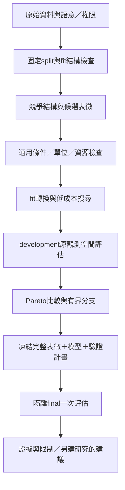

# 49｜數據結構與自主表徵探索

> AXIOM v2.9 設計規格｜文件 ID AX-49｜狀態：待實作、待驗收｜2026-10-20

## 目的與範圍

REQ-011將「由資料探索研究角度」列為完整產品必要能力，涵蓋一維／二維／三維及任意**受配置上限約束的有限維度**、非時間序列、單／多時間序列、固定／變動／多重週期。三維是顯示優先項，不是數學上限。M1～M3先交付可追溯的結構檢查、人工確認與單變量identity表徵；M4交付受限單變量轉換搜尋；M6～M7交付多維／多序列、狀態重建及複合表徵。這些是已納入的分階段需求，不能把首期限制解讀為完整產品只支援一維。

## 結構判斷不能只看欄位數

| 維度／結構 | 必須保存的事實 | 不得推定的結論 |
|---|---|---|
| 觀測／座標維度 | 欄位、shape、座標角色及單位 | 三欄必然三個獨立自由度 |
| 時間／事件順序 | timestamp來源、時區、排序、重複、間距、缺口 | 只有row index就知道物理時間及頻率 |
| 內在／潛在維度 | 估計方法、範圍、穩定性、資料條件 | 能唯一還原真實隱藏系統維度 |
| 狀態維度 | 狀態候選、延遲、導數估計與觀測假設 | 一欄觀測代表一維動力系統 |
| 表徵維度 | 轉換後特徵數、rank、資訊損失及回投影 | 升維創造新的獨立觀測資訊 |
| 多序列關係 | 各序列時基、單位、同步／非同步、缺測及對齊政策 | 相關或時滯能識別因果 |

建立後的可信PROFILE從已固定fit資料提出FIT_ONLY StructureAssessment，保存所有競爭結構、方法／設定hash、來源與uncertainty_reason；UNKNOWN／多解是合法結果。時間語意不明時可提議索引序列與時間序列兩種假說，但不得自動套TIME_ORDERED物理預測或宣稱週期單位為秒。MVP建立表單只能先使用本章下節的METADATA_ONLY預覽／建議，使用者確認後才提交現行CreateResearchVersion；不繞過必填欄位、SemanticProfile及固定split。

## ARSE表徵搜尋流程

表徵選擇是模型選擇的一部分，所有嘗試共用研究／root／租戶預算，包含檢測及失敗轉換成本。配置必含max_representation_dimension、max_transform_depth、max_representation_candidates、max_branch_count及wall／memory上限；正整數、入列前固定，超限拒絕而非無限制窮舉。identity必為基線；低成本檢測→候選產生→篩選→深入搜尋→跨表徵核對，保留未通過分支及排除原因。

| 家族 | 適用／風險檢查 | 輸出與原空間驗證 |
|---|---|---|
| 座標／線性投影／組合變數 | 同量綱才可相加；矩陣rank、條件數及座標單位 | 保存正逆映射，非單射標資訊損失，不冒稱等價 |
| 對數／指數／冪轉換 | 實數域及無量綱要求；有單位量先除固定同單位尺度 | 凍結尺度及逆轉換；原y尺度重算誤差，不能只比log誤差 |
| 頻率／時頻／多尺度 | 時間語意、採樣、aliasing、window及邊界 | 固定頻率、漂移、多週期作競爭假說；不均勻採樣不直接套普通FFT頻率格 |
| 微分／積分／包絡 | 噪聲放大、導數／積分單位、平滑與初值 | 保存估計器、參數、有效mask及邊界；正包絡才可取log |
| 延遲嵌入／狀態重建 | 有順序及適用動態假設；delay／dimension／有效樣本量 | 不保證真維度；記錄每個輸出依賴的原始row IDs |
| 降維／升維／流形 | 僅fit學映射；out-of-sample映射能力及資訊損失 | $(x,x^2,x^3)$只是重表示；不可逆時須驗證可觀測不變量及明列不可回復部分 |
| 關係圖／多序列／新表徵 | 對齊、lag、群組與混雜；新算子需註冊安全插件 | AI只能提案受限算子組合，不能自行執行生成的Python或修改驗證器 |

RepresentationSpec保存input dataset／split、fit列hash、方法及code/config hash、輸入／輸出維度、原始row依賴Artifact、可逆性、information_loss、正逆映射Artifact、domain／單位及成本上限。學習型映射只用fit；預註冊refit例外仍依AX-28。對每個partition各自建窗口，任何嵌入／導數／濾波使用的support row不得跨fit/development/final/gap；需要前視的估計器不能用於宣稱即時預測。丟失邊界列在預註冊有效集合及分母中說明，不在看到誤差後刪列。

## 比較、凍結與停止

以development的原尺度誤差、coverage、穩定性、表徵＋模型複雜度、可解釋性與成本作Pareto比較；先套域／單位／資訊可回復等硬限制。加權分數只有在尺度及權重預註冊後才可用，不把來源貼文中含final準確度的概念Q用來反覆選模。多次看development需披露選擇偏差，final不得回流搜尋。M4的轉換必能編譯回DSL v1的單輸入原空間AST，附完整recipe及environment，FrozenCandidate固定此組合；做不到就保持不支援。M6／M7的新多輸入、ODE／隱式關係需新DSL/API major及相容遷移，不能只改現行SemanticProfile.inputs的maxItems=1。

同一理論可有多種表達，關係分REPRESENTATION_EQUIVALENT、DERIVABLE_UNDER、APPROXIMATES、EMPIRICALLY_COMPATIBLE、SPECIAL_CASE。等價邊需假設、domain、初值與可檢查證據，embedding距離或相同低誤差不產生等價邊。例如$x=A\cos(\omega t+\phi)$、$x''+\omega^2x=0$及$x^2+(x'/\omega)^2=A^2$在$\omega\ne0$及相符初值下相關；後兩式單獨不決定原相位。$x$與$x'$量綱不同，不直接寫$x^2+(x')^2=A^2$。阻尼案例滿足$y''+2ky'+(k^2+\omega^2)y=0$，但有限噪聲資料不能因此識別唯一機制。

## 驗收（產品 NOT_RUN）

| ID | 情境 | 預期 |
|---|---|---|
| AC-49-01 | 一欄無timestamp、三欄共線、五維低rank資料 | 分開保存觀測／表徵／內在估計；未知時間與真維度不捏造 |
| AC-49-02 | 同步／非同步多序列及重複時間 | 保存競爭對齊與適用條件；未交付階段明確不支援，不錯套單序列 |
| AC-49-03 | 不均勻採樣、漂移週期、負值log與噪聲導數 | 各自適用性裁決；不套普通FFT／非法log，不假稱穩定導數 |
| AC-49-04 | delay／平滑窗口跨partition或用未來值預測 | 原row依賴檢查拒絕，final不進fit或選模 |
| AC-49-05 | log空間較準但原y尺度更差 | 原尺度及coverage比較保留競爭模型，不只按log分數勝出 |
| AC-49-06 | 一維升至三維、非可逆降維及超維度上限 | 不增加獨立資訊宣稱；資訊損失明列，超限停止且計成本 |
| AC-49-07 | 振盪公式／ODE／不變量與缺初值／ω=0 | 有條件推導；無條件等價拒絕，domain與量綱可核對 |
| AC-49-08 | 看final後換表徵或AI提交任意新程式 | 拒絕；新研究仍查曝光資格，新算子須安全契約與插件審查 |

## 技術來源

不均勻採樣的頻率分析可參照[SciPy lombscargle](https://docs.scipy.org/doc/scipy/reference/generated/scipy.signal.lombscargle.html)；是否採用須驗證其正規化、角頻率單位與適用假設。方法存在不表示已納入首期引擎。

## 建立前預覽與建立後fit評估的分工（v2.9）

建立研究前不能呼叫尚無ResearchVersion／split的PROFILE。INGEST在既有dataset任務內產生analysis_scope=METADATA_ONLY的StructureAssessment，只讀來源schema、欄名／型別、shape及明示data dictionary，不讀labels統計、不推算週期／內在維度；fit_rows_hash、research_version_id及intrinsic_dimension_estimate皆null，periodicity=UNKNOWN。DatasetVersion.structure_preview_artifact_id保存此Artifact引用；沿GET /datasets/{id}/versions及Artifact端點可重新發現，不新增虛構preflight API或Run.type。

使用者確認語意／時間假說與split後，既有PROFILE只從該fit產生FIT_ONLY報告，ResearchVersion.structure_assessment_artifact_id指向它，必有fit_rows_hash及研究ID。MVP的完整自動統計判斷發生於此階段；若推翻原先語意，保留舊報告並建立新版本，不回頭把整份資料拿來預覽或重分fit/final。未提供可讀metadata的正式blind來源直接不提供預覽。INGEST成功的AVAILABLE版本必有可授權的metadata報告，READY以上版本必有fit評估；缺失則不能宣稱該階段完成。

| ID | 情境 | 預期 |
|---|---|---|
| AC-49-09 | 尚未建立研究而請求結構建議／重開dataset | INGEST的metadata Artifact可找回；不要求不存在的PROFILE／split |
| AC-49-10 | metadata預覽夾labels統計，或fit評估綁錯split | 拒絕；前者不估週期／真維度，後者不READY且不偷換final |

METADATA_ONLY 的 StructureAssessment 可用 source_metadata={row_count,columns:[{name,physical_type}]} 承載授權 schema／shape；不包含 samples、label 統計、missing counts、極值或推估語意。此為向後相容的可選欄位，本機 INGEST 實作產物必填。observation_dimension／representation_dimension 在 metadata 範圍只記來源欄數，coordinate_dimension 仍 null，不宣稱座標或內在維度。
