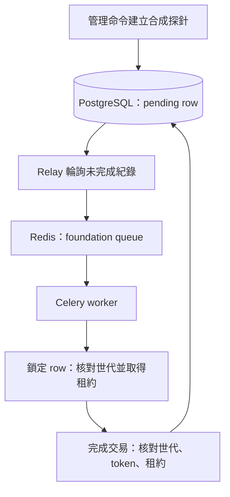

# T04｜產品工程骨架

日期：2026-10-20；開發／SELF_REVIEW：project-owner。依 T02 鎖定版本，先建本機工程基礎，不啟用正式研究 API 或對外部署。

## 範圍與邊界

本輪交付 T04 的基礎切片，T04 整票仍在進行中，尚待最小 Run／Attempt 契約整合。本輪建立 Django、Vue、PostgreSQL、Redis、Celery、可重跑遷移、健康檢查、CI，以及可觀察的合成任務派送。物件儲存與租戶／檔案授權依 T05 實作；正式 Run、預算、取消樹、Solver 沙箱與研究介面仍待後續工作票。本機 web／frontend 僅綁定 loopback；Django runserver 與 Vite 僅用於開發。

內部 DispatchProbe 只保存 UUID、世代、租約、狀態與完成次數，不接收研究數據或任意程式。它不是 AX-38 的 RunRecord，不新增 task-input enum，不提供 public API，不能投影成正式 Run 已通過驗收。僅透過管理命令建立與觀察；worker 用固定函式執行一次資料庫完成交易。

## 資料流與一致性

探針資料列同時是持久派送來源：只有提交後 relay 才看得到。發送失敗不刪 row；發送成功亦不預先標完成。重複訊息攜帶相同世代，只能取得一次租約；worker 回傳前崩潰，由 relay 在租約到期後推進世代重送。舊世代、錯 token、逾時結果一律拒收，完成次數只在同一鎖定交易內增加一次。每次輪詢限制批次；CLI 的 once 模式可供測試及手動診斷，常駐 relay 為獨立服務。

這是至少一次派送、資料庫內冪等效果；不宣稱 broker exactly-once，也不涵蓋外部物件寫入或數學運算。重送採固定間隔，正式任務的退避、失敗分類、預算、dead letter 與事件 outbox 由領域實作補齊。

## 執行與設定

根目錄 Compose 從 T02 使用相同 digest／hash lock。backend Docker 非 root；web、worker、relay 共用同一映像與設定；migrate 為一次性依賴。PostgreSQL 與 Redis 不發布宿主埠；Redis 啟用 AOF，資料庫與 broker 使用專屬 named volume。開發密碼與 Django secret 由未追蹤的 .env 提供，缺少設定即拒絕啟動。沒有內建使用者或預設密碼。health endpoint 不回傳例外、DSN 或密鑰。

- `/health/live/`：程序存活回 200。
- `/health/ready/`：實際查詢 PostgreSQL、確認 foundation migration 已建立、Redis ping；依賴失敗回 503。worker 活性由合成任務 smoke 額外驗證，不能由 ready 推論。
- frontend 透過 Vite 同源代理查詢 ready，顯示載入、可用、不可用及重試，不暴露 broker 或資料庫。

## 驗證與交付

先在空白專案專用 volume 執行 migration，再執行實際 PostgreSQL 交易測試：回滾不派送、重複訊息、錯世代／token／租約、到期重試、完成後重播、並行 claim。smoke 經真實 Redis／Celery 確認完成一次，停止依賴確認 ready 失敗；恢復後重跑 migration／smoke。frontend 執行 strict typecheck、狀態轉換測試與 build。Python 使用獨立 3.13 runtime + Django stubs 的 strict Pyright；既有文件工具檢查不變。所有新 Python／TS／Vue 執行 Sonar 分析，不用忽略規則遮蔽問題。

本輪實測紀錄與剩餘限制另記；M0 整體及企劃產品案例維持 NOT_RUN。
